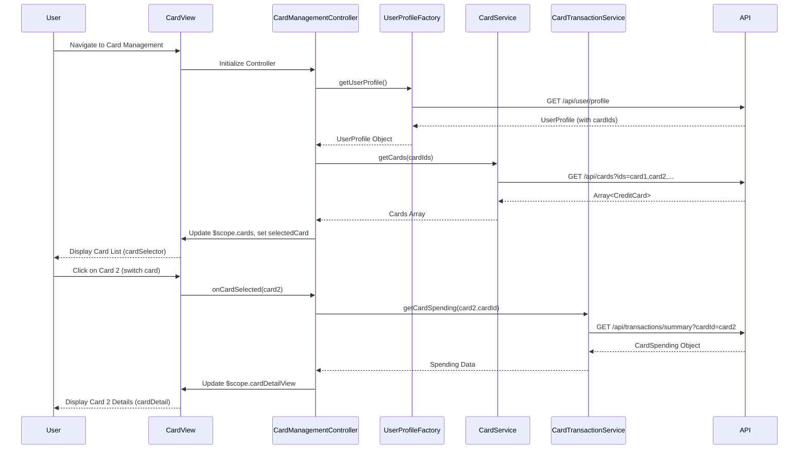

# Low-Level Design: QE-10478 - Multi-Card Management and Visualization

## a. Architecture Mapping

**HLD Component → AngularJS Artifact:**
- Card Management UI → AngularJS Module (`app.cardManagement`), Controller (`CardManagementController`), HTML Template (`card-management.html`)
- Card Data Repository Integration → AngularJS Service (`CardService`) for fetching card details and limits via REST API
- User Profile Service → AngularJS Factory (`UserProfileFactory`) for retrieving user-card associations
- Transaction Service → AngularJS Service (`CardTransactionService`) for fetching card-specific spending data
- Card Switching Component → AngularJS Directive (`cardSelector`) for card selection UI
- Card Detail View → AngularJS Directive (`cardDetail`) for displaying individual card information

**Recommended Folder Structure:**
```
app/
├── modules/
│   └── card-management/
│       ├── card-management.module.js
│       ├── card-management.controller.js
│       ├── card.service.js
│       ├── card-transaction.service.js
│       ├── card-management.html
│       └── directives/
│           ├── card-selector.directive.js
│           └── card-detail.directive.js
├── shared/
│   ├── factories/
│   │   └── user-profile.factory.js
│   └── services/
│       └── api.service.js
└── assets/
    ├── css/
    │   └── card-styles.css
    └── images/
```

## b. Component Specifications

| Component Name | Artifact Type | Responsibility | Key Dependencies |
|----------------|---------------|----------------|------------------|
| `app.cardManagement` | Module | Root module for card management feature, registers all card-related components | `ngRoute`, `app.shared` |
| `CardManagementController` | Controller | Manages card list state, handles card selection, fetches card-specific data | `CardService`, `CardTransactionService`, `UserProfileFactory`, `$scope` |
| `CardService` | Service | Fetches credit card details, limits, and status from card data repository API | `$http`, `ApiService`, `$q` |
| `CardTransactionService` | Service | Fetches card-specific transaction data and calculates card-wise spending | `$http`, `ApiService` |
| `UserProfileFactory` | Factory | Retrieves user profile and associated card IDs for the authenticated user | `$http`, `$window` |
| `cardSelector` | Directive | Renders card selection UI (dropdown or card grid), emits card selection events | None |
| `cardDetail` | Directive | Displays detailed view of selected card including limit, usage, status, and spending | None |

## c. Data Model

**CreditCard Model:**
```javascript
{
  cardId: String,
  cardNumber: String,
  cardType: String,
  cardNetwork: String,
  creditLimit: Number,
  availableCredit: Number,
  outstandingAmount: Number,
  status: String,
  expiryDate: Date,
  lastUpdated: Date
}
```

**CardSpending Model:**
```javascript
{
  cardId: String,
  currentMonthSpend: Number,
  lastMonthSpend: Number,
  yearToDateSpend: Number,
  transactionCount: Number
}
```

**UserProfile Model:**
```javascript
{
  userId: String,
  userName: String,
  cardIds: Array<String>
}
```

**CardDetailView Model:**
```javascript
{
  card: CreditCard,
  spending: CardSpending,
  utilizationPercentage: Number
}
```

## d. Data Flow

User navigates to the card management view, triggering `CardManagementController` initialization which calls `UserProfileFactory.getUserProfile()` to retrieve the authenticated user's profile including associated card IDs. The controller then calls `CardService.getCards(cardIds)` to fetch details for all user cards in a single API call (`/api/cards?ids=card1,card2,...`). The service returns an array of `CreditCard` objects, which the controller assigns to `$scope.cards` and sets the first card as `$scope.selectedCard`. The `cardSelector` directive renders the card list, and when the user clicks a different card, the directive emits a `cardSelected` event captured by the controller, which updates `$scope.selectedCard` and calls `CardTransactionService.getCardSpending(cardId)` to fetch card-specific spending data (`/api/transactions/summary?cardId=X`). The service returns a `CardSpending` object, the controller computes utilization percentage, updates `$scope.cardDetailView`, and the `cardDetail` directive re-renders with the selected card's details.

## e. Primary Sequence Diagram



## f. Implementation Notes

- Use AngularJS event system (`$scope.$emit`, `$scope.$on`) for card selection communication between `cardSelector` directive and controller.
- Implement ES6 template literals for dynamic API endpoint construction in services (e.g., `/api/cards?ids=${cardIds.join(',')}`).
- Apply client-side caching in `CardService` using `$cacheFactory` to store card data and avoid redundant API calls when switching between previously viewed cards, ensuring sub-500ms switching performance.
- Use Bootstrap card components and CSS3 transitions for smooth card switching animations and responsive grid layout (col-md-4 for card grid, col-md-8 for detail view).
- Implement optimistic UI updates: immediately update `$scope.selectedCard` on user click while fetching spending data in background to meet 500ms NFR.

## g. Error Handling

HTTP interceptor captures API errors and displays Bootstrap alert notifications; controller implements fallback to cached data if card spending fetch fails.

## h. Security Notes

Requires token-based auth via existing SSO; all card and transaction API calls include Authorization header with JWT token from AuthFactory.