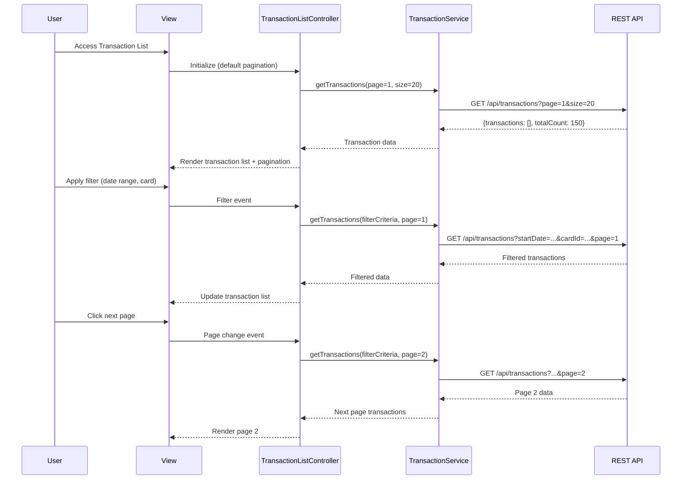

# Low-Level Design: Transaction Management and Monitoring
**Epic ID:** QE-10479  
**Technology Stack:** AngularJS 1.x, JavaScript ES6, HTML5, CSS3, Bootstrap, REST APIs, MVC Architecture

---

## a. Architecture Mapping

- **Transaction List Module** → AngularJS Module (`transactionModule`)
- **Transaction Controller** → AngularJS Controller (`TransactionListController`)
- **Transaction Service** → AngularJS Service (`TransactionService`)
- **Search/Filter Component** → AngularJS Directive (`transactionFilter`)
- **Pagination Component** → AngularJS Directive (`transactionPagination`)

**Recommended Folder Structure:**
```
/app
  /modules
    /transactions
      /controllers
        transaction-list.controller.js
      /services
        transaction.service.js
      /directives
        transaction-filter.directive.js
        transaction-pagination.directive.js
      /views
        transaction-list.html
      transaction.module.js
```

---

## b. Component Specifications

| Component Name | Artifact Type | Responsibility | Key Dependencies |
|----------------|---------------|----------------|------------------|
| `transactionModule` | Module | Register all transaction-related components and configure routing | `ngRoute`, `ui.bootstrap` |
| `TransactionListController` | Controller | Manage transaction list state, handle user actions, coordinate pagination and filtering | `TransactionService`, `$scope`, `$filter` |
| `TransactionService` | Service | Fetch transaction data via REST API, handle search/filter requests, manage caching | `$http`, `$q` |
| `transactionFilter` | Directive | Render filter UI (date range, card selector, merchant search, amount range) and emit filter events | `TransactionService` |
| `transactionPagination` | Directive | Render pagination controls, manage page state, emit page change events | None |

---

## c. Data Model

**Transaction Object:**
```javascript
{
  transactionId: String,
  cardId: String,
  cardName: String,
  date: Date,
  merchant: String,
  category: String,
  amount: Number,
  currency: String
}
```

**Filter Criteria Object:**
```javascript
{
  startDate: Date,
  endDate: Date,
  cardIds: Array<String>,
  merchant: String,
  minAmount: Number,
  maxAmount: Number
}
```

**Pagination State Object:**
```javascript
{
  currentPage: Number,
  pageSize: Number,
  totalRecords: Number,
  totalPages: Number
}
```

---

## d. Data Flow

User opens transaction list view → `TransactionListController` initializes with default pagination (page 1, size 20) → `TransactionService.getTransactions()` calls REST API `/api/transactions?page=1&size=20` → API returns paginated transaction array and total count → Controller updates `$scope.transactions` and `$scope.pagination` → View renders transaction table with Bootstrap styling and pagination controls → User applies filter (e.g., date range, card) via `transactionFilter` directive → Directive emits filter event → Controller calls `TransactionService.getTransactions(filterCriteria, pagination)` → API returns filtered results within 1 second → View updates with filtered transactions → User clicks next page → `transactionPagination` emits page change → Controller fetches new page and updates view.

---

## e. Primary Sequence Diagram



---

## f. Implementation Notes

- Use AngularJS `$http` service with promise-based API calls; implement response caching via `$cacheFactory` for repeated queries.
- Leverage AngularJS dependency injection for all services and controllers; use ES6 classes with `$inject` annotation for minification safety.
- Implement filter debouncing (300ms) using `$timeout` to avoid excessive API calls during user input.
- Use Bootstrap table component with responsive classes (`table-responsive`) and custom CSS for mobile optimization.
- Pagination directive communicates via isolated scope with two-way binding for `currentPage` and event callbacks for page changes.

---

## g. Error Handling

HTTP interceptor captures API errors (4xx/5xx), displays user-friendly notifications via Bootstrap alerts, and logs errors to console; try/catch wraps service calls in controller.

---

## h. Security Notes

Requires token-based auth via existing SSO; API calls include Authorization header with JWT token.

---