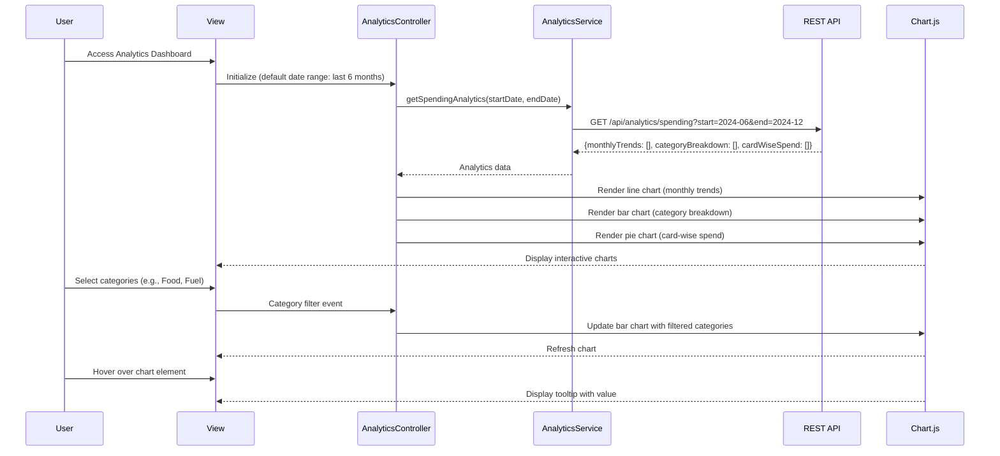

# Low-Level Design: Spending Analytics and Insights
**Epic ID:** QE-10480  
**Technology Stack:** AngularJS 1.x, JavaScript ES6, HTML5, CSS3, Bootstrap, REST APIs, MVC Architecture

---

## a. Architecture Mapping

- **Analytics Module** → AngularJS Module (`analyticsModule`)
- **Analytics Controller** → AngularJS Controller (`AnalyticsController`)
- **Analytics Service** → AngularJS Service (`AnalyticsService`)
- **Chart Directive** → AngularJS Directive (`spendingChart`)
- **Category Filter** → AngularJS Directive (`categoryFilter`)

**Recommended Folder Structure:**
```
/app
  /modules
    /analytics
      /controllers
        analytics.controller.js
      /services
        analytics.service.js
      /directives
        spending-chart.directive.js
        category-filter.directive.js
      /views
        analytics-dashboard.html
      analytics.module.js
```

---

## b. Component Specifications

| Component Name | Artifact Type | Responsibility | Key Dependencies |
|----------------|---------------|----------------|------------------|
| `analyticsModule` | Module | Register analytics components, configure routing, import charting library | `ngRoute`, `chart.js` (or `angular-chart.js`) |
| `AnalyticsController` | Controller | Manage analytics dashboard state, fetch aggregated data, handle user interactions (date range, card selection) | `AnalyticsService`, `$scope`, `$filter` |
| `AnalyticsService` | Service | Fetch aggregated spending data via REST API (monthly trends, category breakdowns, card-wise spend) | `$http`, `$q` |
| `spendingChart` | Directive | Render interactive charts (line for trends, bar/pie for categories) using Chart.js, handle chart updates on data change | `chart.js` library |
| `categoryFilter` | Directive | Render category selection UI (checkboxes for 9 categories), emit filter events | None |

---

## c. Data Model

**Monthly Spend Trend Object:**
```javascript
{
  month: String,       // "2024-01"
  totalSpend: Number
}
```

**Category Spend Object:**
```javascript
{
  category: String,    // "Food & Dining", "Fuel", etc.
  amount: Number
}
```

**Card-wise Spend Object:**
```javascript
{
  cardId: String,
  cardName: String,
  totalSpend: Number
}
```

**Analytics Response Object:**
```javascript
{
  monthlyTrends: Array<MonthlySpendTrend>,
  categoryBreakdown: Array<CategorySpend>,
  cardWiseSpend: Array<CardWiseSpend>
}
```

---

## d. Data Flow

User accesses analytics dashboard → `AnalyticsController` initializes with default date range (last 6 months) → `AnalyticsService.getSpendingAnalytics(startDate, endDate)` calls REST API `/api/analytics/spending?start=...&end=...` → API aggregates transaction data, computes monthly totals, category breakdowns, and card-wise spend, returns within 3 seconds → Controller receives analytics data → `spendingChart` directives render line chart (monthly trends), bar chart (category breakdown), and pie chart (card-wise spend) using Chart.js → User interacts with category filter → `categoryFilter` directive emits selected categories → Controller filters category breakdown data → Chart updates dynamically → User hovers over chart elements → Chart.js displays tooltips with detailed values.

---

## e. Primary Sequence Diagram



---

## f. Implementation Notes

- Use `angular-chart.js` wrapper for Chart.js integration; bind chart data to controller scope with two-way binding for automatic updates.
- Implement AngularJS `$watch` on date range and category filters to trigger chart re-rendering on user input changes.
- Use ES6 `Array.map()` and `Array.reduce()` for client-side data transformation before passing to charts.
- Leverage Chart.js responsive configuration (`maintainAspectRatio: false`) and Bootstrap grid (`col-md-6`, `col-sm-12`) for cross-device rendering.
- Cache analytics API responses for 5 minutes using `$cacheFactory` to reduce redundant API calls during user interactions.

---

## g. Error Handling

HTTP interceptor handles API failures, displays error message in dashboard header via Bootstrap alert; controller wraps service calls in try/catch with fallback to empty state message.

---

## h. Security Notes

Standard input validation and secure API calls assumed; requires token-based auth via existing SSO.

---