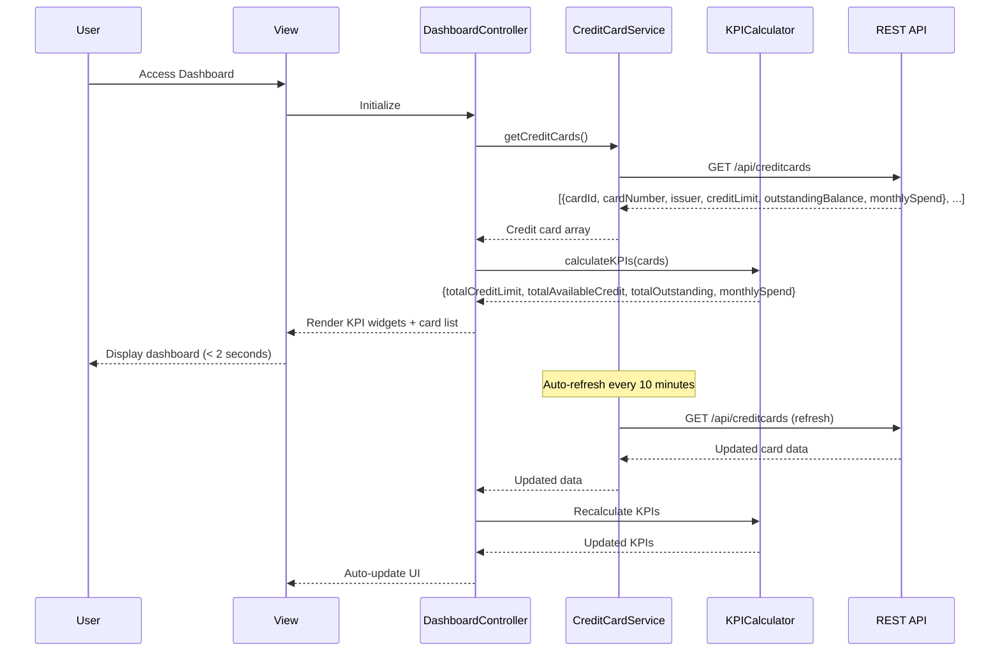

# Low-Level Design: Credit Card Portfolio and KPI Dashboard
**Epic ID:** QE-10481  
**Technology Stack:** AngularJS 1.x, JavaScript ES6, HTML5, CSS3, Bootstrap, REST APIs, MVC Architecture

---

## a. Architecture Mapping

- **Dashboard Module** → AngularJS Module (`dashboardModule`)
- **Dashboard Controller** → AngularJS Controller (`DashboardController`)
- **Credit Card Service** → AngularJS Service (`CreditCardService`)
- **KPI Calculation Service** → AngularJS Factory (`KPICalculator`)
- **Card List Component** → AngularJS Directive (`creditCardList`)
- **KPI Widget** → AngularJS Directive (`kpiWidget`)

**Recommended Folder Structure:**
```
/app
  /modules
    /dashboard
      /controllers
        dashboard.controller.js
      /services
        credit-card.service.js
      /factories
        kpi-calculator.factory.js
      /directives
        credit-card-list.directive.js
        kpi-widget.directive.js
      /views
        dashboard.html
      dashboard.module.js
```

---

## b. Component Specifications

| Component Name | Artifact Type | Responsibility | Key Dependencies |
|----------------|---------------|----------------|------------------|
| `dashboardModule` | Module | Register dashboard components, configure routing, set up module dependencies | `ngRoute`, `ui.bootstrap` |
| `DashboardController` | Controller | Fetch credit card portfolio data, coordinate KPI calculations, manage dashboard state | `CreditCardService`, `KPICalculator`, `$scope` |
| `CreditCardService` | Service | Fetch credit card details (card list, balances, limits) via REST API, handle data refresh | `$http`, `$q`, `$interval` |
| `KPICalculator` | Factory | Compute aggregated KPIs (total credit limit, available credit, outstanding amount, monthly spend) from card data | None |
| `creditCardList` | Directive | Render list of credit cards with individual card details (card number, issuer, limit, balance) | None |
| `kpiWidget` | Directive | Render individual KPI widget (title, value, icon) with responsive styling | None |

---

## c. Data Model

**Credit Card Object:**
```javascript
{
  cardId: String,
  cardNumber: String,      // Masked: "****1234"
  issuer: String,          // "Visa", "MasterCard"
  creditLimit: Number,
  outstandingBalance: Number,
  availableCredit: Number  // Calculated: creditLimit - outstandingBalance
}
```

**KPI Summary Object:**
```javascript
{
  totalCreditLimit: Number,
  totalAvailableCredit: Number,
  totalOutstanding: Number,
  monthlySpend: Number
}
```

---

## d. Data Flow

User accesses dashboard → `DashboardController` initializes and calls `CreditCardService.getCreditCards()` → Service makes REST API call to `/api/creditcards` → API returns array of credit card objects with limits, balances, and monthly spend → Service returns data to controller → Controller passes card array to `KPICalculator.calculateKPIs(cards)` → Factory computes total credit limit (sum of all limits), total available credit (sum of all available credits), total outstanding (sum of all balances), and monthly spend (sum of current month transactions) → Controller updates `$scope.cards` and `$scope.kpis` → View renders KPI widgets at top (4 widgets in Bootstrap grid) and credit card list below → Dashboard loads within 2 seconds → Service sets up `$interval` to refresh data every 10 minutes → On refresh, updated data flows through same pipeline and view auto-updates via AngularJS two-way binding.

---

## e. Primary Sequence Diagram



---

## f. Implementation Notes

- Use AngularJS `$interval` service for periodic data refresh (every 10 minutes); cancel interval on controller `$destroy` event to prevent memory leaks.
- Implement `KPICalculator` as a stateless factory with pure functions using ES6 arrow functions and `Array.reduce()` for aggregations.
- Use Bootstrap grid system (`col-lg-3 col-md-6 col-sm-12`) for responsive KPI widget layout; apply CSS3 flexbox for card list on mobile.
- Leverage AngularJS `ng-repeat` with `track by cardId` for efficient card list rendering and updates.
- Apply AngularJS filters (e.g., `currency`) in view templates for formatting KPI values; use `number` filter with precision for large amounts.

---

## g. Error Handling

HTTP interceptor captures API errors, displays Bootstrap alert at top of dashboard with retry button; service returns cached data as fallback if available.

---

## h. Security Notes

Requires token-based auth via existing SSO; card numbers are masked by API (only last 4 digits visible).

---