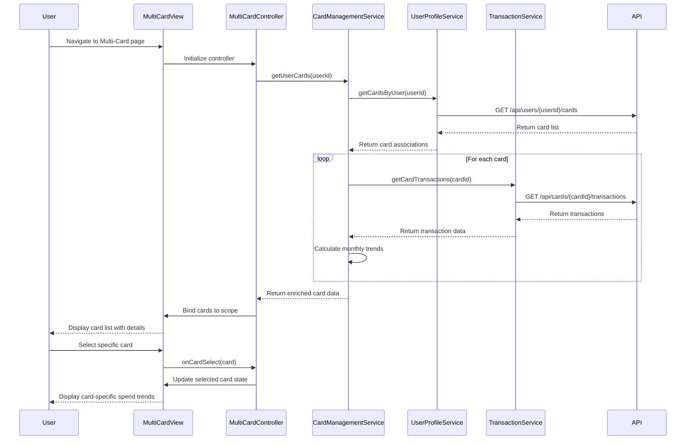

# Low-Level Design: QE-10482 - Multi-Card Management and Tracking

## a. Architecture Mapping

**AngularJS Artifacts:**
- **Module:** `app.creditCard.multiCard` - Main module for multi-card management
- **Controller:** `MultiCardController` - Manages card listing, selection, and filtering logic
- **Service:** `CardManagementService` - Handles card data retrieval and card-specific operations
- **Service:** `UserProfileService` - Manages user-card ownership mapping
- **Service:** `TransactionService` - Provides card-specific transaction history
- **Directive:** `cardListItem` - Renders individual card display with details
- **Directive:** `spendTrendChart` - Displays monthly spend trends per card

**Folder Structure:**
```
app/
├── modules/
│   └── credit-card/
│       ├── multi-card/
│       │   ├── multi-card.module.js
│       │   ├── multi-card.controller.js
│       │   ├── multi-card.html
│       │   ├── directives/
│       │   │   ├── card-list-item.directive.js
│       │   │   └── spend-trend-chart.directive.js
│       │   └── services/
│       │       └── card-management.service.js
│       └── shared/
│           └── services/
│               ├── user-profile.service.js
│               └── transaction.service.js
└── assets/
    └── css/
        └── multi-card.css
```

## b. Component Specifications

| Component Name | Artifact Type | Responsibility | Key Dependencies |
|----------------|---------------|----------------|------------------|
| `app.creditCard.multiCard` | Module | Root module for multi-card feature | ngRoute, ngResource |
| `MultiCardController` | Controller | Orchestrates card listing, filtering, selection; manages view state | CardManagementService, $scope, $filter |
| `CardManagementService` | Service/Factory | Fetches user's card list, retrieves card details, calculates card-wise metrics | $http, UserProfileService, TransactionService |
| `UserProfileService` | Service/Factory | Provides user-card ownership mapping and card associations | $http, $q |
| `TransactionService` | Service/Factory | Retrieves card-specific transaction history and spending data | $http, $q |
| `cardListItem` | Directive | Renders individual card with details (name, limit, balance, utilization) | None |
| `spendTrendChart` | Directive | Displays monthly spend trends as chart for selected card | Chart.js or D3.js |

## c. Data Model

**Card Model:**
```javascript
class Card {
  cardId: String
  userId: String
  cardName: String
  cardNumber: String (masked)
  cardType: String (Visa, MasterCard, etc.)
  creditLimit: Number
  availableCredit: Number
  outstandingAmount: Number
  utilizationPercentage: Number
  lastUpdated: Date
}
```

**Transaction Model:**
```javascript
class Transaction {
  transactionId: String
  cardId: String
  amount: Number
  category: String
  merchantName: String
  transactionDate: Date
  description: String
}
```

**Monthly Spend Trend Model:**
```javascript
class MonthlySpend {
  cardId: String
  month: String (YYYY-MM)
  totalSpend: Number
  transactionCount: Number
}
```

## d. Data Flow

User navigates to multi-card interface → `MultiCardController` initializes and calls `CardManagementService.getUserCards()` → Service requests user's card list from `UserProfileService` via REST API (`GET /api/users/{userId}/cards`) → For each card, service fetches card details and recent transactions from `TransactionService` (`GET /api/cards/{cardId}/details`, `GET /api/cards/{cardId}/transactions?period=12months`) → Service calculates card-wise metrics (utilization, monthly trends) → Controller receives aggregated card data and binds to `$scope.cards` → View renders card list using `cardListItem` directive for each card → User selects a card → Controller updates selected card state → `spendTrendChart` directive renders monthly spend visualization for selected card.

## e. Primary Sequence Diagram



## f. Implementation Notes

- **AngularJS DI:** Use `$inject` annotation for minification-safe dependency injection in all controllers and services
- **ES6 Patterns:** Leverage ES6 classes for service definitions, arrow functions for callbacks, template literals for API URL construction
- **API Integration:** Use `$http` service with promise-based error handling; implement response interceptor for 401/403 handling
- **Performance:** Implement card data caching in `CardManagementService` with 5-minute TTL; use `track by cardId` in ng-repeat for efficient DOM updates
- **Pagination:** Support lazy loading for users with >10 cards using virtual scrolling or pagination directive

## g. Error Handling

HTTP interceptor-based error handling with user-friendly toast notifications for API failures; try/catch blocks in service methods with fallback to cached data when available.

## h. Security Notes

Requires token-based authentication via existing SSO; card numbers displayed as masked (last 4 digits only); all API calls include authorization header with JWT token.