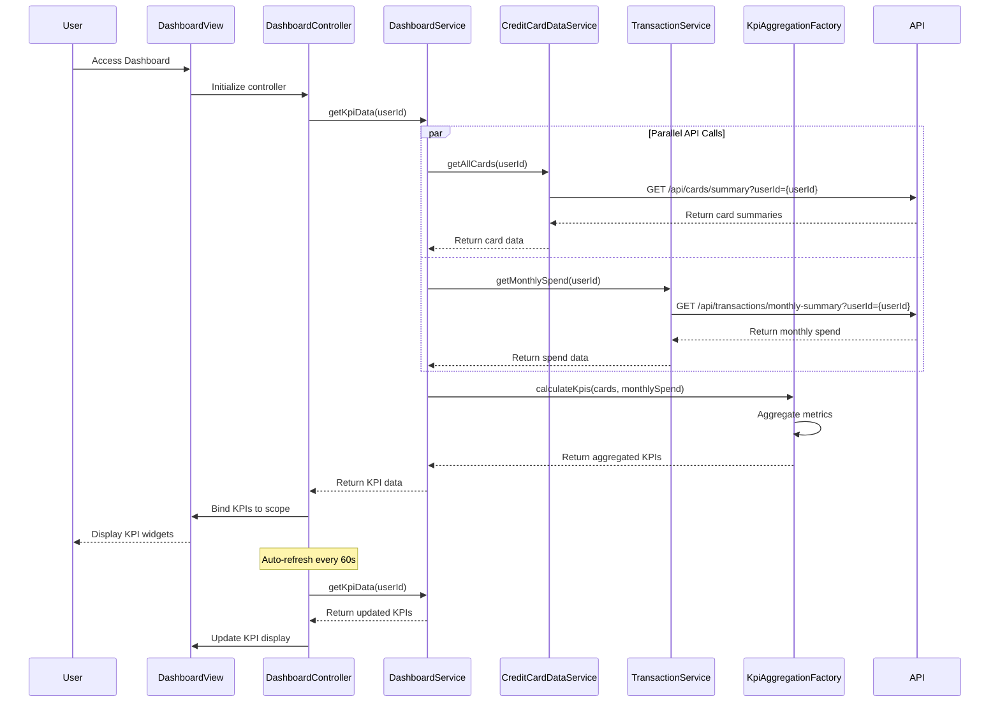

# Low-Level Design: QE-10483 - Dashboard and KPI Monitoring

## a. Architecture Mapping

**AngularJS Artifacts:**
- **Module:** `app.creditCard.dashboard` - Main module for dashboard and KPI monitoring
- **Controller:** `DashboardController` - Manages dashboard state, KPI refresh, and data binding
- **Service:** `DashboardService` - Orchestrates KPI data aggregation from multiple sources
- **Service:** `CreditCardDataService` - Retrieves card balances and credit limits
- **Service:** `TransactionService` - Provides monthly spend calculations
- **Directive:** `kpiWidget` - Reusable widget for displaying individual KPI metrics
- **Factory:** `KpiAggregationFactory` - Calculates aggregated metrics across all cards

**Folder Structure:**
```
app/
├── modules/
│   └── credit-card/
│       ├── dashboard/
│       │   ├── dashboard.module.js
│       │   ├── dashboard.controller.js
│       │   ├── dashboard.html
│       │   ├── directives/
│       │   │   └── kpi-widget.directive.js
│       │   ├── services/
│       │   │   └── dashboard.service.js
│       │   └── factories/
│       │       └── kpi-aggregation.factory.js
│       └── shared/
│           └── services/
│               ├── credit-card-data.service.js
│               └── transaction.service.js
└── assets/
    └── css/
        └── dashboard.css
```

## b. Component Specifications

| Component Name | Artifact Type | Responsibility | Key Dependencies |
|----------------|---------------|----------------|------------------|
| `app.creditCard.dashboard` | Module | Root module for dashboard feature | ngRoute, ngResource |
| `DashboardController` | Controller | Manages dashboard initialization, periodic refresh, user interactions | DashboardService, $scope, $interval |
| `DashboardService` | Service | Orchestrates data retrieval from CreditCardDataService and TransactionService; coordinates KPI calculation | $q, CreditCardDataService, TransactionService, KpiAggregationFactory |
| `CreditCardDataService` | Service/Factory | Fetches card balances and credit limits via REST API | $http, $q |
| `TransactionService` | Service/Factory | Retrieves monthly spend data for all cards | $http, $q |
| `KpiAggregationFactory` | Factory | Calculates total credit limit, available credit, outstanding amount, credit utilization percentage | None |
| `kpiWidget` | Directive | Renders individual KPI with title, value, trend indicator, and icon | None |

## c. Data Model

**Dashboard KPI Model:**
```javascript
class DashboardKpi {
  monthlySpend: Number
  totalCreditLimit: Number
  availableCredit: Number
  outstandingAmount: Number
  creditUtilization: Number (percentage)
  lastRefreshed: Date
}
```

**Card Summary Model:**
```javascript
class CardSummary {
  cardId: String
  balance: Number
  creditLimit: Number
  availableCredit: Number
}
```

**Monthly Spend Summary Model:**
```javascript
class MonthlySpendSummary {
  currentMonth: String (YYYY-MM)
  totalSpend: Number
  cardCount: Number
}
```

## d. Data Flow

User accesses dashboard page → `DashboardController` initializes and calls `DashboardService.getKpiData()` → Service makes parallel API calls: `CreditCardDataService.getAllCards()` (`GET /api/cards/summary`) for card balances/limits and `TransactionService.getMonthlySpend()` (`GET /api/transactions/monthly-summary`) for current month spend → Both promises resolve → `KpiAggregationFactory.calculateKpis(cards, monthlySpend)` aggregates total credit limit (sum of all card limits), available credit (sum of all available credit), outstanding amount (sum of all balances), and credit utilization ((total outstanding / total limit) × 100) → Aggregated KPI object returned to controller → Controller binds KPI data to `$scope.kpiData` → View renders four `kpiWidget` directives displaying monthly spend, total credit limit, available credit, and outstanding amount → User can trigger manual refresh or auto-refresh occurs every 60 seconds via `$interval`.

## e. Primary Sequence Diagram



## f. Implementation Notes

- **AngularJS DI:** Use explicit `$inject` array notation for all controllers, services, and directives to ensure minification compatibility
- **ES6 Patterns:** Use ES6 classes for service definitions, `const`/`let` for variable declarations, `Promise.all()` for parallel API calls in DashboardService
- **API Integration:** Leverage `$q.all()` to execute CreditCardDataService and TransactionService calls in parallel; implement HTTP interceptor for global error handling
- **Responsive Design:** Use Bootstrap grid system (col-md-3 for each KPI widget on desktop, col-xs-12 on mobile); implement CSS media queries for viewport-specific styling
- **Auto-refresh:** Implement `$interval` service with 60-second polling; cancel interval on `$scope.$on('$destroy')` to prevent memory leaks

## g. Error Handling

HTTP interceptor captures API errors (4xx/5xx) and displays user-friendly error messages via toast notification service; fallback to last successful KPI data cached in localStorage when API calls fail.

## h. Security Notes

Requires token-based auth via existing SSO; all API requests include Authorization header with JWT token; KPI data is user-scoped and validated server-side.