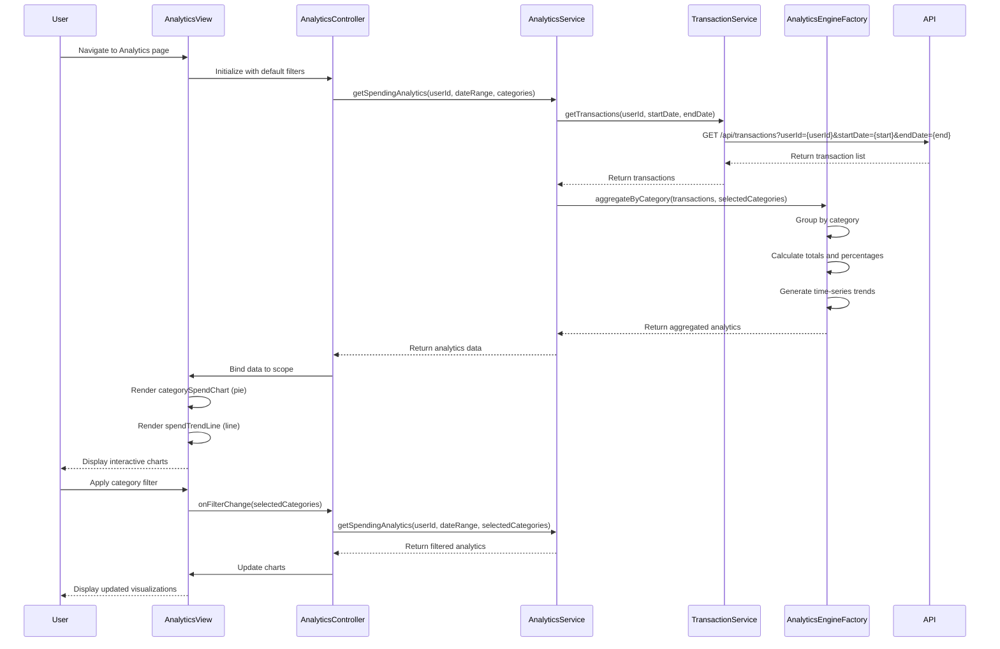

# Low-Level Design: QE-10484 - Spending Analytics and Visualization

## a. Architecture Mapping

**AngularJS Artifacts:**
- **Module:** `app.creditCard.analytics` - Main module for spending analytics and visualization
- **Controller:** `AnalyticsController` - Manages filter selection, date range, chart rendering, and user interactions
- **Service:** `AnalyticsService` - Retrieves transaction data and coordinates with analytics engine
- **Service:** `TransactionService` - Provides categorized transaction data
- **Factory:** `AnalyticsEngineFactory` - Performs data aggregation, category-wise calculations, and trend analysis
- **Directive:** `categorySpendChart` - Renders category-wise spending breakdown as pie/donut chart
- **Directive:** `spendTrendLine` - Displays spending trends over time as line chart
- **Directive:** `categoryFilter` - Provides multi-select category filter UI component

**Folder Structure:**
```
app/
├── modules/
│   └── credit-card/
│       ├── analytics/
│       │   ├── analytics.module.js
│       │   ├── analytics.controller.js
│       │   ├── analytics.html
│       │   ├── directives/
│       │   │   ├── category-spend-chart.directive.js
│       │   │   ├── spend-trend-line.directive.js
│       │   │   └── category-filter.directive.js
│       │   ├── services/
│       │   │   └── analytics.service.js
│       │   └── factories/
│       │       └── analytics-engine.factory.js
│       └── shared/
│           └── services/
│               └── transaction.service.js
└── assets/
    └── css/
        └── analytics.css
```

## b. Component Specifications

| Component Name | Artifact Type | Responsibility | Key Dependencies |
|----------------|---------------|----------------|------------------|
| `app.creditCard.analytics` | Module | Root module for analytics feature | ngRoute, ngResource, chart.js |
| `AnalyticsController` | Controller | Manages filter state, date range selection, triggers data fetch and chart updates | AnalyticsService, $scope, $filter |
| `AnalyticsService` | Service | Orchestrates transaction data retrieval and analytics engine processing | $http, $q, TransactionService, AnalyticsEngineFactory |
| `TransactionService` | Service/Factory | Fetches categorized transaction data for specified date range | $http, $q |
| `AnalyticsEngineFactory` | Factory | Aggregates transactions by category, calculates totals, percentages, and time-based trends | None |
| `categorySpendChart` | Directive | Renders interactive pie/donut chart showing category-wise spending distribution | Chart.js |
| `spendTrendLine` | Directive | Displays line chart showing spending trends over selected time period | Chart.js |
| `categoryFilter` | Directive | Multi-select dropdown for filtering by categories (Food, Fuel, Shopping, Travel, Entertainment, Utilities, Healthcare, Education, Miscellaneous) | None |

## c. Data Model

**Transaction Model:**
```javascript
class Transaction {
  transactionId: String
  userId: String
  cardId: String
  amount: Number
  category: String (Food & Dining, Fuel, Shopping, Travel, Entertainment, Utilities, Healthcare, Education, Miscellaneous)
  merchantName: String
  transactionDate: Date
  description: String
}
```

**Category Spend Model:**
```javascript
class CategorySpend {
  category: String
  totalAmount: Number
  transactionCount: Number
  percentage: Number
}
```

**Trend Data Model:**
```javascript
class TrendData {
  period: String (YYYY-MM or YYYY-MM-DD)
  categoryBreakdown: Array<CategorySpend>
  totalSpend: Number
}
```

## d. Data Flow

User navigates to analytics page → `AnalyticsController` initializes with default date range (last 12 months) and all categories selected → Controller calls `AnalyticsService.getSpendingAnalytics(userId, dateRange, categories)` → Service invokes `TransactionService.getTransactions(userId, startDate, endDate)` which calls REST API (`GET /api/transactions?userId={userId}&startDate={start}&endDate={end}`) → Transaction data returned to service → `AnalyticsEngineFactory.aggregateByCategory(transactions, selectedCategories)` processes data: groups by category, sums amounts, calculates percentages, generates time-series trends → Aggregated analytics object with category breakdowns and trend data returned to controller → Controller binds data to `$scope.analyticsData` → View renders `categorySpendChart` directive (pie chart) and `spendTrendLine` directive (line chart) → User applies category filter or changes date range → Controller re-triggers data fetch and chart re-render with updated parameters.

## e. Primary Sequence Diagram



## f. Implementation Notes

- **AngularJS DI:** Use `$inject` property for dependency injection in all controllers, services, and directives to ensure minification safety
- **ES6 Patterns:** Utilize ES6 classes for service/factory definitions, arrow functions for array operations (map/filter/reduce), destructuring for API responses
- **API Integration:** Use `$http` service with promise chaining; implement caching strategy in `TransactionService` using `$cacheFactory` for repeated date range queries
- **Chart Library:** Integrate Chart.js via directive wrappers; use `$watch` on data binding to trigger chart updates; implement responsive chart options for mobile viewports
- **Performance:** Implement client-side pagination for large transaction datasets; use Web Workers (if supported) for heavy aggregation operations in `AnalyticsEngineFactory`

## g. Error Handling

HTTP interceptor-based global error handling with user-friendly toast notifications; try/catch blocks in `AnalyticsEngineFactory` for data processing errors with graceful degradation to partial results.

## h. Security Notes

Requires token-based authentication via existing SSO; all API requests include Authorization header with JWT token; transaction data is user-scoped and validated server-side.