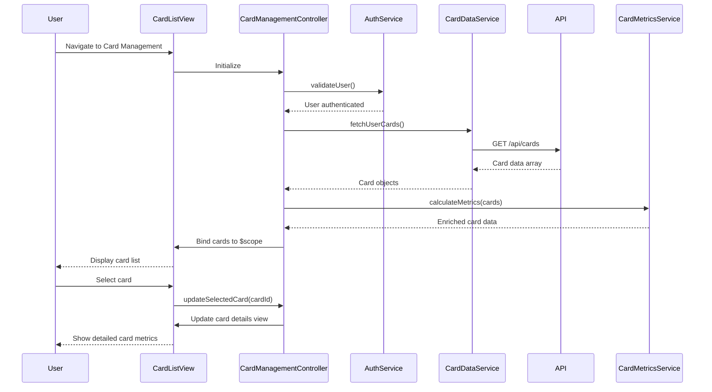

# Low-Level Design: Multiple Credit Card Management
**Epic ID:** QE-10485  
**Technology Stack:** AngularJS 1.x, JavaScript ES6, HTML5, CSS3, Bootstrap, REST APIs, MVC Architecture

---

## a. Architecture Mapping

| HLD Component | AngularJS Artifact | Purpose |
|---------------|-------------------|------|
| User Interface | Module: `cardManagement`, Directive: `cardList`, `cardDetails` | Render card portfolio and individual card views |
| Card Management Controller | Controller: `CardManagementController` | Orchestrate card display, filtering, and selection logic |
| User Authentication Service | Factory: `AuthService` | Validate user identity and card ownership |
| Credit Card Data Repository | Service: `CardDataService` | Fetch, cache, and manage card data via REST API |
| Card Metrics Calculator | Service: `CardMetricsService` | Compute card-specific KPIs (utilization, spend, limits) |

**Recommended Folder Structure:**
```
app/
├── modules/
│   └── card-management/
│       ├── controllers/
│       │   └── CardManagementController.js
│       ├── services/
│       │   ├── CardDataService.js
│       │   ├── CardMetricsService.js
│       │   └── AuthService.js
│       ├── directives/
│       │   ├── cardList.js
│       │   └── cardDetails.js
│       └── views/
│           ├── card-list.html
│           └── card-details.html
```

---

## b. Component Specifications

| Component Name | Artifact Type | Responsibility | Key Dependencies |
|----------------|---------------|----------------|------------------|
| `cardManagement` | Module | Root module for card management features | `ngRoute`, `AuthService` |
| `CardManagementController` | Controller | Handle card selection, filtering, comparison, and view state | `CardDataService`, `CardMetricsService`, `$scope` |
| `CardDataService` | Service | Fetch card data from REST API, manage cache, handle refresh | `$http`, `$q`, `AuthService` |
| `CardMetricsService` | Service | Calculate card-level metrics (available credit, utilization %, spend totals) | `CardDataService` |
| `AuthService` | Factory | Validate user session and card ownership before data access | `$http`, `$window` (for token storage) |
| `cardList` | Directive | Display all user cards in grid/list view with filtering controls | `CardManagementController` |
| `cardDetails` | Directive | Show detailed view of selected card with metrics and spend breakdown | `CardManagementController`, `CardMetricsService` |

---

## c. Data Model

**Card Object:**
```javascript
{
  cardId: String,              // Unique card identifier
  cardNumber: String,          // Masked card number (e.g., "**** 1234")
  cardType: String,            // "Visa", "MasterCard", "Amex"
  cardName: String,            // User-defined card nickname
  creditLimit: Number,         // Total credit limit
  availableCredit: Number,     // Remaining available credit
  outstandingAmount: Number,   // Current outstanding balance
  monthlySpend: Number,        // Current month spend
  utilizationRate: Number,     // (outstandingAmount / creditLimit) * 100
  status: String,              // "Active", "Blocked", "Expired"
  expiryDate: String,          // "MM/YY"
  issuingBank: String
}
```

**CardListViewModel:**
```javascript
{
  cards: Array<Card>,          // Array of Card objects
  selectedCard: Card,          // Currently selected card for detail view
  filterCriteria: Object,      // { cardType: String, status: String }
  sortBy: String               // "cardName", "creditLimit", "monthlySpend"
}
```

---

## d. Data Flow

User opens card management view → `CardManagementController` initializes and calls `AuthService.validateUser()` → Upon successful authentication, controller invokes `CardDataService.fetchUserCards()` which makes REST API call (`GET /api/cards`) → Service returns array of Card objects → Controller passes data to `CardMetricsService.calculateMetrics()` for utilization and spend computations → Enriched card data is bound to `$scope.cards` → `cardList` directive renders cards in UI → User selects a card → Controller updates `$scope.selectedCard` → `cardDetails` directive displays detailed metrics → User applies filter/sort → Controller updates view model and re-renders card list.

---

## e. Primary Sequence Diagram



---

## f. Implementation Notes

- Use AngularJS Dependency Injection to inject `CardDataService`, `CardMetricsService`, and `AuthService` into `CardManagementController`.
- Implement `CardDataService` as a singleton service with in-memory caching (TTL: 3 seconds) to meet NFR refresh requirement.
- Use ES6 classes for services and arrow functions for promise chaining in API calls.
- Leverage Bootstrap grid system and responsive utilities for card list layout (grid on desktop, stacked on mobile).
- Implement card filtering and sorting using AngularJS filters (`orderBy`, custom `filterBy`) bound to controller scope properties.

---

## g. Error Handling

HTTP interceptor captures API errors (401/403/500); user notified via toast notification; failed requests retry once with exponential backoff.

---

## h. Security Notes

Requires token-based authentication via existing SSO; card data transmitted over HTTPS; sensitive card details masked in UI and logs.

---