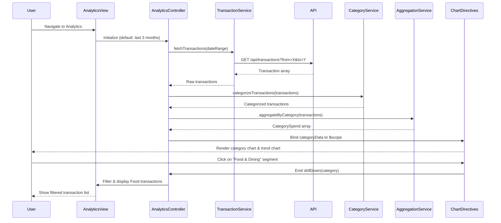

# Low-Level Design: Spending Analytics and Transaction Insights
**Epic ID:** QE-10486  
**Technology Stack:** AngularJS 1.x, JavaScript ES6, HTML5, CSS3, Bootstrap, REST APIs, MVC Architecture

---

## a. Architecture Mapping

| HLD Component | AngularJS Artifact | Purpose |
|---------------|-------------------|------|
| User Interface | Module: `spendingAnalytics`, Directive: `categoryChart`, `trendChart`, `transactionList` | Render analytics visualizations and transaction history |
| Analytics Controller | Controller: `AnalyticsController` | Manage analytics state, filters, date ranges, and chart data |
| Transaction Data Service | Service: `TransactionService` | Fetch transaction history from REST API (up to 12 months) |
| Categorization Engine | Service: `CategoryService` | Map transactions to 9 predefined spending categories |
| Visualization Rendering | Directive: `chartRenderer` (wraps Chart.js/D3.js) | Render interactive charts with drill-down capability |
| Data Aggregation Layer | Service: `AggregationService` | Aggregate transactions by category, month, and card |

**Recommended Folder Structure:**
```
app/
├── modules/
│   └── spending-analytics/
│       ├── controllers/
│       │   └── AnalyticsController.js
│       ├── services/
│       │   ├── TransactionService.js
│       │   ├── CategoryService.js
│       │   └── AggregationService.js
│       ├── directives/
│       │   ├── categoryChart.js
│       │   ├── trendChart.js
│       │   ├── transactionList.js
│       │   └── chartRenderer.js
│       └── views/
│           └── analytics-dashboard.html
```

---

## b. Component Specifications

| Component Name | Artifact Type | Responsibility | Key Dependencies |
|----------------|---------------|----------------|------------------|
| `spendingAnalytics` | Module | Root module for analytics and insights features | `ngRoute`, `chart.js` or `angular-chart.js` |
| `AnalyticsController` | Controller | Manage date range selection, category filters, chart data binding | `TransactionService`, `AggregationService`, `$scope` |
| `TransactionService` | Service | Fetch transaction history via REST API, cache 12-month data | `$http`, `$q` |
| `CategoryService` | Service | Classify transactions into 9 categories (Food, Fuel, Shopping, Travel, Entertainment, Utilities, Healthcare, Education, Misc) | None (static mapping logic) |
| `AggregationService` | Service | Aggregate transactions by category and month; compute totals accurate to 2 decimals | `CategoryService` |
| `categoryChart` | Directive | Render pie/donut chart for category-wise spending distribution | `chartRenderer`, `AggregationService` |
| `trendChart` | Directive | Render line/bar chart for monthly spend trends | `chartRenderer`, `AggregationService` |
| `transactionList` | Directive | Display paginated, sortable transaction history table | `TransactionService` |
| `chartRenderer` | Directive | Wrapper for Chart.js library; supports click events for drill-down | `chart.js` library |

---

## c. Data Model

**Transaction Object:**
```javascript
{
  transactionId: String,
  cardId: String,
  amount: Number,              // Transaction amount (2 decimal precision)
  category: String,            // One of 9 categories
  merchantName: String,
  transactionDate: String,     // ISO 8601 format
  description: String,
  transactionType: String      // "Debit", "Credit"
}
```

**CategorySpend Object:**
```javascript
{
  category: String,            // "Food & Dining", "Fuel", etc.
  totalSpend: Number,          // Sum of all transactions in category (2 decimals)
  transactionCount: Number,
  percentage: Number           // (totalSpend / overallSpend) * 100
}
```

**MonthlyTrend Object:**
```javascript
{
  month: String,               // "2024-01", "2024-02", etc.
  totalSpend: Number,
  categoryBreakdown: Array<CategorySpend>
}
```

---

## d. Data Flow

User navigates to analytics view → `AnalyticsController` initializes and calls `TransactionService.fetchTransactions(dateRange)` → Service makes REST API call (`GET /api/transactions?from=<date>&to=<date>`) → Raw transaction array returned → Controller passes data to `CategoryService.categorizeTransactions()` → Categorized data sent to `AggregationService.aggregateByCategory()` and `aggregateByMonth()` → Aggregated data bound to `$scope.categoryData` and `$scope.trendData` → `categoryChart` and `trendChart` directives render visualizations → User clicks chart segment → Directive emits drill-down event → Controller filters transaction list and updates `transactionList` directive.

---

## e. Primary Sequence Diagram



---

## f. Implementation Notes

- Use AngularJS `$http` with promise chaining for asynchronous transaction data retrieval; cache responses for 5 minutes.
- Implement `CategoryService` with a static mapping object (merchant patterns → categories); fallback to "Miscellaneous" for unmatched transactions.
- Leverage Chart.js via `angular-chart.js` wrapper for responsive, interactive charts; bind chart click events to controller methods for drill-down.
- Use AngularJS `ng-repeat` with `track by transactionId` for transaction list rendering; implement client-side pagination (20 records/page).
- Ensure all aggregation logic in `AggregationService` uses `toFixed(2)` for 2-decimal precision per NFR.

---

## g. Error Handling

HTTP interceptor catches API failures; retry logic for transient errors; user notified via inline alert if data unavailable; graceful degradation with cached data.

---

## h. Security Notes

Standard input validation and secure API calls assumed; transaction data access restricted to authenticated users with valid session tokens.

---