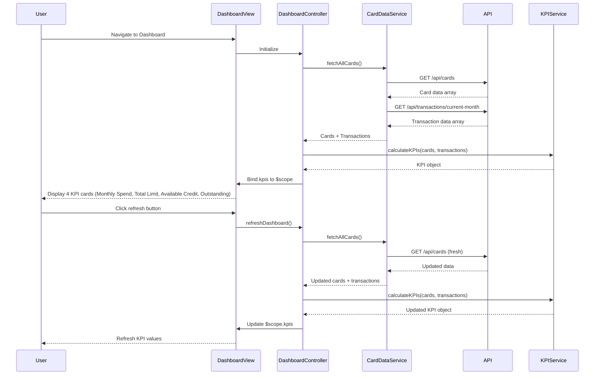

# Low-Level Design: Credit Card Dashboard and KPI Management
**Epic ID:** QE-10487  
**Technology Stack:** AngularJS 1.x, JavaScript ES6, HTML5, CSS3, Bootstrap, REST APIs, MVC Architecture

---

## a. Architecture Mapping

| HLD Component | AngularJS Artifact | Purpose |
|---------------|-------------------|------|
| User Interface | Module: `dashboard`, Directive: `kpiCard`, `responsiveLayout` | Render KPI widgets and responsive dashboard grid |
| Dashboard Controller | Controller: `DashboardController` | Orchestrate KPI data fetching, aggregation, and view binding |
| KPI Aggregation Service | Service: `KPIService` | Aggregate KPIs (monthly spend, total limit, available credit, outstanding) across all cards |
| Credit Card Data Source | Service: `CardDataService` | Fetch card and transaction data via REST API or mock service |
| Responsive Layout Engine | Directive: `responsiveGrid` | Implement Bootstrap-based responsive grid for multi-device support |

**Recommended Folder Structure:**
```
app/
├── modules/
│   └── dashboard/
│       ├── controllers/
│       │   └── DashboardController.js
│       ├── services/
│       │   ├── KPIService.js
│       │   └── CardDataService.js
│       ├── directives/
│       │   ├── kpiCard.js
│       │   └── responsiveGrid.js
│       └── views/
│           └── dashboard.html
```

---

## b. Component Specifications

| Component Name | Artifact Type | Responsibility | Key Dependencies |
|----------------|---------------|----------------|------------------|
| `dashboard` | Module | Root module for dashboard and KPI features | `ngRoute`, `ui.bootstrap` |
| `DashboardController` | Controller | Fetch card data, invoke KPI calculations, bind to view, handle refresh | `CardDataService`, `KPIService`, `$scope`, `$interval` |
| `KPIService` | Service | Calculate aggregated KPIs: total monthly spend, total credit limit, total available credit, total outstanding | `CardDataService` |
| `CardDataService` | Service | Fetch all user cards and recent transactions from REST API or mock data | `$http`, `$q` |
| `kpiCard` | Directive | Render individual KPI widget (icon, label, value, trend indicator) | `DashboardController` |
| `responsiveGrid` | Directive | Manage Bootstrap grid layout; adapt KPI card arrangement for mobile/tablet/desktop | None (pure layout logic) |

---

## c. Data Model

**KPI Object:**
```javascript
{
  monthlySpend: Number,        // Sum of current month transactions across all cards
  totalCreditLimit: Number,    // Sum of credit limits across all cards
  availableCredit: Number,     // Sum of available credit across all cards
  outstandingAmount: Number,   // Sum of outstanding balances across all cards
  utilizationRate: Number      // (outstandingAmount / totalCreditLimit) * 100
}
```

**DashboardViewModel:**
```javascript
{
  kpis: KPI,                   // Aggregated KPI object
  cards: Array<Card>,          // Array of user's credit cards
  lastUpdated: String,         // Timestamp of last data refresh
  isLoading: Boolean           // Loading state indicator
}
```

---

## d. Data Flow

User lands on dashboard → `DashboardController` initializes and calls `CardDataService.fetchAllCards()` → Service makes REST API call (`GET /api/cards`) and (`GET /api/transactions/current-month`) → Raw card and transaction data returned → Controller passes data to `KPIService.calculateKPIs(cards, transactions)` → Service computes monthly spend, total limits, available credit, outstanding amounts → Aggregated KPI object bound to `$scope.kpis` → `kpiCard` directives render 4 KPI widgets → `responsiveGrid` adjusts layout based on viewport → User triggers manual refresh → Controller re-invokes data fetch and KPI calculation → UI updates with new values.

---

## e. Primary Sequence Diagram



---

## f. Implementation Notes

- Use AngularJS `$interval` to auto-refresh dashboard data every 60 seconds; cancel interval on `$scope.$destroy` to prevent memory leaks.
- Implement `KPIService` with pure calculation functions (no side effects); ensure all KPI computations complete within 200ms per NFR.
- Leverage Bootstrap grid classes (`col-xs-12`, `col-sm-6`, `col-md-3`) in `responsiveGrid` directive for mobile-first responsive layout.
- Use AngularJS `ng-if` and `ng-show` for conditional rendering of loading spinners and error messages.
- Ensure WCAG 2.1 compliance: semantic HTML5 tags, ARIA labels on KPI cards, keyboard navigation support, sufficient color contrast.

---

## g. Error Handling

Interceptor-based error handling for API failures; user notified via dismissible alert banner; stale cached data displayed with warning if API unavailable.

---

## h. Security Notes

Requires token-based auth via existing SSO; all API calls include Authorization header; dashboard data restricted to authenticated user's cards only.

---