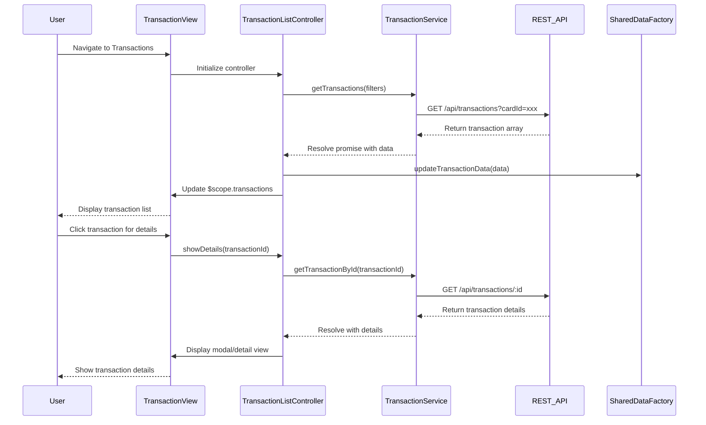

# Low-Level Design: Transaction Management and Viewing
**Epic ID:** QE-10488

## a. Architecture Mapping

- **User Interface** → AngularJS View (HTML template with ng-repeat for transaction list)
- **Transaction Controller** → AngularJS Controller (TransactionController managing view state and user interactions)
- **Transaction Service** → AngularJS Service (TransactionService for API calls and data retrieval)
- **Transaction Data Source** → REST API endpoint integration
- **Dashboard Integration** → AngularJS Factory (SharedDataFactory for cross-component communication)

**Recommended Folder Structure:**
```
app/
├── modules/
│   └── transactions/
│       ├── controllers/
│       ├── services/
│       ├── views/
│       └── transactions.module.js
├── shared/
│   ├── factories/
│   └── models/
└── assets/
    └── css/
```

## b. Component Specifications

| Name | Artifact Type | Responsibility | Key Dependencies |
|------|---------------|----------------|------------------|
| TransactionsModule | Module | Register all transaction-related components and configure routing | angular, ngRoute |
| TransactionListController | Controller | Manage transaction list display, filtering, sorting, and pagination | TransactionService, $scope |
| TransactionDetailController | Controller | Display detailed view of a single transaction | TransactionService, $routeParams, $scope |
| TransactionService | Service | Fetch transaction data from REST API with filtering and sorting support | $http, $q |
| SharedDataFactory | Factory | Share transaction data with Dashboard and Analytics modules | - |
| TransactionListView | View (HTML) | Render transaction list with Bootstrap table and responsive design | Bootstrap CSS, AngularJS directives |
| TransactionDetailView | View (HTML) | Render individual transaction details in modal or separate view | Bootstrap modal component |

## c. Data Model

```javascript
// Transaction Model
const Transaction = {
  transactionId: String,
  cardId: String,
  cardName: String,
  amount: Number,
  currency: String,
  category: String, // One of 9 predefined categories
  merchantName: String,
  transactionDate: Date,
  description: String,
  status: String // 'completed', 'pending', 'failed'
};

// Transaction Filter Model
const TransactionFilter = {
  cardId: String,
  category: String,
  startDate: Date,
  endDate: Date,
  minAmount: Number,
  maxAmount: Number,
  sortBy: String, // 'date', 'amount', 'merchant'
  sortOrder: String // 'asc', 'desc'
};
```

## d. Data Flow

User navigates to the Transactions view, triggering TransactionListController initialization. The controller invokes TransactionService.getTransactions() with optional filter parameters. The service makes a REST API call via $http, retrieves paginated transaction data, and returns a promise. Upon resolution, the controller updates $scope.transactions, and the view renders the transaction list using ng-repeat with Bootstrap table styling. User interactions (filter, sort, detail view) trigger controller methods that update the service call parameters or navigate to TransactionDetailController, which fetches and displays individual transaction details. Transaction data is also shared with Dashboard via SharedDataFactory for KPI calculations.

## e. Primary Sequence Diagram



## f. Implementation Notes

- Use AngularJS dependency injection to inject TransactionService into controllers for loose coupling and testability.
- Implement ES6 classes for service definitions with arrow functions for promise handling and callback management.
- Use $http interceptors for request/response transformation and authentication token injection.
- Leverage ng-repeat with track by transactionId for efficient DOM rendering and pagination with limitTo filter.
- Apply Bootstrap responsive grid (col-xs, col-sm, col-md) for mobile-first transaction list layout.

## g. Error Handling

HTTP interceptor captures API errors; service layer wraps promises with try/catch; controller displays user-friendly error messages via Bootstrap alerts.

## h. Security Notes

Requires token-based auth via existing SSO; all API calls include Authorization header with JWT token.