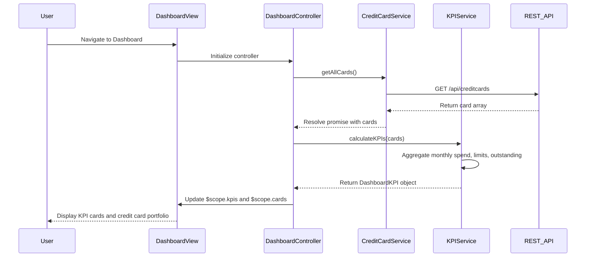

# Low-Level Design: Credit Card Portfolio and KPI Dashboard
**Epic ID:** QE-10489

## a. Architecture Mapping

- **User Interface** → AngularJS View (HTML template with Bootstrap grid for responsive dashboard layout)
- **Dashboard Controller** → AngularJS Controller (DashboardController managing KPI display and card portfolio)
- **KPI Calculation Service** → AngularJS Service (KPIService for aggregating and calculating metrics)
- **Credit Card Data Service** → AngularJS Service (CreditCardService for fetching card data from REST API)
- **Data Store** → REST API backend with JSON response format

**Recommended Folder Structure:**
```
app/
├── modules/
│   └── dashboard/
│       ├── controllers/
│       ├── services/
│       ├── views/
│       └── dashboard.module.js
├── shared/
│   ├── services/
│   └── models/
└── assets/
    ├── css/
    └── images/
```

## b. Component Specifications

| Name | Artifact Type | Responsibility | Key Dependencies |
|------|---------------|----------------|------------------|
| DashboardModule | Module | Register dashboard components and configure routing for main dashboard view | angular, ngRoute |
| DashboardController | Controller | Orchestrate KPI display, manage card portfolio view, handle user interactions | KPIService, CreditCardService, $scope |
| KPIService | Service | Calculate monthly spend, total credit limit, available credit, outstanding amounts from card and transaction data | CreditCardService, $http, $q |
| CreditCardService | Service | Fetch all credit card details (balance, limit, outstanding) from REST API | $http, $q |
| DashboardView | View (HTML) | Render KPI cards, credit card list with responsive Bootstrap layout | Bootstrap CSS, AngularJS directives |
| KPICardDirective | Directive | Reusable component to display individual KPI metric with icon and value | - |
| CreditCardListDirective | Directive | Display multiple credit cards in a responsive grid or list format | CreditCardService |

## c. Data Model

```javascript
// Credit Card Model
const CreditCard = {
  cardId: String,
  cardName: String,
  cardNumber: String, // Masked format (e.g., **** **** **** 1234)
  cardType: String, // 'Visa', 'Mastercard', 'Amex'
  creditLimit: Number,
  availableCredit: Number,
  outstandingAmount: Number,
  currentBalance: Number,
  expiryDate: String,
  status: String // 'active', 'blocked', 'expired'
};

// KPI Model
const DashboardKPI = {
  monthlySpend: Number,
  totalCreditLimit: Number,
  totalAvailableCredit: Number,
  totalOutstanding: Number,
  calculatedAt: Date
};
```

## d. Data Flow

User navigates to the Dashboard view, triggering DashboardController initialization. The controller invokes CreditCardService.getAllCards() to fetch all credit card data via REST API. Upon receiving the card data, the controller calls KPIService.calculateKPIs(cards) to aggregate monthly spend, total credit limit, available credit, and outstanding amounts. The KPIService processes the card array and returns a DashboardKPI object. The controller updates $scope.kpis and $scope.cards, and the view renders KPI cards using the KPICardDirective and displays the credit card portfolio using CreditCardListDirective with Bootstrap responsive grid. The UI updates dynamically as data is resolved from promises.

## e. Primary Sequence Diagram



## f. Implementation Notes

- Use AngularJS dependency injection to inject services into DashboardController for testability and modularity.
- Implement ES6 Promise.all() in KPIService to parallelize multiple API calls if card and transaction data come from separate endpoints.
- Create reusable directives (KPICardDirective, CreditCardListDirective) with isolated scope for component encapsulation.
- Apply Bootstrap responsive classes (col-xs-12, col-sm-6, col-md-3) for KPI cards to ensure mobile, tablet, and desktop compatibility.
- Use ng-if and ng-show for conditional rendering of loading spinners and error messages during data fetch.

## g. Error Handling

HTTP interceptor-based error handling with try/catch in service layer; user notified via Bootstrap alert component on API failure.

## h. Security Notes

Requires token-based auth via existing SSO; sensitive card data (full card number) never exposed in client-side code.