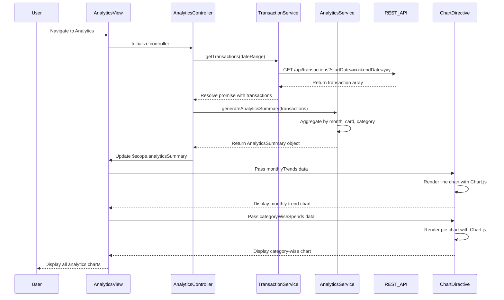

# Low-Level Design: Spending Analytics and Insights
**Epic ID:** QE-10490

## a. Architecture Mapping

- **Analytics UI** → AngularJS View (HTML template with chart containers and Bootstrap layout)
- **Analytics Controller** → AngularJS Controller (AnalyticsController managing chart data and user interactions)
- **Spend Analysis Engine** → AngularJS Service (AnalyticsService for data aggregation and spend calculations)
- **Transaction Data Service** → AngularJS Service (TransactionService for fetching transaction data from REST API)
- **Chart Rendering Component** → AngularJS Directive (ChartDirective wrapping Chart.js or D3.js library)

**Recommended Folder Structure:**
```
app/
├── modules/
│   └── analytics/
│       ├── controllers/
│       ├── services/
│       ├── directives/
│       ├── views/
│       └── analytics.module.js
├── shared/
│   ├── services/
│   └── constants/
└── assets/
    ├── css/
    └── js/
        └── chart.min.js
```

## b. Component Specifications

| Name | Artifact Type | Responsibility | Key Dependencies |
|------|---------------|----------------|------------------|
| AnalyticsModule | Module | Register analytics components, configure routing, and import charting library dependencies | angular, ngRoute, Chart.js |
| AnalyticsController | Controller | Manage analytics view state, trigger data aggregation, and pass chart data to directives | AnalyticsService, TransactionService, $scope |
| AnalyticsService | Service | Aggregate transaction data by month, card, and category; calculate spend trends and breakdowns | TransactionService, $q |
| TransactionService | Service | Fetch transaction data from REST API with date range and card filters | $http, $q |
| MonthlyTrendChartDirective | Directive | Render line chart for monthly spend trends using Chart.js | Chart.js library |
| CardWiseSpendChartDirective | Directive | Render bar or pie chart for card-wise spend breakdown | Chart.js library |
| CategoryWiseSpendChartDirective | Directive | Render pie or donut chart for category-wise spending across 9 categories | Chart.js library |
| SpendingCategoriesConstant | Constant | Define 9 spending categories (Food & Dining, Fuel, Shopping, Travel, Entertainment, Utilities, Healthcare, Education, Miscellaneous) | - |

## c. Data Model

```javascript
// Monthly Spend Trend Model
const MonthlySpendTrend = {
  month: String, // 'YYYY-MM' format
  totalSpend: Number,
  transactionCount: Number
};

// Card-wise Spend Model
const CardWiseSpend = {
  cardId: String,
  cardName: String,
  totalSpend: Number,
  percentage: Number
};

// Category-wise Spend Model
const CategoryWiseSpend = {
  category: String, // One of 9 predefined categories
  totalSpend: Number,
  transactionCount: Number,
  percentage: Number
};

// Analytics Summary Model
const AnalyticsSummary = {
  monthlyTrends: Array<MonthlySpendTrend>,
  cardWiseSpends: Array<CardWiseSpend>,
  categoryWiseSpends: Array<CategoryWiseSpend>,
  dateRange: { startDate: Date, endDate: Date }
};
```

## d. Data Flow

User navigates to the Analytics view, triggering AnalyticsController initialization. The controller invokes TransactionService.getTransactions() with date range filters to fetch all relevant transactions. Once transaction data is retrieved, the controller calls AnalyticsService.generateAnalyticsSummary(transactions), which aggregates data into monthly trends, card-wise spend, and category-wise spend arrays. The service returns an AnalyticsSummary object. The controller updates $scope.analyticsSummary and passes specific datasets to chart directives (MonthlyTrendChartDirective, CardWiseSpendChartDirective, CategoryWiseSpendChartDirective). Each directive uses Chart.js to render interactive, responsive visualizations. User interactions (hover, click) on charts trigger tooltip displays and drill-down actions managed by the controller.

## e. Primary Sequence Diagram



## f. Implementation Notes

- Use AngularJS dependency injection to inject AnalyticsService and TransactionService into AnalyticsController for modularity.
- Implement ES6 array methods (map, reduce, filter) in AnalyticsService for efficient data aggregation and transformation.
- Create isolated-scope directives for each chart type with two-way data binding to support real-time updates when filters change.
- Integrate Chart.js library via CDN or npm; wrap in AngularJS directive with $watch on data property to re-render charts on data changes.
- Apply Bootstrap responsive grid for chart containers to ensure proper rendering on mobile, tablet, and desktop devices.

## g. Error Handling

Interceptor-based error handling for API calls; service layer uses try/catch with fallback to empty datasets; user notified via alert on failure.

## h. Security Notes

Standard input validation and secure API calls assumed; transaction data access controlled via token-based authentication.