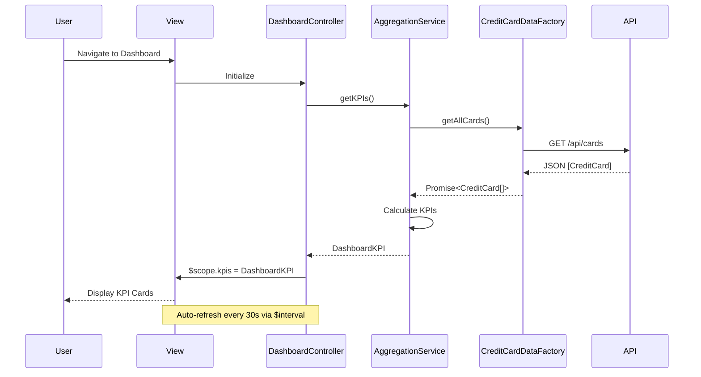

# Low-Level Design: QE-10491 - Credit Card Portfolio and KPI Dashboard

## a. Architecture Mapping

**HLD Component → AngularJS Artifact:**
- User Interface → AngularJS Module (`creditCardDashboard`) + HTML5 Views + Bootstrap CSS
- Dashboard Controller → AngularJS Controller (`DashboardController`)
- Data Aggregation Service → AngularJS Service (`AggregationService`)
- Credit Card Data Service → AngularJS Factory (`CreditCardDataFactory`) for REST API calls
- User Authentication Service → AngularJS Service (`AuthService`) with token management

**Recommended Folder Structure:**
```
app/
├── modules/
│   └── dashboard/
│       ├── controllers/
│       │   └── dashboard.controller.js
│       ├── services/
│       │   ├── aggregation.service.js
│       │   └── auth.service.js
│       ├── factories/
│       │   └── creditCardData.factory.js
│       ├── views/
│       │   └── dashboard.html
│       └── dashboard.module.js
├── shared/
│   ├── directives/
│   └── filters/
└── assets/
    ├── css/
    └── js/
```

## b. Component Specifications

| Component Name | Artifact Type | Responsibility | Key Dependencies |
|---|---|---|---|
| `creditCardDashboard` | Module | Root module for dashboard feature, defines routing and DI container | `ngRoute`, `ngResource` |
| `DashboardController` | Controller | Orchestrates KPI display, binds aggregated data to view, handles user interactions | `AggregationService`, `$scope`, `$interval` |
| `AggregationService` | Service | Aggregates KPIs (monthly spend, total limit, available credit, outstanding) from multiple cards | `CreditCardDataFactory`, `$q` |
| `CreditCardDataFactory` | Factory | Fetches credit card data via REST API, returns promise-based resources | `$http`, `$resource`, `API_ENDPOINT` |
| `AuthService` | Service | Manages user authentication, token storage, and session validation | `$http`, `$window.localStorage` |
| `kpiCard` | Directive | Reusable UI component to display individual KPI metrics with icon and value | None |
| `dashboardView` | HTML5 View | Responsive layout using Bootstrap grid to display KPI cards and card list | Bootstrap CSS, AngularJS directives |

## c. Data Model

```javascript
// CreditCard Model
const CreditCard = {
  cardId: String,
  cardNumber: String,        // masked, e.g., "**** **** **** 1234"
  cardType: String,          // "Visa", "MasterCard", "Amex"
  creditLimit: Number,
  availableCredit: Number,
  outstandingAmount: Number,
  monthlySpend: Number,
  lastUpdated: Date
};

// Dashboard KPI Model
const DashboardKPI = {
  totalMonthlySpend: Number,
  totalCreditLimit: Number,
  totalAvailableCredit: Number,
  totalOutstanding: Number,
  cards: Array<CreditCard>,
  lastRefreshed: Date
};
```

## d. Data Flow

User navigates to dashboard → `DashboardController` initializes and calls `AggregationService.getKPIs()` → `AggregationService` invokes `CreditCardDataFactory.getAllCards()` which makes REST API call (`GET /api/cards`) → API returns JSON array of credit card objects → `AggregationService` calculates consolidated KPIs (sum of monthly spend, total limits, available credit, outstanding) → Controller binds `DashboardKPI` model to `$scope` → View renders KPI cards using Bootstrap grid and `kpiCard` directive → `$interval` triggers refresh every 30 seconds to update KPIs in real-time.

## e. Primary Sequence Diagram



## f. Implementation Notes

- Use AngularJS 1.x with ES6 modules; transpile via Babel for browser compatibility.
- Dependency Injection: Register all services/factories/controllers in module config; inject dependencies via function parameters.
- REST API Integration: Use `$resource` or `$http` with promise chaining; handle async operations with `$q.all()` for parallel card fetching.
- Caching Strategy: Implement 30-second client-side cache in `CreditCardDataFactory` using timestamp comparison to reduce API calls.
- Responsive UI: Bootstrap 4 grid system with col-md-3 for KPI cards; mobile-first approach with stacked layout on small screens.

## g. Error Handling

HTTP interceptor captures API errors; displays user-friendly toast notifications via `toastr`; logs errors to console for debugging.

## h. Security Notes

Requires token-based authentication via existing SSO; token stored in localStorage and attached to API requests via HTTP interceptor.