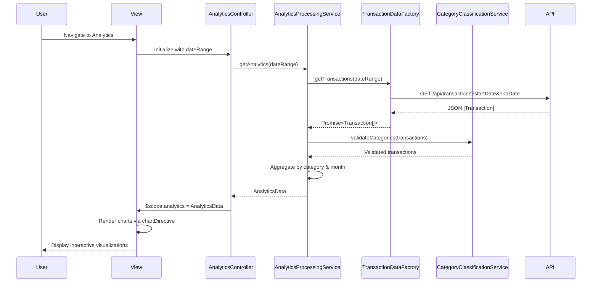

# Low-Level Design: QE-10492 - Spending Analytics and Insights

## a. Architecture Mapping

**HLD Component → AngularJS Artifact:**
- User Interface → AngularJS Module (`spendingAnalytics`) + HTML5 Views + Chart.js/D3.js integration
- Analytics Controller → AngularJS Controller (`AnalyticsController`)
- Analytics Processing Service → AngularJS Service (`AnalyticsProcessingService`)
- Transaction Data Service → AngularJS Factory (`TransactionDataFactory`) for REST API calls
- Category Classification Engine → AngularJS Service (`CategoryClassificationService`)
- Visualization Library → Chart.js directive wrapper (`chartDirective`)

**Recommended Folder Structure:**
```
app/
├── modules/
│   └── analytics/
│       ├── controllers/
│       │   └── analytics.controller.js
│       ├── services/
│       │   ├── analyticsProcessing.service.js
│       │   └── categoryClassification.service.js
│       ├── factories/
│       │   └── transactionData.factory.js
│       ├── directives/
│       │   └── chart.directive.js
│       ├── views/
│       │   └── analytics.html
│       └── analytics.module.js
├── shared/
│   └── constants/
│       └── categories.constant.js
└── assets/
    └── libs/
        └── chart.js
```

## b. Component Specifications

| Component Name | Artifact Type | Responsibility | Key Dependencies |
|---|---|---|---|
| `spendingAnalytics` | Module | Root module for analytics feature, defines routing and chart library integration | `ngRoute`, `chart.js` |
| `AnalyticsController` | Controller | Manages analytics view state, triggers data processing, binds chart data to view | `AnalyticsProcessingService`, `$scope`, `$filter` |
| `AnalyticsProcessingService` | Service | Aggregates transactions by category and month, calculates trends and patterns | `TransactionDataFactory`, `CategoryClassificationService`, `$q` |
| `TransactionDataFactory` | Factory | Fetches transaction history via REST API, supports date range filtering | `$http`, `$resource`, `API_ENDPOINT` |
| `CategoryClassificationService` | Service | Maps transactions to 9 predefined categories using rule-based logic | `CATEGORY_CONSTANTS` |
| `chartDirective` | Directive | Wraps Chart.js library, renders pie/bar/line charts with responsive config | `Chart.js`, `$window` |
| `CATEGORY_CONSTANTS` | Constant | Defines 9 spending categories and their classification rules | None |
| `analyticsView` | HTML5 View | Displays category-wise pie chart, monthly trend line chart, and summary table | Bootstrap CSS, chartDirective |

## c. Data Model

```javascript
// Transaction Model
const Transaction = {
  transactionId: String,
  cardId: String,
  amount: Number,
  category: String,          // One of 9 categories
  merchantName: String,
  transactionDate: Date,
  description: String
};

// Category Spending Model
const CategorySpending = {
  category: String,          // "Food & Dining", "Fuel", etc.
  totalAmount: Number,
  transactionCount: Number,
  percentage: Number         // % of total spend
};

// Monthly Trend Model
const MonthlyTrend = {
  month: String,             // "2024-01", "2024-02"
  totalSpend: Number,
  categoryBreakdown: Array<CategorySpending>
};

// Analytics Data Model
const AnalyticsData = {
  categorySpending: Array<CategorySpending>,
  monthlyTrends: Array<MonthlyTrend>,
  totalTransactions: Number,
  dateRange: { startDate: Date, endDate: Date }
};
```

## d. Data Flow

User navigates to analytics page → `AnalyticsController` initializes and calls `AnalyticsProcessingService.getAnalytics(dateRange)` → Service invokes `TransactionDataFactory.getTransactions(dateRange)` which makes REST API call (`GET /api/transactions?startDate=X&endDate=Y`) → API returns JSON array of transactions → `CategoryClassificationService` validates/corrects category assignments → `AnalyticsProcessingService` aggregates data into `CategorySpending` and `MonthlyTrend` arrays → Controller binds `AnalyticsData` to `$scope` → `chartDirective` renders pie chart (category-wise) and line chart (monthly trends) using Chart.js → User interacts with charts (hover, click) to explore insights.

## e. Primary Sequence Diagram



## f. Implementation Notes

- Use Chart.js 3.x for visualizations; wrap in AngularJS directive for declarative chart rendering (`<chart data="chartData" type="pie"></chart>`).
- Category classification: Define constant object mapping merchant patterns/MCC codes to 9 categories; fallback to "Miscellaneous" for unmatched transactions.
- Performance optimization: Process up to 10,000 transactions client-side using Web Workers for heavy aggregation; cache processed results in service.
- Date range filtering: Implement date picker (Bootstrap Datepicker) bound to controller; default to last 6 months on initial load.
- Responsive charts: Use Chart.js responsive config with maintainAspectRatio=false; container sizing via Bootstrap grid.

## g. Error Handling

Try/catch blocks in service methods with promise rejection; HTTP interceptor for API errors; user-friendly error messages displayed in view with retry option.

## h. Security Notes

Standard input validation and secure API calls assumed; date range inputs sanitized to prevent injection attacks.