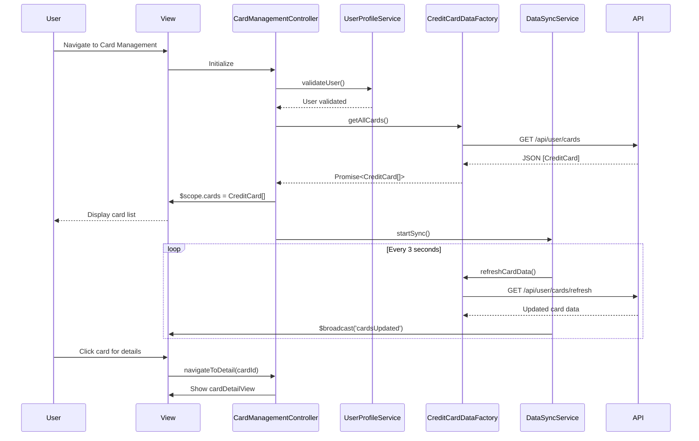

# Low-Level Design: QE-10493 - Credit Card Management and Monitoring

## a. Architecture Mapping

**HLD Component → AngularJS Artifact:**
- User Interface → AngularJS Module (`cardManagement`) + HTML5 Views + Bootstrap Cards
- Card Management Controller → AngularJS Controller (`CardManagementController`)
- Credit Card Data Service → AngularJS Factory (`CreditCardDataFactory`) for REST API calls
- User Profile Service → AngularJS Service (`UserProfileService`)
- Data Synchronization Service → AngularJS Service (`DataSyncService`) with polling mechanism

**Recommended Folder Structure:**
```
app/
├── modules/
│   └── cardManagement/
│       ├── controllers/
│       │   └── cardManagement.controller.js
│       ├── services/
│       │   ├── userProfile.service.js
│       │   └── dataSync.service.js
│       ├── factories/
│       │   └── creditCardData.factory.js
│       ├── directives/
│       │   └── cardItem.directive.js
│       ├── views/
│       │   ├── cardList.html
│       │   └── cardDetail.html
│       └── cardManagement.module.js
├── shared/
│   └── filters/
│       └── cardMask.filter.js
└── assets/
    └── images/
        └── card-icons/
```

## b. Component Specifications

| Component Name | Artifact Type | Responsibility | Key Dependencies |
|---|---|---|---|
| `cardManagement` | Module | Root module for card management feature, defines routing and state management | `ngRoute`, `ngResource` |
| `CardManagementController` | Controller | Manages card list display, detail view navigation, and card-wise spend analysis | `CreditCardDataFactory`, `UserProfileService`, `DataSyncService`, `$scope` |
| `CreditCardDataFactory` | Factory | Fetches card details, balances, and transaction history via REST API | `$http`, `$resource`, `API_ENDPOINT` |
| `UserProfileService` | Service | Validates card ownership, retrieves user permissions and preferences | `$http`, `$window.sessionStorage` |
| `DataSyncService` | Service | Polls API every 3 seconds to refresh card data, manages sync state | `CreditCardDataFactory`, `$interval`, `$rootScope` |
| `cardItem` | Directive | Reusable card component displaying card number, balance, limit, and utilization bar | `cardMaskFilter` |
| `cardMaskFilter` | Filter | Masks card number for display (e.g., "**** **** **** 1234") | None |
| `cardListView` | HTML5 View | Responsive grid layout displaying all user cards with summary info | Bootstrap CSS, cardItem directive |
| `cardDetailView` | HTML5 View | Detailed view of single card with spend analysis, transactions, and utilization chart | Bootstrap CSS, Chart.js |

## c. Data Model

```javascript
// CreditCard Model (Extended)
const CreditCard = {
  cardId: String,
  cardNumber: String,        // full number (masked in view)
  cardType: String,          // "Visa", "MasterCard", "Amex", "Discover"
  cardHolderName: String,
  expiryDate: String,        // "MM/YY"
  creditLimit: Number,
  availableCredit: Number,
  outstandingAmount: Number,
  currentBalance: Number,
  monthlySpend: Number,
  utilizationRate: Number,   // calculated as (outstandingAmount / creditLimit) * 100
  status: String,            // "Active", "Inactive", "Blocked"
  lastTransactionDate: Date,
  lastSyncedAt: Date
};

// Card Spend Analysis Model
const CardSpendAnalysis = {
  cardId: String,
  monthlySpend: Number,
  categoryBreakdown: Array<{ category: String, amount: Number }>,
  topMerchants: Array<{ merchantName: String, totalSpent: Number }>,
  transactionCount: Number
};
```

## d. Data Flow

User navigates to card management page → `CardManagementController` initializes and calls `UserProfileService.validateUser()` to verify permissions → Controller invokes `CreditCardDataFactory.getAllCards()` which makes REST API call (`GET /api/user/cards`) → API returns JSON array of credit cards → Controller binds cards to `$scope.cards` → View renders card list using `cardItem` directive with Bootstrap grid → `DataSyncService` starts polling (`$interval` every 3 seconds) to call `CreditCardDataFactory.refreshCardData()` → On data update, `$rootScope.$broadcast('cardsUpdated')` triggers view refresh → User clicks card to view details → Controller navigates to detail view with card-specific spend analysis.

## e. Primary Sequence Diagram



## f. Implementation Notes

- Use AngularJS 1.x with component-based architecture; `cardItem` directive with isolated scope for reusability.
- Data synchronization: Implement polling with `$interval` service; stop polling on route change using `$scope.$on('$destroy')` cleanup.
- Card utilization calculation: Computed property in controller as `(card.outstandingAmount / card.creditLimit) * 100`; display as progress bar.
- Performance: Limit initial load to 20 cards; implement virtual scrolling (ng-virtual-repeat) if user has more cards.
- Card masking: Custom filter `cardMaskFilter` to display only last 4 digits; full number never exposed in client-side code.

## g. Error Handling

HTTP interceptor for API errors; retry logic with exponential backoff for sync failures; error state displayed in view with manual refresh button.

## h. Security Notes

Requires token-based auth via existing SSO; card ownership validated server-side; sensitive card data (CVV, full number) never transmitted to client.