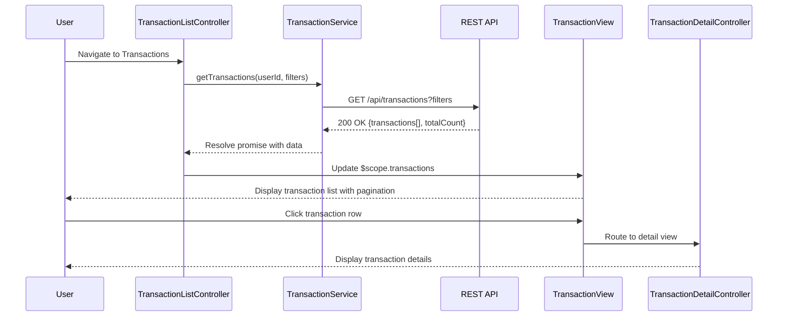

# Low-Level Design: Transaction Management and Viewing
**Epic ID:** QE-10494  
**Tech Stack:** AngularJS 1.x, JavaScript ES6, HTML5, CSS3, Bootstrap, REST APIs, MVC

---

## a. Architecture Mapping

- **Transaction View Module** → AngularJS Module (`transactionModule`)
- **Transaction List Controller** → AngularJS Controller (`TransactionListController`)
- **Transaction Detail Controller** → AngularJS Controller (`TransactionDetailController`)
- **Transaction Service** → AngularJS Service (`TransactionService`)
- **Card Service** → AngularJS Service (`CardService`)
- **Auth Interceptor** → AngularJS Factory (`authInterceptor`)
- **Transaction Filter Directive** → AngularJS Directive (`transactionFilter`)

**Folder Structure:**
```
/app
  /modules
    /transaction
      /controllers
      /services
      /directives
      /views
  /shared
    /services
    /interceptors
```

---

## b. Component Specifications

| Name | Artifact Type | Responsibility | Key Dependencies |
|------|---------------|----------------|------------------|
| transactionModule | Module | Registers transaction feature components | ngRoute, ui.bootstrap |
| TransactionListController | Controller | Manages transaction list view, filtering, pagination | TransactionService, CardService, $scope |
| TransactionDetailController | Controller | Displays individual transaction details | TransactionService, $routeParams, $scope |
| TransactionService | Service | Fetches transactions via REST API, handles pagination | $http, $q, authInterceptor |
| CardService | Service | Retrieves user's card list for filtering | $http, $q, authInterceptor |
| authInterceptor | Factory | Attaches auth token to API requests | $window, $q |
| transactionFilter | Directive | Renders filter UI (date range, card selection) | TransactionService, CardService |

---

## c. Data Model

**Transaction Object:**
```javascript
{
  transactionId: String,
  cardId: String,
  cardName: String,
  merchantName: String,
  amount: Number,
  currency: String,
  category: String,
  transactionDate: Date,
  status: String // 'posted', 'pending'
}
```

**Card Object:**
```javascript
{
  cardId: String,
  cardName: String,
  lastFourDigits: String
}
```

**Filter Object:**
```javascript
{
  cardId: String,
  startDate: Date,
  endDate: Date,
  pageNumber: Number,
  pageSize: Number
}
```

---

## d. Data Flow

User authenticates and navigates to transaction view → TransactionListController initializes and calls CardService to load user's cards → User selects filters (card, date range) via transactionFilter directive → Controller calls TransactionService.getTransactions() with filter parameters → Service sends GET request to `/api/transactions?cardId={id}&startDate={date}&endDate={date}&page={n}&size={s}` with auth token → API returns paginated transaction array → Service resolves promise with transaction data → Controller updates $scope.transactions → View renders transaction list using ng-repeat with Bootstrap table → User clicks transaction row → TransactionDetailController loads and displays full transaction details.

---

## e. Primary Sequence Diagram



---

## f. Implementation Notes

- Use AngularJS Dependency Injection for all services and controllers; register components via module.controller() and module.service().
- Implement pagination using UI Bootstrap's pagination directive with server-side paging (pageNumber, pageSize params).
- Use $http service with promise-based API calls; handle responses in .then() and errors in .catch().
- Apply authInterceptor factory via $httpProvider.interceptors to inject JWT token in Authorization header for all API requests.
- Use ng-repeat with track by transactionId for efficient list rendering; apply Bootstrap responsive table classes for mobile compatibility.

---

## g. Error Handling

HTTP interceptor captures API errors; display user-friendly messages via Bootstrap alert component; log errors to console.

---

## h. Security Notes

Requires token-based auth via existing SSO; authInterceptor attaches JWT to all API calls.

---