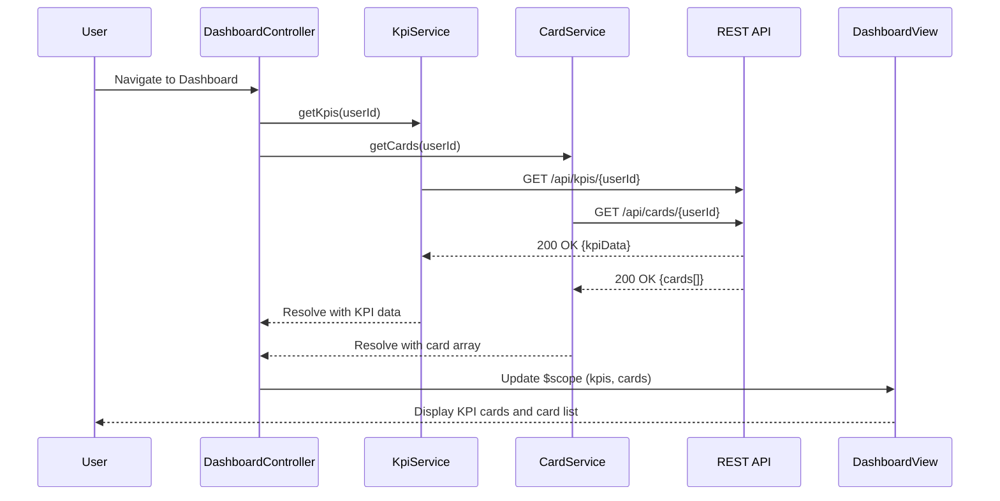

# Low-Level Design: Credit Card Dashboard and KPI Management
**Epic ID:** QE-10495  
**Tech Stack:** AngularJS 1.x, JavaScript ES6, HTML5, CSS3, Bootstrap, REST APIs, MVC

---

## a. Architecture Mapping

- **Dashboard Module** → AngularJS Module (`dashboardModule`)
- **Dashboard Controller** → AngularJS Controller (`DashboardController`)
- **KPI Service** → AngularJS Service (`KpiService`)
- **Card Service** → AngularJS Service (`CardService`)
- **Auth Interceptor** → AngularJS Factory (`authInterceptor`)
- **KPI Card Directive** → AngularJS Directive (`kpiCard`)
- **Card List Directive** → AngularJS Directive (`cardList`)

**Folder Structure:**
```
/app
  /modules
    /dashboard
      /controllers
      /services
      /directives
      /views
  /shared
    /services
    /interceptors
```

---

## b. Component Specifications

| Name | Artifact Type | Responsibility | Key Dependencies |
|------|---------------|----------------|------------------|
| dashboardModule | Module | Registers dashboard feature components | ngRoute, ui.bootstrap |
| DashboardController | Controller | Orchestrates dashboard view, loads KPIs and card data | KpiService, CardService, $scope, $interval |
| KpiService | Service | Fetches aggregated KPI data via REST API | $http, $q, authInterceptor |
| CardService | Service | Retrieves user's credit card list with balances | $http, $q, authInterceptor |
| authInterceptor | Factory | Attaches auth token to API requests | $window, $q |
| kpiCard | Directive | Renders individual KPI metric card (monthly spend, total limit, available credit, outstanding) | None |
| cardList | Directive | Displays list of user's credit cards with individual card details | CardService |

---

## c. Data Model

**KPI Object:**
```javascript
{
  totalCreditLimit: Number,
  totalAvailableCredit: Number,
  totalOutstandingAmount: Number,
  monthlySpend: Number,
  currency: String
}
```

**CreditCard Object:**
```javascript
{
  cardId: String,
  cardName: String,
  cardType: String,
  lastFourDigits: String,
  creditLimit: Number,
  availableCredit: Number,
  outstandingAmount: Number,
  monthlySpend: Number
}
```

---

## d. Data Flow

User authenticates and lands on dashboard → DashboardController initializes and calls KpiService.getKpis(userId) and CardService.getCards(userId) → Services send parallel GET requests to `/api/kpis/{userId}` and `/api/cards/{userId}` with auth token → API returns aggregated KPI data and card array → Services resolve promises → Controller updates $scope.kpis and $scope.cards → View renders KPI summary cards using kpiCard directive and individual card list using cardList directive with Bootstrap grid layout → $interval service refreshes KPI data every 5 minutes → UI updates reactively via two-way data binding.

---

## e. Primary Sequence Diagram



---

## f. Implementation Notes

- Use AngularJS DI to inject KpiService and CardService into DashboardController; register via module.controller() and module.service().
- Implement auto-refresh using $interval service (5-minute interval) to call KpiService.getKpis() and update $scope.
- Use Bootstrap grid system (col-md-3, col-sm-6, col-xs-12) for responsive KPI cards and card list layout.
- Apply $http service with promise chaining; use $q.all() to wait for parallel API calls if needed.
- Create reusable kpiCard directive with isolated scope accepting metric name, value, and icon as attributes.

---

## g. Error Handling

HTTP interceptor captures API failures; display error banner using Bootstrap alert; retry logic in $interval for transient failures.

---

## h. Security Notes

Requires token-based auth via existing SSO; authInterceptor attaches JWT to all API calls.

---