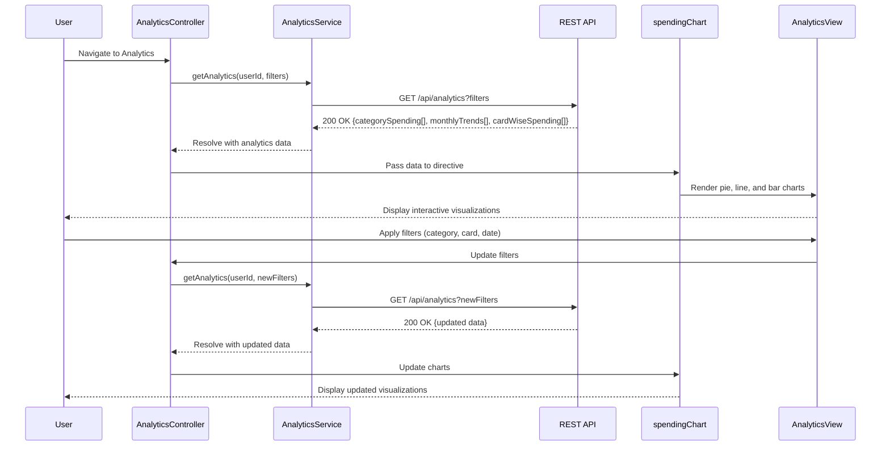

# Low-Level Design: Spending Analytics and Insights
**Epic ID:** QE-10496  
**Tech Stack:** AngularJS 1.x, JavaScript ES6, HTML5, CSS3, Bootstrap, REST APIs, MVC

---

## a. Architecture Mapping

- **Analytics Module** → AngularJS Module (`analyticsModule`)
- **Analytics Controller** → AngularJS Controller (`AnalyticsController`)
- **Analytics Service** → AngularJS Service (`AnalyticsService`)
- **Chart Directive** → AngularJS Directive (`spendingChart`)
- **Category Filter Directive** → AngularJS Directive (`categoryFilter`)
- **Auth Interceptor** → AngularJS Factory (`authInterceptor`)

**Folder Structure:**
```
/app
  /modules
    /analytics
      /controllers
      /services
      /directives
      /views
  /shared
    /services
    /interceptors
```

---

## b. Component Specifications

| Name | Artifact Type | Responsibility | Key Dependencies |
|------|---------------|----------------|------------------|
| analyticsModule | Module | Registers analytics feature components | ngRoute, ui.bootstrap, chart.js |
| AnalyticsController | Controller | Manages analytics view, loads spending data, handles filters | AnalyticsService, $scope |
| AnalyticsService | Service | Fetches category-wise, card-wise, and monthly trend data via REST API | $http, $q, authInterceptor |
| spendingChart | Directive | Renders interactive charts (pie for categories, line for trends, bar for card-wise) using Chart.js | AnalyticsService |
| categoryFilter | Directive | Provides UI for filtering by category, card, and date range | None |
| authInterceptor | Factory | Attaches auth token to API requests | $window, $q |

---

## c. Data Model

**CategorySpending Object:**
```javascript
{
  category: String, // 'Food & Dining', 'Fuel', 'Shopping', 'Travel', 'Entertainment', 'Utilities', 'Healthcare', 'Education', 'Miscellaneous'
  totalAmount: Number,
  transactionCount: Number
}
```

**MonthlyTrend Object:**
```javascript
{
  month: String, // 'YYYY-MM'
  totalSpend: Number
}
```

**CardWiseSpending Object:**
```javascript
{
  cardId: String,
  cardName: String,
  totalSpend: Number
}
```

**AnalyticsData Object:**
```javascript
{
  categorySpending: Array<CategorySpending>,
  monthlyTrends: Array<MonthlyTrend>,
  cardWiseSpending: Array<CardWiseSpending>
}
```

---

## d. Data Flow

User navigates to analytics dashboard → AnalyticsController initializes and calls AnalyticsService.getAnalytics(userId, filters) → Service sends GET request to `/api/analytics?userId={id}&startDate={date}&endDate={date}&cardId={id}` with auth token → API aggregates transaction data by category, month, and card using backend classification engine → API returns AnalyticsData object → Service resolves promise → Controller updates $scope.analyticsData → spendingChart directive renders three charts: pie chart for category-wise spending, line chart for monthly trends (12-month rolling), bar chart for card-wise spending → User interacts with charts (hover, click) to drill down → categoryFilter directive allows user to refine view by category, card, or date range → Controller re-fetches data and updates charts.

---

## e. Primary Sequence Diagram



---

## f. Implementation Notes

- Use AngularJS DI to inject AnalyticsService into AnalyticsController; register components via module.controller(), module.service(), and module.directive().
- Integrate Chart.js library via spendingChart directive; use directive's link function to initialize charts with $scope.analyticsData.
- Implement responsive chart sizing using Chart.js responsive option and Bootstrap container classes.
- Use $http service for REST API calls; handle promises with .then() for success and .catch() for errors.
- Apply ng-change on categoryFilter directive inputs to trigger AnalyticsController methods that re-fetch data.

---

## g. Error Handling

HTTP interceptor captures API errors; display error message via Bootstrap alert; fallback to cached data if available.

---

## h. Security Notes

Requires token-based auth via existing SSO; authInterceptor attaches JWT to all API calls.

---