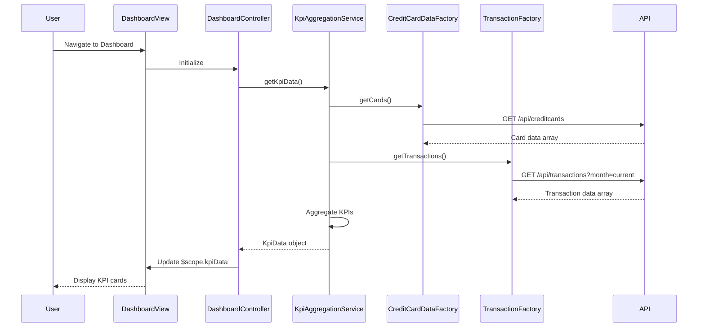

# Low-Level Design: Credit Card Dashboard and KPI Overview

**Epic ID:** QE-10497  
**Technology Stack:** AngularJS 1.x, JavaScript ES6, HTML5, CSS3, Bootstrap, REST APIs, MVC Architecture

---

## a. Architecture Mapping

- **Dashboard UI Component** → AngularJS Module (`creditCardDashboard`) + Controller (`DashboardController`)
- **KPI Aggregation Service** → AngularJS Service (`KpiAggregationService`) for business logic and API orchestration
- **Credit Card Data Service Integration** → AngularJS Factory (`CreditCardDataFactory`) for REST API calls
- **Transaction Service Integration** → AngularJS Factory (`TransactionFactory`) for monthly spend API calls
- **Dashboard View** → HTML5 template with Bootstrap grid for responsive KPI cards

**Recommended Folder Structure:**
```
app/
├── modules/
│   └── dashboard/
│       ├── dashboard.module.js
│       ├── controllers/
│       │   └── dashboard.controller.js
│       ├── services/
│       │   └── kpi-aggregation.service.js
│       ├── factories/
│       │   ├── credit-card-data.factory.js
│       │   └── transaction.factory.js
│       └── views/
│           └── dashboard.html
└── assets/
    └── css/
        └── dashboard.css
```

---

## b. Component Specifications

| Component Name | Artifact Type | Responsibility | Key Dependencies |
|----------------|---------------|----------------|------------------|
| `creditCardDashboard` | Module | Root module for dashboard feature | `ngRoute`, `ui.bootstrap` |
| `DashboardController` | Controller | Manages dashboard state, triggers KPI refresh, binds data to view | `KpiAggregationService`, `$scope`, `$interval` |
| `KpiAggregationService` | Service | Orchestrates calls to data factories, aggregates KPIs (monthly spend, total limit, available credit, outstanding) | `CreditCardDataFactory`, `TransactionFactory`, `$q` |
| `CreditCardDataFactory` | Factory | Fetches credit card details and balances via REST API (`GET /api/creditcards`) | `$http` |
| `TransactionFactory` | Factory | Fetches transaction data for monthly spend calculation via REST API (`GET /api/transactions`) | `$http` |
| `dashboardView` | HTML Template | Displays KPI cards using Bootstrap responsive grid, binds to controller scope | Bootstrap CSS, AngularJS directives |

---

## c. Data Model

**KpiData (JavaScript Object):**
```javascript
{
  monthlySpend: Number,        // Total spend for current month
  totalCreditLimit: Number,    // Sum of all card limits
  availableCredit: Number,     // Total limit - outstanding
  outstandingAmount: Number,   // Sum of all card balances
  lastUpdated: Date            // Timestamp of last refresh
}
```

**CreditCard (JavaScript Object):**
```javascript
{
  cardId: String,
  cardNumber: String,
  cardLimit: Number,
  currentBalance: Number,
  availableBalance: Number
}
```

**Transaction (JavaScript Object):**
```javascript
{
  transactionId: String,
  cardId: String,
  amount: Number,
  date: Date,
  category: String
}
```

---

## d. Data Flow

User navigates to dashboard → `DashboardController` initializes and calls `KpiAggregationService.getKpiData()` → Service invokes `CreditCardDataFactory.getCards()` and `TransactionFactory.getTransactions()` in parallel using `$q.all()` → Factories make REST API calls to backend → Service aggregates responses (sums limits, calculates available credit, filters current month transactions for spend) → Aggregated `KpiData` object returned to controller → Controller updates `$scope.kpiData` → View auto-updates via two-way binding, displaying KPI cards with Bootstrap styling → `$interval` triggers periodic refresh every 30 seconds for near real-time updates.

---

## e. Primary Sequence Diagram



---

## f. Implementation Notes

- Use AngularJS Dependency Injection for all services, factories, and controllers to ensure testability and modularity.
- Implement `$http` interceptors for global error handling and request/response transformation.
- Leverage `$q.all()` in `KpiAggregationService` to parallelize API calls and meet 2-second load time NFR.
- Use Bootstrap responsive grid (`col-xs-*`, `col-sm-*`, `col-md-*`, `col-lg-*`) for KPI card layout to support desktop, tablet, and mobile.
- Implement `$interval` service for periodic KPI refresh (30-second interval) to achieve near real-time data updates.

---

## g. Error Handling

HTTP interceptor-based error handling with user-friendly notifications via `$http` interceptor and Bootstrap alerts for API failures.

---

## h. Security Notes

Standard input validation and secure API calls assumed; requires token-based auth via existing SSO for API endpoints.