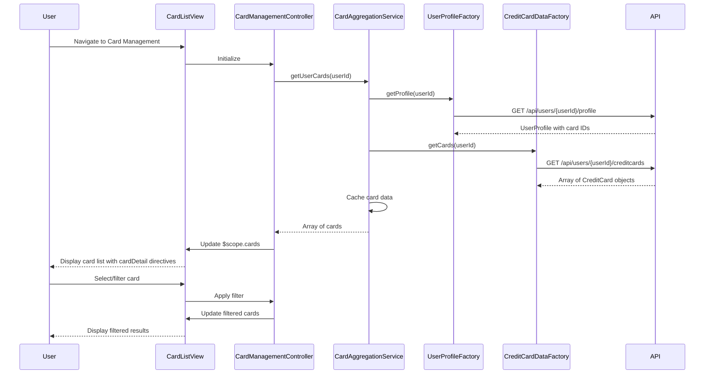

# Low-Level Design: Multiple Credit Card Management

**Epic ID:** QE-10498  
**Technology Stack:** AngularJS 1.x, JavaScript ES6, HTML5, CSS3, Bootstrap, REST APIs, MVC Architecture

---

## a. Architecture Mapping

- **Card Management UI** → AngularJS Module (`cardManagement`) + Controller (`CardManagementController`)
- **Card Aggregation Service** → AngularJS Service (`CardAggregationService`) for fetching and caching card data
- **Credit Card Data Service Integration** → AngularJS Factory (`CreditCardDataFactory`) for REST API calls
- **User Profile Service Integration** → AngularJS Factory (`UserProfileFactory`) for user-card association API calls
- **Card List View** → HTML5 template with Bootstrap cards/panels for responsive multi-card display
- **Card Detail Directive** → AngularJS Directive (`cardDetail`) for reusable card display component

**Recommended Folder Structure:**
```
app/
├── modules/
│   └── card-management/
│       ├── card-management.module.js
│       ├── controllers/
│       │   └── card-management.controller.js
│       ├── services/
│       │   └── card-aggregation.service.js
│       ├── factories/
│       │   ├── credit-card-data.factory.js
│       │   └── user-profile.factory.js
│       ├── directives/
│       │   └── card-detail.directive.js
│       └── views/
│           ├── card-list.html
│           └── card-detail.html
└── assets/
    └── css/
        └── card-management.css
```

---

## b. Component Specifications

| Component Name | Artifact Type | Responsibility | Key Dependencies |
|----------------|---------------|----------------|------------------|
| `cardManagement` | Module | Root module for card management feature | `ngRoute`, `ui.bootstrap` |
| `CardManagementController` | Controller | Manages card list state, handles card selection/filtering, triggers card data refresh | `CardAggregationService`, `$scope`, `$filter` |
| `CardAggregationService` | Service | Fetches user's cards, caches data, provides card comparison logic | `CreditCardDataFactory`, `UserProfileFactory`, `$q`, `$cacheFactory` |
| `CreditCardDataFactory` | Factory | Fetches multiple credit card details via REST API (`GET /api/users/{userId}/creditcards`) | `$http` |
| `UserProfileFactory` | Factory | Fetches user profile and card associations via REST API (`GET /api/users/{userId}/profile`) | `$http` |
| `cardDetail` | Directive | Reusable component to display individual card details (limit, balance, spend) | None (isolated scope) |
| `cardListView` | HTML Template | Displays all cards in responsive grid, supports filtering and selection | Bootstrap CSS, AngularJS directives |

---

## c. Data Model

**CreditCard (JavaScript Object):**
```javascript
{
  cardId: String,
  cardNumber: String,           // Masked format (e.g., "**** **** **** 1234")
  cardType: String,             // "Visa", "MasterCard", "Amex"
  cardLimit: Number,
  currentBalance: Number,
  availableBalance: Number,
  monthlySpend: Number,
  lastTransactionDate: Date,
  isActive: Boolean
}
```

**UserProfile (JavaScript Object):**
```javascript
{
  userId: String,
  userName: String,
  associatedCardIds: Array<String>
}
```

**CardFilter (JavaScript Object):**
```javascript
{
  cardType: String,             // Filter by card type
  isActive: Boolean,            // Filter by active status
  sortBy: String                // "cardLimit", "monthlySpend", "availableBalance"
}
```

---

## d. Data Flow

User navigates to card management page → `CardManagementController` initializes and calls `CardAggregationService.getUserCards(userId)` → Service checks cache; if miss, invokes `UserProfileFactory.getProfile(userId)` to retrieve associated card IDs → Service then calls `CreditCardDataFactory.getCards(userId)` to fetch all card details → Factory makes REST API call to backend → Service caches response using `$cacheFactory` and returns card array to controller → Controller updates `$scope.cards` → View renders card list using `ng-repeat` and `cardDetail` directive with Bootstrap grid → User selects/filters cards → Controller applies `$filter` to `$scope.cards` → View updates instantly → Card switching responds within 500ms via cached data and efficient Angular digest cycle.

---

## e. Primary Sequence Diagram



---

## f. Implementation Notes

- Use AngularJS `$cacheFactory` in `CardAggregationService` to cache card data and achieve <500ms card switching response time.
- Implement `cardDetail` directive with isolated scope (`scope: { card: '=' }`) for reusability and encapsulation.
- Leverage Bootstrap responsive utilities (`hidden-xs`, `col-md-4`) to adapt card layout across screen sizes.
- Use AngularJS `$filter` service for client-side card filtering and sorting to minimize server round-trips.
- Support up to 10 cards per user by optimizing DOM rendering with `track by cardId` in `ng-repeat`.

---

## g. Error Handling

HTTP interceptor handles API failures with fallback to cached data where available; user notified via Bootstrap alert on critical errors.

---

## h. Security Notes

Requires token-based auth via existing SSO; card numbers masked on client-side; API endpoints secured with user-specific authorization.