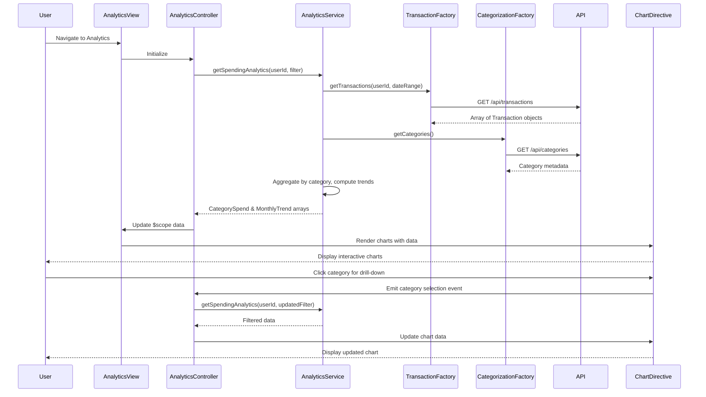

# Low-Level Design: Spending Analytics and Transaction Insights

**Epic ID:** QE-10499  
**Technology Stack:** AngularJS 1.x, JavaScript ES6, HTML5, CSS3, Bootstrap, REST APIs, MVC Architecture

---

## a. Architecture Mapping

- **Analytics UI Component** → AngularJS Module (`spendingAnalytics`) + Controller (`AnalyticsController`)
- **Analytics Service** → AngularJS Service (`AnalyticsService`) for data aggregation and trend computation
- **Transaction Service Integration** → AngularJS Factory (`TransactionFactory`) for REST API calls to fetch transactions
- **Categorization Engine Integration** → AngularJS Factory (`CategorizationFactory`) for category data and rules
- **Visualization Component** → AngularJS Directive (`spendingChart`) wrapping Chart.js for interactive charts
- **Category Filter Component** → AngularJS Directive (`categoryFilter`) for drill-down and multi-category selection

**Recommended Folder Structure:**
```
app/
├── modules/
│   └── spending-analytics/
│       ├── spending-analytics.module.js
│       ├── controllers/
│       │   └── analytics.controller.js
│       ├── services/
│       │   └── analytics.service.js
│       ├── factories/
│       │   ├── transaction.factory.js
│       │   └── categorization.factory.js
│       ├── directives/
│       │   ├── spending-chart.directive.js
│       │   └── category-filter.directive.js
│       └── views/
│           └── analytics.html
└── assets/
    ├── js/
    │   └── chart.min.js
    └── css/
        └── analytics.css
```

---

## b. Component Specifications

| Component Name | Artifact Type | Responsibility | Key Dependencies |
|----------------|---------------|----------------|------------------|
| `spendingAnalytics` | Module | Root module for analytics feature | `ngRoute`, `ui.bootstrap`, `chart.js` |
| `AnalyticsController` | Controller | Manages analytics state, handles category selection, triggers data refresh and chart updates | `AnalyticsService`, `$scope`, `$filter` |
| `AnalyticsService` | Service | Aggregates transaction data by category, computes monthly trends, provides comparison logic | `TransactionFactory`, `CategorizationFactory`, `$q` |
| `TransactionFactory` | Factory | Fetches transaction data via REST API (`GET /api/transactions?userId={userId}&dateRange={range}`) | `$http` |
| `CategorizationFactory` | Factory | Fetches category metadata and pre-categorized transaction mappings via REST API (`GET /api/categories`) | `$http` |
| `spendingChart` | Directive | Renders interactive charts (pie, bar, line) using Chart.js, handles user interactions (click, hover) | Chart.js library |
| `categoryFilter` | Directive | Provides UI for category selection, drill-down, and multi-category comparison | None (isolated scope) |
| `analyticsView` | HTML Template | Displays charts, filters, and trend summaries using Bootstrap responsive layout | Bootstrap CSS, AngularJS directives |

---

## c. Data Model

**Transaction (JavaScript Object):**
```javascript
{
  transactionId: String,
  cardId: String,
  amount: Number,
  date: Date,
  category: String,              // One of 9 predefined categories
  description: String,
  merchant: String
}
```

**CategorySpend (JavaScript Object):**
```javascript
{
  category: String,              // "Food & Dining", "Fuel", etc.
  totalAmount: Number,
  transactionCount: Number,
  percentageOfTotal: Number
}
```

**MonthlyTrend (JavaScript Object):**
```javascript
{
  month: String,                 // "2024-01", "2024-02", etc.
  totalSpend: Number,
  categoryBreakdown: Array<CategorySpend>
}
```

**AnalyticsFilter (JavaScript Object):**
```javascript
{
  selectedCategories: Array<String>,
  dateRange: { startDate: Date, endDate: Date },
  cardId: String                 // Optional: filter by specific card
}
```

---

## d. Data Flow

User navigates to analytics page → `AnalyticsController` initializes and calls `AnalyticsService.getSpendingAnalytics(userId, filter)` → Service invokes `TransactionFactory.getTransactions(userId, dateRange)` and `CategorizationFactory.getCategories()` in parallel → Factories make REST API calls to backend → Service receives pre-categorized transactions and category metadata → Service aggregates transactions by category, computes totals and percentages, calculates monthly trends → Service returns `CategorySpend` array and `MonthlyTrend` array to controller → Controller updates `$scope.categoryData` and `$scope.trendData` → View renders charts via `spendingChart` directive (Chart.js) and category filters via `categoryFilter` directive → User interacts with chart (clicks category) or selects filter → Directive emits event to controller → Controller updates filter and re-queries service → Service returns filtered data → Charts re-render with sub-second response via optimized Angular digest and Chart.js update methods.

---

## e. Primary Sequence Diagram



---

## f. Implementation Notes

- Use Chart.js library wrapped in AngularJS directive (`spendingChart`) for interactive visualizations; leverage Chart.js `update()` method for sub-second re-rendering.
- Implement category aggregation logic in `AnalyticsService` using ES6 `Array.reduce()` and `Map` for efficient grouping.
- Support 9 predefined categories via enum or constant array in `CategorizationFactory`; validate all transactions against this list.
- Use AngularJS event system (`$scope.$emit`, `$scope.$on`) for communication between `categoryFilter` directive and `AnalyticsController`.
- Optimize chart rendering for 3-second NFR by lazy-loading Chart.js and pre-aggregating data server-side where possible.

---

## g. Error Handling

HTTP interceptor-based error handling with graceful degradation; display cached/partial data if available and notify user via Bootstrap alert.

---

## h. Security Notes

Standard input validation and secure API calls assumed; requires token-based auth via existing SSO for transaction and category endpoints.