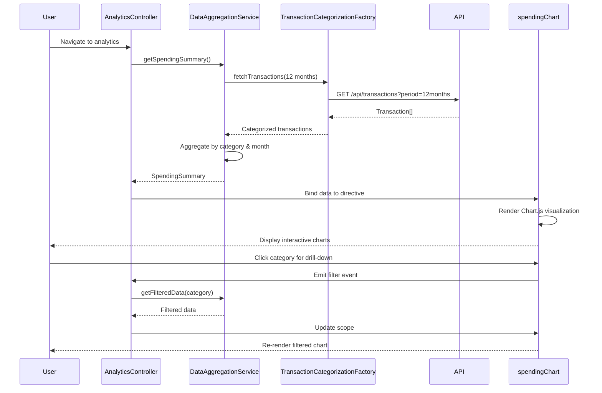

# Low-Level Design: QE-10506 - Analytics and Spending Insights

## a. Architecture Mapping

- **Analytics UI** → AngularJS Module (`analyticsModule`) + Controller (`AnalyticsController`)
- **Visualization Engine** → AngularJS Directive (`spendingChart`) wrapping Chart.js
- **Data Aggregation Service** → AngularJS Service (`DataAggregationService`) for trend computation
- **Transaction Categorization Service** → AngularJS Factory (`TransactionCategorizationFactory`) for REST API calls
- **Transaction Data Store** → Backend REST API endpoints (`/api/transactions`, `/api/spending/trends`)

**Folder Structure:**
```
app/
├── modules/analytics/
│   ├── analytics.module.js
│   ├── analytics.controller.js
│   ├── analytics.service.js
│   ├── analytics.html
├── services/
│   ├── data-aggregation.service.js
│   ├── transaction-categorization.factory.js
├── directives/
│   ├── spending-chart.directive.js
├── models/
│   ├── transaction.model.js
│   ├── spending-summary.model.js
```

## b. Component Specifications

| Name | Artifact Type | Responsibility | Key Dependencies |
|------|---------------|----------------|------------------|
| analyticsModule | Module | Root module for analytics feature | ngRoute, chart.js |
| AnalyticsController | Controller | Manages analytics view state and user interactions | DataAggregationService, TransactionCategorizationFactory, $scope |
| DataAggregationService | Service | Computes category-wise and monthly spending aggregations | TransactionCategorizationFactory, $q |
| TransactionCategorizationFactory | Factory | Fetches categorized transaction data from REST API | $http, $q |
| spendingChart | Directive | Renders interactive Chart.js visualizations with drill-down | Chart.js, $timeout |

## c. Data Model

**Transaction:**
```javascript
{
  id: String,
  cardId: String,
  amount: Number,
  category: String, // One of 9 predefined categories
  date: Date,
  merchant: String,
  description: String
}
```

**SpendingSummary:**
```javascript
{
  categoryBreakdown: [
    { category: String, totalAmount: Number, transactionCount: Number }
  ],
  monthlyTrends: [
    { month: String, totalSpend: Number, categoryData: Object }
  ],
  period: { startDate: Date, endDate: Date }
}
```

## d. Data Flow

User navigates to analytics view → AnalyticsController initializes and calls DataAggregationService.getSpendingSummary() → Service invokes TransactionCategorizationFactory.fetchTransactions() which makes GET request to `/api/transactions?period=12months` → API returns categorized transaction array → DataAggregationService aggregates data by category and month → Aggregated SpendingSummary returned to controller → Controller binds data to $scope → spendingChart directive watches scope changes and renders Chart.js visualizations → User clicks chart segment to drill down → Directive emits event → Controller filters data and updates scope → Chart re-renders with filtered view.

## e. Primary Sequence Diagram



## f. Implementation Notes

- Use AngularJS DI to inject DataAggregationService and TransactionCategorizationFactory into AnalyticsController for testability
- Implement client-side caching in DataAggregationService using $cacheFactory to avoid redundant API calls for 12-month data
- Use Chart.js with AngularJS directive wrapper for two-way data binding and responsive rendering
- Apply ES6 arrow functions and const/let for service and factory implementations
- Leverage $q promises for asynchronous data aggregation and chaining

## g. Error Handling

HTTP interceptor captures API errors; DataAggregationService wraps calls in try/catch; user notified via toast notification service on failure.

## h. Security Notes

Standard input validation and secure API calls assumed; category filtering performed client-side on already-fetched data to minimize attack surface.