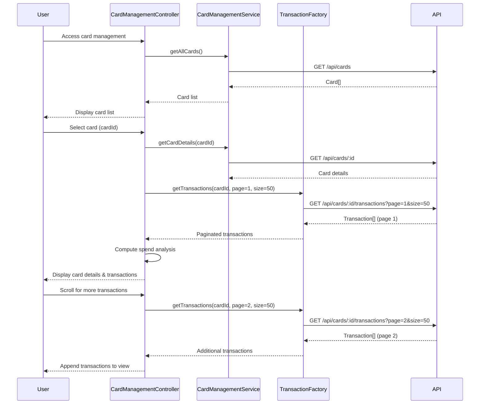

# Low-Level Design: QE-10507 - Multiple Credit Card Management and Monitoring

## a. Architecture Mapping

- **User Interface** → AngularJS Module (`cardManagementModule`) + Controller (`CardManagementController`)
- **Card Management Module** → AngularJS Service (`CardManagementService`) orchestrating card and transaction logic
- **Transaction Service** → AngularJS Factory (`TransactionFactory`) for paginated transaction API calls
- **Card Repository** → Backend REST API (`/api/cards`, `/api/cards/:id`)
- **Transaction Data Store** → Backend REST API (`/api/cards/:id/transactions?page=X&size=50`)

**Folder Structure:**
```
app/
├── modules/card-management/
│   ├── card-management.module.js
│   ├── card-management.controller.js
│   ├── card-list.html
│   ├── card-detail.html
├── services/
│   ├── card-management.service.js
│   ├── transaction.factory.js
├── models/
│   ├── card.model.js
│   ├── transaction.model.js
```

## b. Component Specifications

| Name | Artifact Type | Responsibility | Key Dependencies |
|------|---------------|----------------|------------------|
| cardManagementModule | Module | Root module for card management feature | ngRoute, ui.bootstrap |
| CardManagementController | Controller | Manages card list, selection, and detail views | CardManagementService, TransactionFactory, $scope, $routeParams |
| CardManagementService | Service | Orchestrates card retrieval, comparison logic, and spend analysis | TransactionFactory, $http, $q |
| TransactionFactory | Factory | Fetches paginated transaction data for selected card | $http, $q |

## c. Data Model

**Card:**
```javascript
{
  id: String,
  cardNumber: String, // Masked
  cardType: String, // Visa, MasterCard, etc.
  bankName: String,
  creditLimit: Number,
  availableCredit: Number,
  outstandingAmount: Number,
  expiryDate: String
}
```

**Transaction:**
```javascript
{
  id: String,
  cardId: String,
  amount: Number,
  date: Date,
  merchant: String,
  category: String,
  status: String // Posted, Pending
}
```

**CardSpendAnalysis:**
```javascript
{
  cardId: String,
  totalSpend: Number,
  transactionCount: Number,
  topCategories: [{ category: String, amount: Number }]
}
```

## d. Data Flow

User accesses card management view → CardManagementController calls CardManagementService.getAllCards() → Service makes GET request to `/api/cards` → API returns Card[] → Controller displays card list in view → User selects a card → Controller navigates to detail view with cardId → CardManagementService.getCardDetails(cardId) fetches card metadata → TransactionFactory.getTransactions(cardId, page=1, size=50) fetches first page of transactions from `/api/cards/:id/transactions` → Controller computes card-wise spend analysis from transaction data → Card details, transactions, and spend analysis rendered in UI → User scrolls to load more transactions → Controller calls TransactionFactory with incremented page number → Additional transactions appended to view.

## e. Primary Sequence Diagram



## f. Implementation Notes

- Use AngularJS $routeParams to pass cardId between list and detail views
- Implement infinite scroll using ng-infinite-scroll directive for transaction pagination
- CardManagementService maintains card comparison state using ES6 Map for O(1) lookup
- TransactionFactory caches paginated results per cardId using $cacheFactory to avoid redundant API calls
- Apply Bootstrap grid system for responsive card list and detail layouts

## g. Error Handling

HTTP interceptor handles API failures; CardManagementService uses $q.reject for error propagation; user notified via modal dialog on card retrieval failure.

## h. Security Notes

Card numbers masked on client-side; requires token-based auth via existing SSO for API access; all card data transmitted over HTTPS.