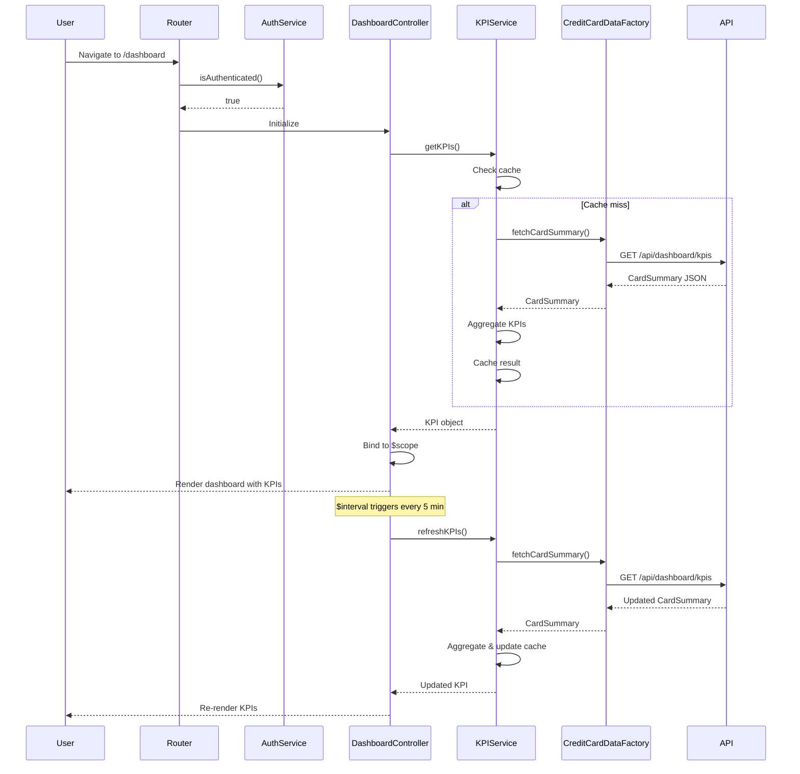

# Low-Level Design: QE-10508 - Dashboard and KPI Management

## a. Architecture Mapping

- **User Browser** → AngularJS SPA entry point
- **Authentication Service** → AngularJS Service (`AuthService`) wrapping SSO/token validation
- **Dashboard UI Component** → AngularJS Module (`dashboardModule`) + Controller (`DashboardController`)
- **KPI Calculation Engine** → AngularJS Service (`KPIService`) for aggregating financial metrics
- **Credit Card Data Service** → AngularJS Factory (`CreditCardDataFactory`) for REST API calls
- **Data Store** → Backend REST API (`/api/dashboard/kpis`, `/api/cards/summary`)

**Folder Structure:**
```
app/
├── modules/dashboard/
│   ├── dashboard.module.js
│   ├── dashboard.controller.js
│   ├── dashboard.html
├── services/
│   ├── auth.service.js
│   ├── kpi.service.js
│   ├── credit-card-data.factory.js
├── models/
│   ├── kpi.model.js
```

## b. Component Specifications

| Name | Artifact Type | Responsibility | Key Dependencies |
|------|---------------|----------------|------------------|
| dashboardModule | Module | Root module for dashboard feature | ngRoute, AuthService |
| DashboardController | Controller | Manages dashboard view state and KPI display | KPIService, AuthService, $scope, $interval |
| AuthService | Service | Handles user authentication and session management | $http, $window, $q |
| KPIService | Service | Computes and caches KPIs (monthly spend, credit limit, available credit, outstanding) | CreditCardDataFactory, $q, $cacheFactory |
| CreditCardDataFactory | Factory | Fetches raw credit card and transaction data from REST API | $http, $q |

## c. Data Model

**KPI:**
```javascript
{
  monthlySpend: Number,
  totalCreditLimit: Number,
  availableCredit: Number,
  outstandingAmount: Number,
  lastUpdated: Date
}
```

**CardSummary:**
```javascript
{
  userId: String,
  cards: [
    {
      cardId: String,
      creditLimit: Number,
      availableCredit: Number,
      currentBalance: Number
    }
  ],
  aggregatedSpend: { currentMonth: Number, lastMonth: Number }
}
```

## d. Data Flow

User accesses dashboard URL → AngularJS router checks authentication via AuthService.isAuthenticated() → If authenticated, DashboardController initializes → Controller calls KPIService.getKPIs() → KPIService checks $cacheFactory for cached data → If cache miss, KPIService invokes CreditCardDataFactory.fetchCardSummary() → Factory makes GET request to `/api/dashboard/kpis` → API returns CardSummary JSON → KPIService aggregates data (sum credit limits, compute available credit, calculate monthly spend from transactions) → Computed KPI object cached and returned to controller → Controller binds KPI data to $scope → Dashboard view renders KPI widgets using Bootstrap cards → $interval triggers KPIService.refreshKPIs() every 5 minutes → Updated KPIs re-rendered in view.

## e. Primary Sequence Diagram



## f. Implementation Notes

- Use AngularJS $interval service for configurable auto-refresh (default 5 minutes) of KPI data
- Implement route resolver in dashboardModule to pre-fetch KPIs before view renders, ensuring <2s load time
- KPIService uses $cacheFactory with TTL to balance real-time data and API load
- Apply Bootstrap responsive grid (col-md-3 for each KPI card) for mobile/tablet/desktop layouts
- Use ES6 template literals in KPIService for constructing API URLs with query parameters

## g. Error Handling

HTTP interceptor captures API errors; AuthService redirects to login on 401; KPIService displays cached data with stale indicator on refresh failure; user notified via toast.

## h. Security Notes

Requires token-based auth via existing SSO; AuthService stores JWT in sessionStorage; all API calls include Authorization header; dashboard route protected by AngularJS route guard.