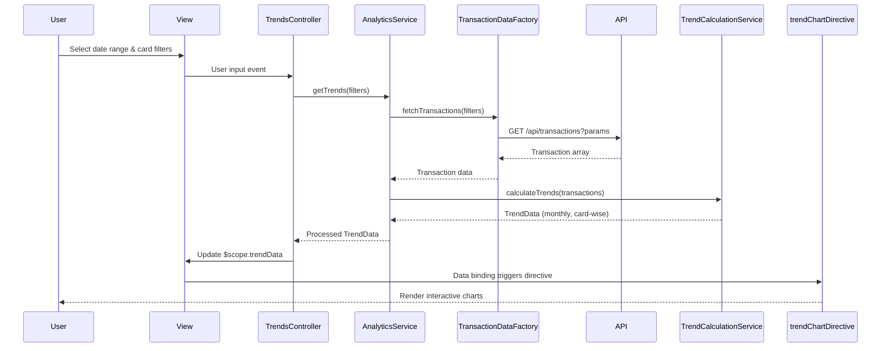

# Low-Level Design: QE-10527 - Spending Trends and Card-wise Analysis

## a. Architecture Mapping

- **User Interface** → AngularJS Module: `spendingTrendsModule` with Controller: `TrendsController` and View templates
- **Analytics Service** → AngularJS Service: `AnalyticsService` (orchestrates data retrieval and analysis)
- **Transaction Data Service** → AngularJS Factory: `TransactionDataFactory` (REST API integration for transaction data)
- **Analytics Engine** → AngularJS Service: `TrendCalculationService` (client-side aggregation and trend calculations)
- **Data Visualization Library** → Directive: `trendChartDirective` (wraps Chart.js/D3.js for rendering)

**Folder Structure:**
```
app/
├── modules/
│   └── spending-trends/
│       ├── controllers/
│       │   └── trends.controller.js
│       ├── services/
│       │   ├── analytics.service.js
│       │   └── trend-calculation.service.js
│       ├── factories/
│       │   └── transaction-data.factory.js
│       ├── directives/
│       │   └── trend-chart.directive.js
│       └── views/
│           └── trends-dashboard.html
```

## b. Component Specifications

| Name | Artifact Type | Responsibility | Key Dependencies |
|------|---------------|----------------|------------------|
| spendingTrendsModule | Module | Root module for spending trends feature | ngRoute, chart.js |
| TrendsController | Controller | Manages UI state, handles user interactions, coordinates data flow | AnalyticsService, $scope |
| AnalyticsService | Service | Orchestrates data retrieval, filtering, and visualization preparation | TransactionDataFactory, TrendCalculationService, $q |
| TransactionDataFactory | Factory | REST API calls to retrieve transaction history with filters | $http, $q |
| TrendCalculationService | Service | Aggregates transactions by month/card, calculates trends and comparisons | None |
| trendChartDirective | Directive | Renders interactive charts for monthly trends and card-wise breakdown | Chart.js/D3.js library |

## c. Data Model

**Transaction Model:**
```javascript
{
  transactionId: String,
  cardId: String,
  cardName: String,
  amount: Number,
  date: Date,
  category: String,
  merchant: String
}
```

**TrendData Model:**
```javascript
{
  monthlyTrends: [
    { month: String, totalSpend: Number, cardBreakdown: Array }
  ],
  cardWiseSpend: [
    { cardId: String, cardName: String, totalSpend: Number, percentage: Number }
  ],
  dateRange: { startDate: Date, endDate: Date }
}
```

## d. Data Flow

User selects time period and card filters in the view → TrendsController captures input and calls AnalyticsService.getTrends() → AnalyticsService invokes TransactionDataFactory to fetch transactions via REST API (GET /api/transactions?startDate=X&endDate=Y&cardId=Z) → Retrieved transaction array passed to TrendCalculationService for aggregation by month and card → Calculated TrendData returned to controller → Controller binds data to $scope → trendChartDirective watches scope changes and renders interactive charts using Chart.js, displaying monthly spend trends and card-wise breakdown with responsive design.

## e. Primary Sequence Diagram



## f. Implementation Notes

- Use AngularJS 1.x dependency injection to inject services/factories into controllers; follow strict DI annotation pattern for minification safety
- Implement TransactionDataFactory using $http service with promise-based API; cache responses using $cacheFactory for 5-minute TTL to reduce API calls
- TrendCalculationService uses ES6 Array methods (map, reduce, filter) for efficient client-side aggregation and grouping
- Integrate Chart.js via trendChartDirective with isolated scope; directive watches data changes and updates charts reactively
- Apply responsive design using Bootstrap grid system and CSS3 media queries; charts resize dynamically using Chart.js responsive configuration

## g. Error Handling

HTTP interceptor captures API errors; display user-friendly notifications using AngularJS $exceptionHandler and Bootstrap alerts; retry logic for transient failures.

## h. Security Notes

Requires token-based auth via existing SSO; API calls include auth token in headers; standard input validation and secure API calls assumed.