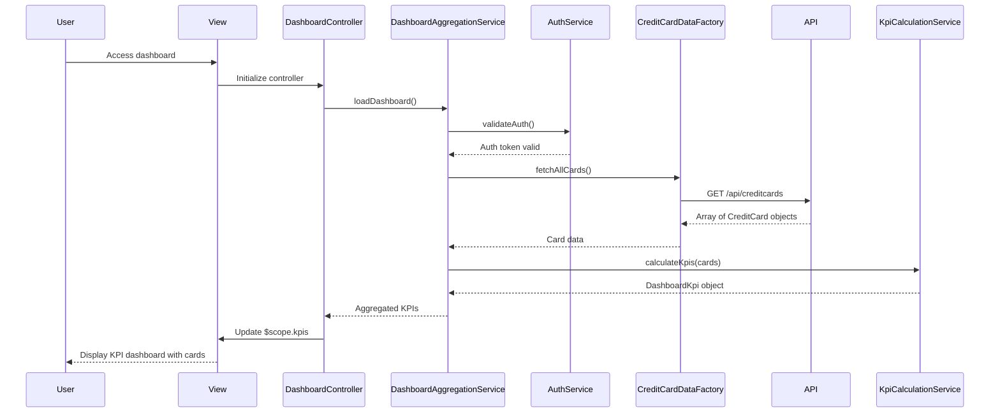

# Low-Level Design: QE-10528 - Dashboard KPIs and Credit Card Overview

## a. Architecture Mapping

- **User Interface** → AngularJS Module: `dashboardModule` with Controller: `DashboardController` and View templates
- **Dashboard Aggregation Service** → AngularJS Service: `DashboardAggregationService` (orchestrates KPI retrieval and calculation)
- **Credit Card Data Source System** → AngularJS Factory: `CreditCardDataFactory` (REST API integration for card data)
- **User Authentication Service** → AngularJS Service: `AuthService` (handles authentication state and token management)
- **Data Aggregation Service** → AngularJS Service: `KpiCalculationService` (aggregates multi-card data and computes KPIs)

**Folder Structure:**
```
app/
├── modules/
│   └── dashboard/
│       ├── controllers/
│       │   └── dashboard.controller.js
│       ├── services/
│       │   ├── dashboard-aggregation.service.js
│       │   ├── kpi-calculation.service.js
│       │   └── auth.service.js
│       ├── factories/
│       │   └── credit-card-data.factory.js
│       └── views/
│           └── dashboard.html
```

## b. Component Specifications

| Name | Artifact Type | Responsibility | Key Dependencies |
|------|---------------|----------------|------------------|
| dashboardModule | Module | Root module for dashboard feature | ngRoute, ui.bootstrap |
| DashboardController | Controller | Manages dashboard UI state, triggers data refresh, displays KPIs | DashboardAggregationService, $scope, $interval |
| DashboardAggregationService | Service | Coordinates authentication, data retrieval, and KPI calculation | AuthService, CreditCardDataFactory, KpiCalculationService, $q |
| CreditCardDataFactory | Factory | REST API calls to fetch credit card account details, balances, limits | $http, $q |
| KpiCalculationService | Service | Aggregates data from multiple cards, calculates total/available credit, monthly spend, outstanding amounts | None |
| AuthService | Service | Validates user authentication, manages auth tokens, enforces access control | $http, $window |

## c. Data Model

**CreditCard Model:**
```javascript
{
  cardId: String,
  cardName: String,
  cardNumber: String,
  creditLimit: Number,
  availableCredit: Number,
  outstandingAmount: Number,
  monthlySpend: Number,
  issuer: String
}
```

**DashboardKpi Model:**
```javascript
{
  totalCreditLimit: Number,
  totalAvailableCredit: Number,
  totalOutstanding: Number,
  totalMonthlySpend: Number,
  numberOfCards: Number,
  cards: Array<CreditCard>
}
```

## d. Data Flow

User accesses dashboard view → DashboardController initializes and calls DashboardAggregationService.loadDashboard() → Service checks authentication via AuthService → If authenticated, CreditCardDataFactory invokes REST API (GET /api/creditcards) to retrieve all user's credit card data → Card array passed to KpiCalculationService which aggregates totals (sum of limits, available credit, outstanding, monthly spend) → DashboardKpi object returned to controller → Controller binds KPIs to $scope → View renders KPI cards using Bootstrap responsive grid with real-time refresh via $interval polling every 2 minutes.

## e. Primary Sequence Diagram



## f. Implementation Notes

- Use AngularJS strict DI with array notation for all controllers/services to ensure minification compatibility
- CreditCardDataFactory implements $http with promise chaining; apply $q.all() for parallel API calls if multiple endpoints exist
- KpiCalculationService uses ES6 reduce() for summing card-level metrics; ensures 100% accuracy with Number.toFixed(2) for currency
- Implement auto-refresh using $interval service (2-minute polling); cancel interval on $scope.$on('$destroy') to prevent memory leaks
- Responsive layout using Bootstrap 3 grid (col-md-3 for KPI cards); CSS3 flexbox for mobile optimization

## g. Error Handling

HTTP interceptor-based error handling with $httpProvider; display Bootstrap modal alerts for API failures; retry mechanism with exponential backoff for transient errors.

## h. Security Notes

Requires token-based auth via existing SSO; AuthService manages JWT tokens in $window.sessionStorage; all API calls include Authorization header.