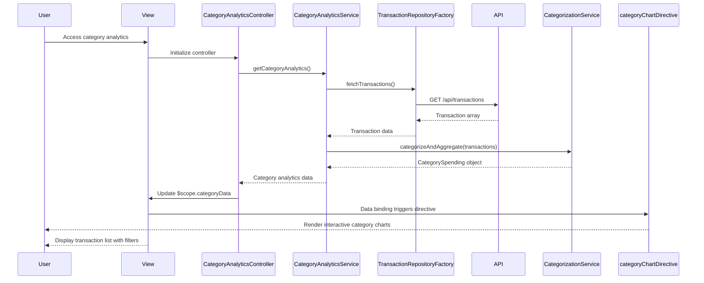

# Low-Level Design: QE-10529 - Category-wise Spending Analytics and Transactions

## a. Architecture Mapping

- **User Interface** → AngularJS Module: `categoryAnalyticsModule` with Controller: `CategoryAnalyticsController` and View templates
- **Analytics Dashboard Service** → AngularJS Service: `CategoryAnalyticsService` (orchestrates category analytics and transaction retrieval)
- **Transaction Categorization Service** → AngularJS Service: `CategorizationService` (applies category mapping and aggregation logic)
- **Transaction Data Repository** → AngularJS Factory: `TransactionRepositoryFactory` (REST API integration for transaction data)
- **Data Visualization Framework** → Directive: `categoryChartDirective` (renders pie/bar charts for category breakdown)

**Folder Structure:**
```
app/
├── modules/
│   └── category-analytics/
│       ├── controllers/
│       │   └── category-analytics.controller.js
│       ├── services/
│       │   ├── category-analytics.service.js
│       │   └── categorization.service.js
│       ├── factories/
│       │   └── transaction-repository.factory.js
│       ├── directives/
│       │   └── category-chart.directive.js
│       └── views/
│           └── category-analytics.html
```

## b. Component Specifications

| Name | Artifact Type | Responsibility | Key Dependencies |
|------|---------------|----------------|------------------|
| categoryAnalyticsModule | Module | Root module for category analytics feature | ngRoute, ngTable, chart.js |
| CategoryAnalyticsController | Controller | Manages UI state, handles filtering/search, displays category breakdown and transaction list | CategoryAnalyticsService, $scope, $filter |
| CategoryAnalyticsService | Service | Orchestrates transaction retrieval, categorization, and visualization data preparation | TransactionRepositoryFactory, CategorizationService, $q |
| CategorizationService | Service | Maps transactions to 9 predefined categories, aggregates spending by category | None |
| TransactionRepositoryFactory | Factory | REST API calls to fetch transaction data with filtering/sorting support | $http, $q |
| categoryChartDirective | Directive | Renders interactive pie/bar charts for category-wise spending visualization | Chart.js library |

## c. Data Model

**Transaction Model:**
```javascript
{
  transactionId: String,
  cardId: String,
  amount: Number,
  date: Date,
  merchant: String,
  category: String, // One of 9 predefined categories
  description: String
}
```

**CategorySpending Model:**
```javascript
{
  categories: [
    { name: String, amount: Number, percentage: Number, transactionCount: Number }
  ],
  totalSpend: Number,
  transactions: Array<Transaction>
}
```

**Predefined Categories:**
```javascript
['Food & Dining', 'Fuel', 'Shopping', 'Travel', 'Entertainment', 'Utilities', 'Healthcare', 'Education', 'Miscellaneous']
```

## d. Data Flow

User accesses category analytics view → CategoryAnalyticsController calls CategoryAnalyticsService.getCategoryAnalytics() → Service invokes TransactionRepositoryFactory to fetch transactions via REST API (GET /api/transactions) → Transaction array passed to CategorizationService which groups transactions by category and calculates totals/percentages for each of the 9 categories → CategorySpending object returned to controller → Controller binds data to $scope → categoryChartDirective renders interactive pie/bar chart showing category breakdown → Transaction list displayed in ng-table with client-side filtering/sorting → User interactions (filter/search) trigger $scope updates and re-render visualizations.

## e. Primary Sequence Diagram



## f. Implementation Notes

- Use AngularJS strict DI pattern with inline array annotation for all components to support minification
- TransactionRepositoryFactory uses $http with promise-based API; implement client-side caching with $cacheFactory (10-minute TTL)
- CategorizationService uses ES6 Map for efficient category grouping; reduce() for aggregation; ensures 100% accuracy in calculations
- Integrate ng-table directive for transaction list with built-in sorting, filtering, and pagination support
- categoryChartDirective wraps Chart.js with isolated scope; implements responsive configuration and interactive tooltips; uses CSS3 for mobile responsiveness

## g. Error Handling

HTTP interceptor captures API errors; user notifications via Bootstrap toasts; try/catch blocks in CategorizationService for data validation; fallback to 'Miscellaneous' for unmapped categories.

## h. Security Notes

Standard input validation and secure API calls assumed; category mapping rules stored server-side to prevent client-side tampering.