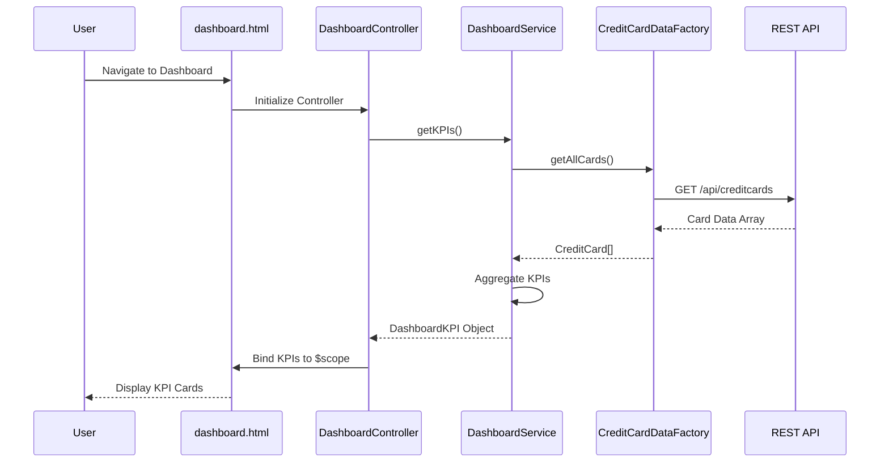

# Low-Level Design: QE-10530 - Dashboard KPIs and Credit Card Overview

## a. Architecture Mapping

**HLD to AngularJS Artifact Mapping:**
- User Interface → AngularJS Module: `dashboard.module.js` + Controller: `DashboardController.js` + View: `dashboard.html`
- Dashboard Service → AngularJS Service: `DashboardService.js` (handles KPI aggregation logic)
- Credit Card Data Service → AngularJS Factory: `CreditCardDataFactory.js` (REST API integration)
- User Authentication Service → AngularJS Service: `AuthService.js` (session and token management)
- Data Repository → Backend REST API endpoints

**Recommended Folder Structure:**
```
app/
├── modules/
│   └── dashboard/
│       ├── dashboard.module.js
│       ├── controllers/
│       │   └── DashboardController.js
│       ├── services/
│       │   └── DashboardService.js
│       ├── factories/
│       │   └── CreditCardDataFactory.js
│       └── views/
│           └── dashboard.html
├── shared/
│   └── services/
│       └── AuthService.js
└── assets/
    ├── css/
    └── js/
```

## b. Component Specifications

| Component Name | Artifact Type | Responsibility | Key Dependencies |
|----------------|---------------|----------------|------------------|
| dashboard.module | Module | Declares dashboard feature module and routes | ngRoute, ui.bootstrap |
| DashboardController | Controller | Manages dashboard view state, fetches and displays KPIs | DashboardService, $scope |
| DashboardService | Service | Aggregates KPI data from multiple cards (monthly spend, credit limit, available credit, outstanding) | CreditCardDataFactory |
| CreditCardDataFactory | Factory | Fetches credit card data from REST API endpoints | $http, $q |
| AuthService | Service | Validates user session and provides authentication token for API calls | $http, $window |
| dashboard.html | View/Template | Renders KPI cards with Bootstrap grid layout, responsive design | Bootstrap CSS |

## c. Data Model

**CreditCard Object:**
```javascript
{
  cardId: String,
  cardNumber: String,
  cardType: String,
  creditLimit: Number,
  availableCredit: Number,
  outstandingAmount: Number,
  monthlySpend: Number
}
```

**DashboardKPI Object:**
```javascript
{
  totalMonthlySpend: Number,
  totalCreditLimit: Number,
  totalAvailableCredit: Number,
  totalOutstanding: Number,
  cardCount: Number
}
```

## d. Data Flow

User navigates to the dashboard view, triggering DashboardController initialization. The controller calls DashboardService.getKPIs(), which invokes CreditCardDataFactory.getAllCards() to fetch all credit card data via REST API (GET /api/creditcards). AuthService injects the authentication token into the request header. Upon receiving the response, DashboardService aggregates KPI metrics (sum of monthly spend, credit limits, available credit, outstanding amounts) and returns the DashboardKPI object to the controller. The controller binds this data to $scope, and the dashboard.html view renders the KPIs in responsive Bootstrap card components.

## e. Primary Sequence Diagram



## f. Implementation Notes

- Use AngularJS dependency injection to inject DashboardService and CreditCardDataFactory into DashboardController.
- Implement CreditCardDataFactory using $http service with promise-based API calls; use $q for error handling.
- Apply Bootstrap grid system (col-md-3, col-sm-6, col-xs-12) for responsive KPI card layout across devices.
- Use ES6 arrow functions and const/let for cleaner service and factory implementations.
- Implement $http interceptor in AuthService to automatically attach authentication tokens to all API requests.

## g. Error Handling

Use $http interceptor to catch API errors globally; display user-friendly error notifications via Bootstrap alerts and log errors to console.

## h. Security Notes

Requires token-based authentication via existing SSO; AuthService manages token injection into API request headers.