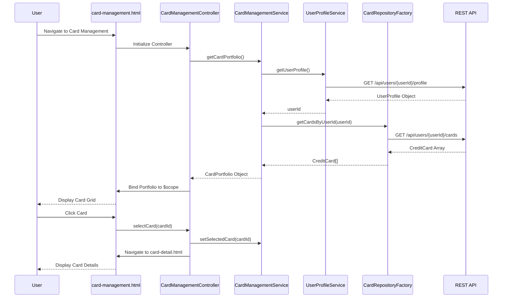

# Low-Level Design: QE-10531 - Multiple Credit Card Management

## a. Architecture Mapping

**HLD to AngularJS Artifact Mapping:**
- User Interface → AngularJS Module: `cardManagement.module.js` + Controller: `CardManagementController.js` + View: `card-management.html`
- Card Management Service → AngularJS Service: `CardManagementService.js` (handles card selection, switching, portfolio logic)
- Credit Card Data Repository → AngularJS Factory: `CardRepositoryFactory.js` (REST API integration for card CRUD)
- User Profile Service → AngularJS Service: `UserProfileService.js` (user-card association management)

**Recommended Folder Structure:**
```
app/
├── modules/
│   └── cardManagement/
│       ├── cardManagement.module.js
│       ├── controllers/
│       │   └── CardManagementController.js
│       ├── services/
│       │   └── CardManagementService.js
│       ├── factories/
│       │   └── CardRepositoryFactory.js
│       ├── directives/
│       │   └── cardListDirective.js
│       └── views/
│           ├── card-management.html
│           └── card-detail.html
├── shared/
│   └── services/
│       └── UserProfileService.js
└── assets/
```

## b. Component Specifications

| Component Name | Artifact Type | Responsibility | Key Dependencies |
|----------------|---------------|----------------|------------------|
| cardManagement.module | Module | Declares card management feature module and routes | ngRoute, ui.bootstrap |
| CardManagementController | Controller | Manages card list view, card selection, and detail navigation | CardManagementService, $scope, $location |
| CardManagementService | Service | Maintains selected card state, provides card switching logic and portfolio summary | CardRepositoryFactory, UserProfileService |
| CardRepositoryFactory | Factory | Fetches user's credit cards from REST API (GET /api/users/{userId}/cards) | $http, $q |
| UserProfileService | Service | Retrieves user profile and associated card IDs | $http |
| cardListDirective | Directive | Renders individual card tiles with card details and selection handler | None |
| card-management.html | View/Template | Displays card portfolio grid with Bootstrap cards, card selection UI | Bootstrap CSS |
| card-detail.html | View/Template | Displays detailed information for a selected card | Bootstrap CSS |

## c. Data Model

**CreditCard Object:**
```javascript
{
  cardId: String,
  userId: String,
  cardNumber: String,
  cardHolderName: String,
  cardType: String,
  bankName: String,
  creditLimit: Number,
  availableCredit: Number,
  outstandingAmount: Number,
  expiryDate: String,
  isActive: Boolean
}
```

**UserProfile Object:**
```javascript
{
  userId: String,
  userName: String,
  email: String,
  cardIds: Array<String>
}
```

**CardPortfolio Object:**
```javascript
{
  totalCards: Number,
  activeCards: Number,
  cards: Array<CreditCard>
}
```

## d. Data Flow

User navigates to the card management view, triggering CardManagementController initialization. The controller calls CardManagementService.getCardPortfolio(), which first invokes UserProfileService.getUserProfile() to retrieve the user's associated card IDs, then calls CardRepositoryFactory.getCardsByUserId(userId) to fetch all card details via REST API (GET /api/users/{userId}/cards). The factory returns an array of CreditCard objects, which the service wraps in a CardPortfolio object and returns to the controller. The controller binds the portfolio to $scope, and card-management.html renders the card list using the cardListDirective. When a user clicks a card, the controller updates the selected card state in CardManagementService and navigates to card-detail.html to display detailed information.

## e. Primary Sequence Diagram



## f. Implementation Notes

- Use AngularJS $routeParams to pass cardId when navigating to card-detail.html for selected card display.
- Implement CardManagementService as a singleton to maintain selected card state across controller instances.
- Use cardListDirective with isolated scope to encapsulate card tile rendering and click event handling.
- Apply Bootstrap card component (card, card-body, card-title) for consistent card UI across the portfolio grid.
- Use ES6 template literals for dynamic API endpoint construction in CardRepositoryFactory.

## g. Error Handling

Implement try/catch blocks in service methods with user-friendly error messages displayed via Bootstrap toast notifications; log API errors to console.

## h. Security Notes

Card data must be transmitted over HTTPS; sensitive card numbers should be masked (show last 4 digits only) in the UI; token-based auth via existing SSO.