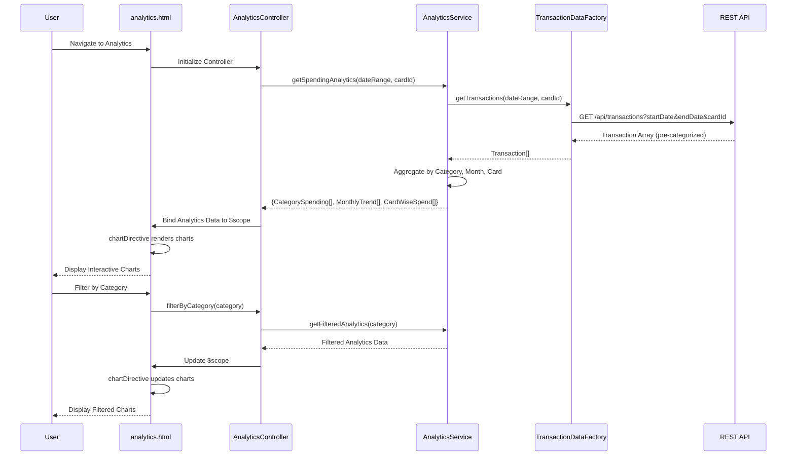

# Low-Level Design: QE-10532 - Spending Analytics and Insights

## a. Architecture Mapping

**HLD to AngularJS Artifact Mapping:**
- User Interface → AngularJS Module: `analytics.module.js` + Controller: `AnalyticsController.js` + View: `analytics.html`
- Analytics Service → AngularJS Service: `AnalyticsService.js` (handles analytics logic, filtering, aggregation)
- Transaction Data Service → AngularJS Factory: `TransactionDataFactory.js` (REST API integration for transaction data)
- Analytics Engine → Backend REST API endpoint (server-side processing)
- Charting Library → AngularJS Directive: `chartDirective.js` (wraps Chart.js or D3.js for rendering)

**Recommended Folder Structure:**
```
app/
├── modules/
│   └── analytics/
│       ├── analytics.module.js
│       ├── controllers/
│       │   └── AnalyticsController.js
│       ├── services/
│       │   └── AnalyticsService.js
│       ├── factories/
│       │   └── TransactionDataFactory.js
│       ├── directives/
│       │   └── chartDirective.js
│       └── views/
│           └── analytics.html
├── shared/
│   └── filters/
│       └── categoryFilter.js
└── assets/
    └── libs/
        └── chart.js
```

## b. Component Specifications

| Component Name | Artifact Type | Responsibility | Key Dependencies |
|----------------|---------------|----------------|------------------|
| analytics.module | Module | Declares analytics feature module, routes, and chart library integration | ngRoute, chart.js |
| AnalyticsController | Controller | Manages analytics view state, handles user interactions (filter, drill-down), fetches spending data | AnalyticsService, $scope, $filter |
| AnalyticsService | Service | Processes transaction data, aggregates category-wise and card-wise spending, calculates monthly trends | TransactionDataFactory |
| TransactionDataFactory | Factory | Fetches transaction history from REST API (GET /api/transactions) with query parameters for date range and cardId | $http, $q |
| chartDirective | Directive | Renders interactive charts (bar, pie, line) using Chart.js; handles chart updates on data change | chart.js library |
| categoryFilter | Filter | Filters transactions by selected category for drill-down analysis | None |
| analytics.html | View/Template | Displays category-wise spending charts, monthly trends, card-wise breakdown with Bootstrap layout | Bootstrap CSS, chart.js |

## c. Data Model

**Transaction Object:**
```javascript
{
  transactionId: String,
  cardId: String,
  amount: Number,
  category: String,
  date: String,
  merchantName: String,
  description: String
}
```

**CategorySpending Object:**
```javascript
{
  category: String,
  totalAmount: Number,
  transactionCount: Number,
  percentage: Number
}
```

**MonthlyTrend Object:**
```javascript
{
  month: String,
  totalSpend: Number,
  categoryBreakdown: Array<CategorySpending>
}
```

**CardWiseSpend Object:**
```javascript
{
  cardId: String,
  cardName: String,
  totalSpend: Number,
  categoryBreakdown: Array<CategorySpending>
}
```

## d. Data Flow

User navigates to the analytics view, triggering AnalyticsController initialization. The controller calls AnalyticsService.getSpendingAnalytics(dateRange, cardId), which invokes TransactionDataFactory.getTransactions(dateRange, cardId) to fetch transaction data via REST API (GET /api/transactions?startDate=X&endDate=Y&cardId=Z). The backend Analytics Engine pre-categorizes transactions into the nine predefined categories. TransactionDataFactory returns the transaction array to AnalyticsService, which aggregates data into CategorySpending, MonthlyTrend, and CardWiseSpend objects. The service returns these analytics objects to the controller, which binds them to $scope. The analytics.html view uses chartDirective to render category-wise pie chart, monthly trend line chart, and card-wise bar chart. User interactions (filter by category, select date range) trigger controller methods that update the data and refresh the charts.

## e. Primary Sequence Diagram



## f. Implementation Notes

- Use Chart.js library integrated via chartDirective with isolated scope; directive watches for data changes and updates charts dynamically.
- Implement AnalyticsService methods using ES6 array methods (map, filter, reduce) for efficient data aggregation and transformation.
- Use $http service with query parameters in TransactionDataFactory for flexible date range and card filtering.
- Apply Bootstrap grid (col-md-4 for three charts side-by-side on desktop, col-xs-12 for stacked mobile view) for responsive chart layout.
- Implement debouncing on filter inputs using $timeout to minimize API calls during user interaction.

## g. Error Handling

Use $http interceptor for global API error handling; display user-friendly error messages via Bootstrap alerts; implement try/catch in aggregation logic with fallback to empty data arrays.

## h. Security Notes

Standard input validation and secure API calls assumed; transaction data access restricted to authenticated users via token-based auth.