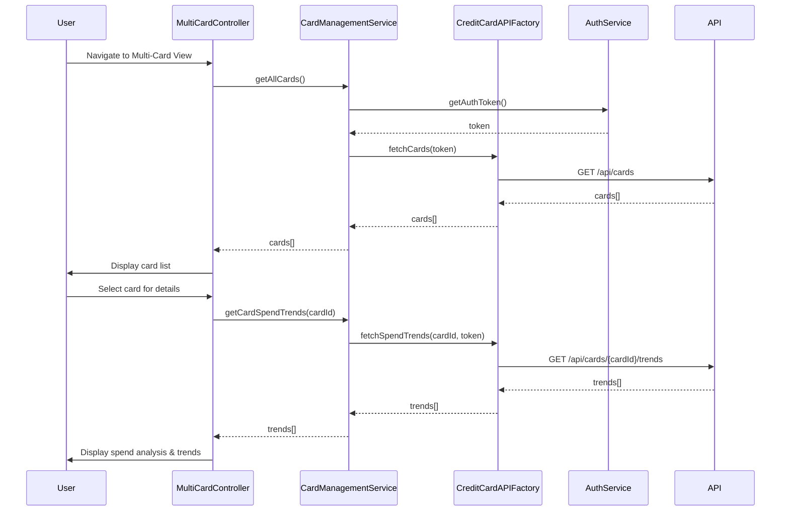

# Low-Level Design: QE-10533 - Multiple Credit Card Management

## a. Architecture Mapping

- **User Interface Multi-Card View** → AngularJS Module (`creditCardModule`) + Controller (`MultiCardController`) + Directive (`cardListDirective`)
- **Card Management Service** → AngularJS Service (`CardManagementService`) for business logic and state management
- **Credit Card Data Service Integration** → AngularJS Factory (`CreditCardAPIFactory`) for REST API calls
- **User Authentication Service Integration** → AngularJS Service (`AuthService`) for token-based authentication
- **Card Display & Comparison Views** → AngularJS Directives (`cardDetailDirective`, `cardComparisonDirective`) + HTML5 templates

**Recommended Folder Structure:**
```
app/
├── modules/
│   └── creditCard/
│       ├── controllers/
│       │   └── multiCardController.js
│       ├── services/
│       │   ├── cardManagementService.js
│       │   └── authService.js
│       ├── factories/
│       │   └── creditCardAPIFactory.js
│       ├── directives/
│       │   ├── cardListDirective.js
│       │   ├── cardDetailDirective.js
│       │   └── cardComparisonDirective.js
│       ├── views/
│       │   ├── multi-card-view.html
│       │   └── card-comparison.html
│       └── creditCardModule.js
```

## b. Component Specifications

| Name | Artifact Type | Responsibility | Key Dependencies |
|------|---------------|----------------|------------------|
| creditCardModule | Module | Root module for credit card features | ngRoute, ngResource |
| MultiCardController | Controller | Manages multi-card view state, fetches card list, handles user interactions | CardManagementService, $scope |
| CardManagementService | Service | Business logic for card operations, caching, spend analysis aggregation | CreditCardAPIFactory, AuthService |
| CreditCardAPIFactory | Factory | REST API calls to retrieve card data, balances, and spend trends | $http, $q |
| AuthService | Service | Token management, user authentication, card ownership validation | $http, $window |
| cardListDirective | Directive | Renders list of credit cards with individual card summaries | CardManagementService |
| cardDetailDirective | Directive | Displays detailed view for a single card including spend analysis | CardManagementService |
| cardComparisonDirective | Directive | Enables side-by-side comparison of multiple cards | CardManagementService |

## c. Data Model

**CreditCard Object:**
```javascript
{
  cardId: String,
  cardNumber: String,
  cardHolderName: String,
  cardType: String,
  creditLimit: Number,
  availableCredit: Number,
  outstandingAmount: Number,
  monthlySpend: Number,
  issuedDate: Date,
  expiryDate: Date,
  status: String
}
```

**CardSpendTrend Object:**
```javascript
{
  cardId: String,
  month: String,
  totalSpend: Number,
  categoryBreakdown: Array<{category: String, amount: Number}>
}
```

**User Object (subset):**
```javascript
{
  userId: String,
  registeredCards: Array<String>
}
```

## d. Data Flow

User navigates to the multi-card view, triggering `MultiCardController` initialization. The controller invokes `CardManagementService.getAllCards()`, which calls `CreditCardAPIFactory.fetchCards()` to retrieve card data via REST API (`GET /api/cards`). `AuthService` injects the authentication token in the request header. The API response (array of `CreditCard` objects) is cached in `CardManagementService` and bound to `$scope.cards`. The view renders card summaries using `cardListDirective`. User selects a card for detailed analysis, triggering `CardManagementService.getCardSpendTrends(cardId)`, which fetches monthly spend data (`GET /api/cards/{cardId}/trends`). The directive updates the UI with spend charts and comparison views.

## e. Primary Sequence Diagram



## f. Implementation Notes

- Use AngularJS Dependency Injection for all services, factories, and controllers to ensure modularity and testability.
- Implement client-side caching in `CardManagementService` using a simple in-memory object to store fetched cards and reduce API calls.
- Use `$http` interceptor pattern for adding authentication tokens to all outgoing API requests.
- Leverage ES6 arrow functions, template literals, and `const`/`let` for cleaner, modern JavaScript code.
- Use Bootstrap grid system and responsive utilities for mobile-first card layout; ensure card comparison view adapts to smaller screens.

## g. Error Handling

HTTP interceptor captures API errors; user-friendly notifications displayed via AngularJS `$rootScope` broadcast and toast directive.

## h. Security Notes

Requires token-based authentication via existing SSO; card ownership validated server-side before returning data.