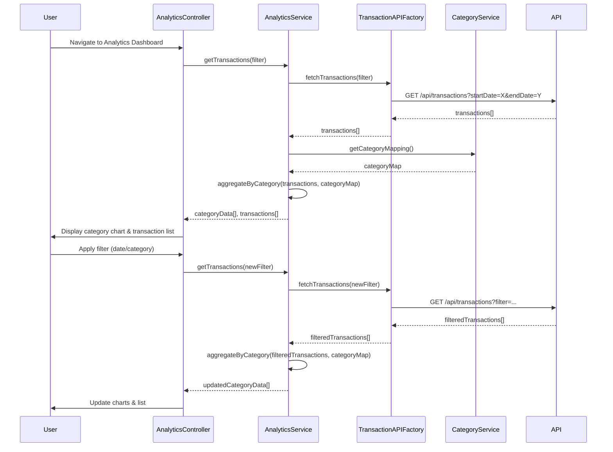

# Low-Level Design: QE-10534 - Transaction Analytics and Category-wise Spending

## a. Architecture Mapping

- **User Interface Analytics Dashboard** → AngularJS Module (`analyticsModule`) + Controller (`AnalyticsController`) + Directive (`categoryChartDirective`)
- **Analytics Engine Integration** → AngularJS Service (`AnalyticsService`) for data aggregation and processing
- **Transaction Data Service Integration** → AngularJS Factory (`TransactionAPIFactory`) for REST API calls
- **Category Classification Service Integration** → AngularJS Service (`CategoryService`) for category mapping and filtering
- **Interactive Charts** → AngularJS Directive (`transactionChartDirective`) integrating Chart.js or D3.js for visualizations

**Recommended Folder Structure:**
```
app/
├── modules/
│   └── analytics/
│       ├── controllers/
│       │   └── analyticsController.js
│       ├── services/
│       │   ├── analyticsService.js
│       │   └── categoryService.js
│       ├── factories/
│       │   └── transactionAPIFactory.js
│       ├── directives/
│       │   ├── categoryChartDirective.js
│       │   └── transactionChartDirective.js
│       ├── views/
│       │   ├── analytics-dashboard.html
│       │   └── transaction-list.html
│       └── analyticsModule.js
```

## b. Component Specifications

| Name | Artifact Type | Responsibility | Key Dependencies |
|------|---------------|----------------|------------------|
| analyticsModule | Module | Root module for transaction analytics features | ngRoute, ngResource |
| AnalyticsController | Controller | Manages analytics dashboard state, filters, and user interactions | AnalyticsService, CategoryService, $scope |
| AnalyticsService | Service | Aggregates transaction data, calculates category-wise spending, applies filters | TransactionAPIFactory, CategoryService |
| TransactionAPIFactory | Factory | REST API calls to retrieve transaction records | $http, $q |
| CategoryService | Service | Manages predefined categories, provides category mapping and filtering logic | None |
| categoryChartDirective | Directive | Renders category-wise spending pie/bar chart using Chart.js | AnalyticsService |
| transactionChartDirective | Directive | Renders interactive transaction trend line chart | AnalyticsService |

## c. Data Model

**Transaction Object:**
```javascript
{
  transactionId: String,
  cardId: String,
  amount: Number,
  category: String,
  merchant: String,
  transactionDate: Date,
  description: String,
  status: String
}
```

**CategorySpending Object:**
```javascript
{
  category: String,
  totalAmount: Number,
  transactionCount: Number,
  percentage: Number
}
```

**AnalyticsFilter Object:**
```javascript
{
  startDate: Date,
  endDate: Date,
  categories: Array<String>,
  cardIds: Array<String>
}
```

**Predefined Categories Array:**
```javascript
['Food & Dining', 'Fuel', 'Shopping', 'Travel', 'Entertainment', 'Utilities', 'Healthcare', 'Education', 'Miscellaneous']
```

## d. Data Flow

User accesses the analytics dashboard, triggering `AnalyticsController` initialization. The controller invokes `AnalyticsService.getTransactions(filter)`, which calls `TransactionAPIFactory.fetchTransactions()` to retrieve transaction data via REST API (`GET /api/transactions?startDate=X&endDate=Y`). The API returns an array of `Transaction` objects. `AnalyticsService` aggregates transactions by category using `CategoryService.getCategoryMapping()`, calculating totals and percentages to produce `CategorySpending` objects. The aggregated data is bound to `$scope.categoryData` and `$scope.transactions`. The `categoryChartDirective` renders a pie chart visualizing category-wise spending, while the `transactionChartDirective` displays a monthly trend line chart. User applies filters (date range, category), triggering re-aggregation and chart updates.

## e. Primary Sequence Diagram



## f. Implementation Notes

- Use Chart.js library integrated via AngularJS directive for responsive, interactive charts; bind chart data to scope variables for automatic updates.
- Implement client-side aggregation in `AnalyticsService` using ES6 `Array.reduce()` for efficient category-wise summation.
- Use AngularJS `$filter` service for date range filtering and sorting transaction lists.
- Leverage ES6 arrow functions and destructuring for cleaner data transformation logic.
- Implement pagination or virtual scrolling for transaction list if count exceeds 1000 to maintain UI responsiveness.

## g. Error Handling

HTTP interceptor captures API errors; fallback to empty state with user notification via toast component.

## h. Security Notes

Standard input validation and secure API calls assumed; transaction data filtered server-side by authenticated user.