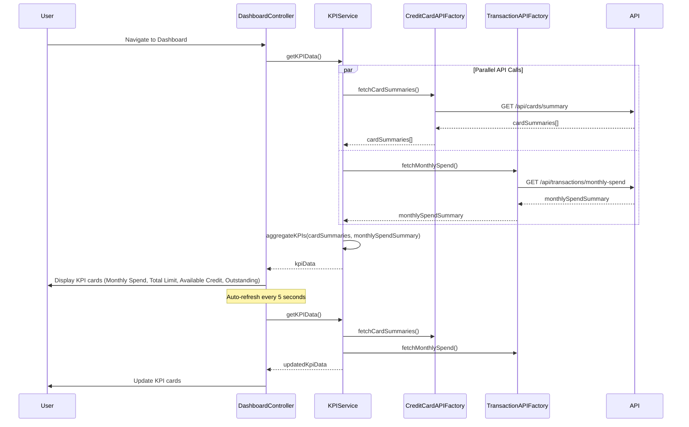

# Low-Level Design: QE-10535 - Credit Card Dashboard and KPIs

## a. Architecture Mapping

- **User Interface Dashboard** → AngularJS Module (`dashboardModule`) + Controller (`DashboardController`) + Directive (`kpiCardDirective`)
- **KPI Aggregation Service** → AngularJS Service (`KPIService`) for aggregating and calculating KPI metrics
- **Credit Card Data Service Integration** → AngularJS Factory (`CreditCardAPIFactory`) for REST API calls to retrieve card data
- **Transaction Processing Service Integration** → AngularJS Factory (`TransactionAPIFactory`) for REST API calls to calculate monthly spend
- **Responsive Dashboard Layout** → Bootstrap grid system + AngularJS Directive (`responsiveDashboardDirective`)

**Recommended Folder Structure:**
```
app/
├── modules/
│   └── dashboard/
│       ├── controllers/
│       │   └── dashboardController.js
│       ├── services/
│       │   └── kpiService.js
│       ├── factories/
│       │   ├── creditCardAPIFactory.js
│       │   └── transactionAPIFactory.js
│       ├── directives/
│       │   ├── kpiCardDirective.js
│       │   └── responsiveDashboardDirective.js
│       ├── views/
│       │   └── dashboard.html
│       └── dashboardModule.js
```

## b. Component Specifications

| Name | Artifact Type | Responsibility | Key Dependencies |
|------|---------------|----------------|------------------|
| dashboardModule | Module | Root module for dashboard features | ngRoute, ngResource |
| DashboardController | Controller | Manages dashboard state, fetches KPI data, handles refresh logic | KPIService, $scope, $interval |
| KPIService | Service | Aggregates data from multiple sources, calculates KPIs (monthly spend, total limit, available credit, outstanding) | CreditCardAPIFactory, TransactionAPIFactory |
| CreditCardAPIFactory | Factory | REST API calls to retrieve card balances, limits, and outstanding amounts | $http, $q |
| TransactionAPIFactory | Factory | REST API calls to calculate monthly spend | $http, $q |
| kpiCardDirective | Directive | Renders individual KPI card with value, label, and icon | None |
| responsiveDashboardDirective | Directive | Manages responsive layout and grid arrangement for KPI cards | None |

## c. Data Model

**KPIData Object:**
```javascript
{
  monthlySpend: Number,
  totalCreditLimit: Number,
  availableCredit: Number,
  outstandingAmount: Number,
  lastUpdated: Date
}
```

**CreditCardSummary Object:**
```javascript
{
  cardId: String,
  creditLimit: Number,
  availableCredit: Number,
  outstandingAmount: Number
}
```

**MonthlySpendSummary Object:**
```javascript
{
  currentMonth: String,
  totalSpend: Number
}
```

## d. Data Flow

User navigates to the dashboard, triggering `DashboardController` initialization. The controller invokes `KPIService.getKPIData()`, which makes parallel API calls via `CreditCardAPIFactory.fetchCardSummaries()` (`GET /api/cards/summary`) and `TransactionAPIFactory.fetchMonthlySpend()` (`GET /api/transactions/monthly-spend`). The API responses return arrays of `CreditCardSummary` and `MonthlySpendSummary` objects. `KPIService` aggregates the data: sums all card credit limits for total credit limit, sums available credit across cards, sums outstanding amounts, and retrieves monthly spend from transaction summary. The aggregated `KPIData` object is bound to `$scope.kpiData`. The view renders four KPI cards using `kpiCardDirective`, each displaying a metric. `$interval` triggers automatic refresh every 5 seconds, re-fetching data and updating the UI.

## e. Primary Sequence Diagram



## f. Implementation Notes

- Use `$q.all()` in `KPIService` to execute parallel API calls for card summaries and monthly spend, improving load time.
- Implement `$interval` service in `DashboardController` for automatic KPI refresh every 5 seconds; cancel interval on scope destruction to prevent memory leaks.
- Use Bootstrap grid classes (`col-md-3`, `col-sm-6`, `col-xs-12`) in `responsiveDashboardDirective` for responsive KPI card layout.
- Leverage ES6 `Array.reduce()` for summing credit limits, available credit, and outstanding amounts across multiple cards.
- Cache KPI data in `KPIService` for 5 seconds to avoid redundant API calls during rapid navigation.

## g. Error Handling

HTTP interceptor captures API failures; display fallback KPI values (0 or 'N/A') with error notification banner.

## h. Security Notes

Requires token-based auth via existing SSO; all API endpoints validate user session before returning aggregated data.