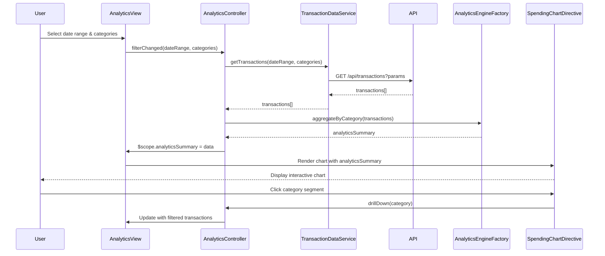

# Low-Level Design: QE-10536 - Spending Analytics and Category Insights

## a. Architecture Mapping

- **Analytics UI Module** → AngularJS Module (`app.analytics`)
- **Analytics Controller** → AngularJS Controller (`AnalyticsController`)
- **Transaction Data Service** → AngularJS Service (`TransactionDataService`)
- **Analytics Engine Client** → AngularJS Factory (`AnalyticsEngineFactory`)
- **Category Filter Directive** → AngularJS Directive (`categoryFilter`)
- **Chart Visualization Directive** → AngularJS Directive (`spendingChart`)

**Recommended Folder Structure:**
```
/app
  /analytics
    analytics.module.js
    analytics.controller.js
    analytics.service.js
    analytics.factory.js
    /directives
      category-filter.directive.js
      spending-chart.directive.js
    /views
      analytics.html
```

## b. Component Specifications

| Name | Artifact Type | Responsibility | Key Dependencies |
|------|--------------|----------------|------------------|
| AnalyticsModule | Module | Registers analytics feature components and routes | angular, ui.router, chart.js |
| AnalyticsController | Controller | Manages analytics view state, user interactions, and data binding | TransactionDataService, AnalyticsEngineFactory, $scope |
| TransactionDataService | Service | Fetches categorized transactions from REST API | $http, $q, API_CONFIG |
| AnalyticsEngineFactory | Factory | Processes and aggregates transaction data by category and time | lodash/ES6 array methods |
| CategoryFilterDirective | Directive | Renders category selection UI and emits filter events | AnalyticsController |
| SpendingChartDirective | Directive | Renders interactive charts using Chart.js with drill-down | Chart.js, AnalyticsController |

## c. Data Model

**Transaction Object:**
```javascript
{
  transactionId: String,
  cardId: String,
  amount: Number,
  category: String, // One of: Food & Dining, Fuel, Shopping, Travel, Entertainment, Utilities, Healthcare, Education, Miscellaneous
  transactionDate: Date,
  description: String
}
```

**AnalyticsSummary Object:**
```javascript
{
  categoryBreakdown: Array<{category: String, totalSpend: Number, transactionCount: Number}>,
  monthlyTrends: Array<{month: String, totalSpend: Number, categoryData: Object}>,
  dateRange: {startDate: Date, endDate: Date}
}
```

## d. Data Flow

User selects date range and category filters in Analytics UI → AnalyticsController captures user input and invokes TransactionDataService to fetch categorized transactions via REST API (`GET /api/transactions?dateRange=...&categories=...`) → TransactionDataService returns transaction array → AnalyticsEngineFactory aggregates data by category and month → AnalyticsController updates $scope with AnalyticsSummary → SpendingChartDirective watches scope changes and renders interactive Chart.js visualizations → User clicks on chart segment to drill down → Controller filters data and updates view with detailed transaction list.

## e. Primary Sequence Diagram



## f. Implementation Notes

- Use AngularJS DI to inject TransactionDataService and AnalyticsEngineFactory into AnalyticsController for testability and modularity.
- Leverage ES6 array methods (map, reduce, filter) in AnalyticsEngineFactory for efficient data aggregation and transformation.
- Integrate Chart.js via custom directive with two-way data binding to $scope for reactive chart updates.
- Implement REST API calls using $http service with promise-based error handling and loading state management.
- Use ui.router for state management with resolve blocks to pre-fetch transaction data before view rendering.

## g. Error Handling

HTTP interceptor captures API errors; display user-friendly notifications via toast service; controller try/catch blocks handle client-side processing errors.

## h. Security Notes

Standard input validation and secure API calls assumed; token-based authentication via existing SSO for API access.