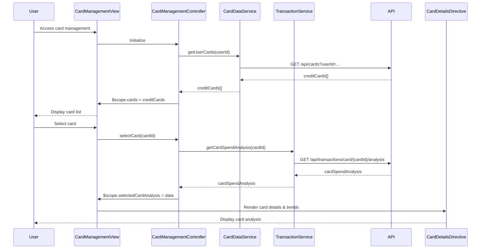

# Low-Level Design: QE-10537 - Multiple Credit Card Management and Monitoring

## a. Architecture Mapping

- **Card Management UI Module** → AngularJS Module (`app.cardManagement`)
- **Card Management Controller** → AngularJS Controller (`CardManagementController`)
- **Card Data Service** → AngularJS Service (`CardDataService`)
- **Transaction Service** → AngularJS Service (`TransactionService`)
- **Card List Directive** → AngularJS Directive (`cardList`)
- **Card Details Directive** → AngularJS Directive (`cardDetails`)
- **Authentication Interceptor** → AngularJS Factory (`AuthInterceptor`)

**Recommended Folder Structure:**
```
/app
  /card-management
    card-management.module.js
    card-management.controller.js
    card-data.service.js
    transaction.service.js
    auth.interceptor.js
    /directives
      card-list.directive.js
      card-details.directive.js
    /views
      card-management.html
```

## b. Component Specifications

| Name | Artifact Type | Responsibility | Key Dependencies |
|------|--------------|----------------|------------------|
| CardManagementModule | Module | Registers card management components, routes, and HTTP interceptor | angular, ui.router, AuthInterceptor |
| CardManagementController | Controller | Manages card list, selection, filtering, and card-wise spend analysis | CardDataService, TransactionService, $scope, $filter |
| CardDataService | Service | Fetches user's credit card list and individual card details from REST API | $http, $q, API_CONFIG |
| TransactionService | Service | Retrieves card-wise transaction data and monthly spend trends | $http, $q, API_CONFIG |
| CardListDirective | Directive | Renders scrollable list of credit cards with search and filter capabilities | CardManagementController |
| CardDetailsDirective | Directive | Displays selected card details, spend analysis, and monthly trends chart | CardManagementController, Chart.js |
| AuthInterceptor | Factory | Attaches authentication token to outgoing API requests | $localStorage, $q |

## c. Data Model

**CreditCard Object:**
```javascript
{
  cardId: String,
  userId: String,
  cardNumber: String, // Masked (e.g., "**** **** **** 1234")
  cardType: String, // Visa, MasterCard, Amex
  creditLimit: Number,
  availableCredit: Number,
  outstandingAmount: Number,
  expiryDate: String
}
```

**CardSpendAnalysis Object:**
```javascript
{
  cardId: String,
  monthlySpend: Number,
  monthlyTrends: Array<{month: String, spend: Number}>,
  topCategories: Array<{category: String, amount: Number}>
}
```

## d. Data Flow

User accesses card management view → CardManagementController initializes and calls CardDataService to fetch user's card list via REST API (`GET /api/cards?userId=...`) with AuthInterceptor attaching token → CardDataService returns array of CreditCard objects → Controller populates $scope.cards and CardListDirective renders list → User selects a card → Controller invokes TransactionService to fetch card-wise spend analysis (`GET /api/transactions/card/{cardId}/analysis`) → TransactionService returns CardSpendAnalysis → Controller updates $scope.selectedCardAnalysis → CardDetailsDirective renders card details and monthly trends chart → User applies filters (search, date range) → Controller updates filtered card list in view.

## e. Primary Sequence Diagram



## f. Implementation Notes

- Use AngularJS $http interceptor (AuthInterceptor) to automatically inject authentication tokens into all API requests.
- Implement pagination or virtual scrolling in CardListDirective to handle up to 50 cards efficiently without performance degradation.
- Use AngularJS $filter service for client-side card search and filtering to minimize API calls.
- Leverage ES6 promises ($q service) for asynchronous API calls with chained then/catch for error handling.
- Implement caching strategy in CardDataService using $cacheFactory to avoid redundant API calls for card list (cache invalidation on data change).

## g. Error Handling

HTTP interceptor captures 401/403 errors and redirects to login; service-level try/catch with user notification via modal or toast for API failures.

## h. Security Notes

Requires token-based auth via existing SSO; card numbers are masked on client-side; all API calls over HTTPS.