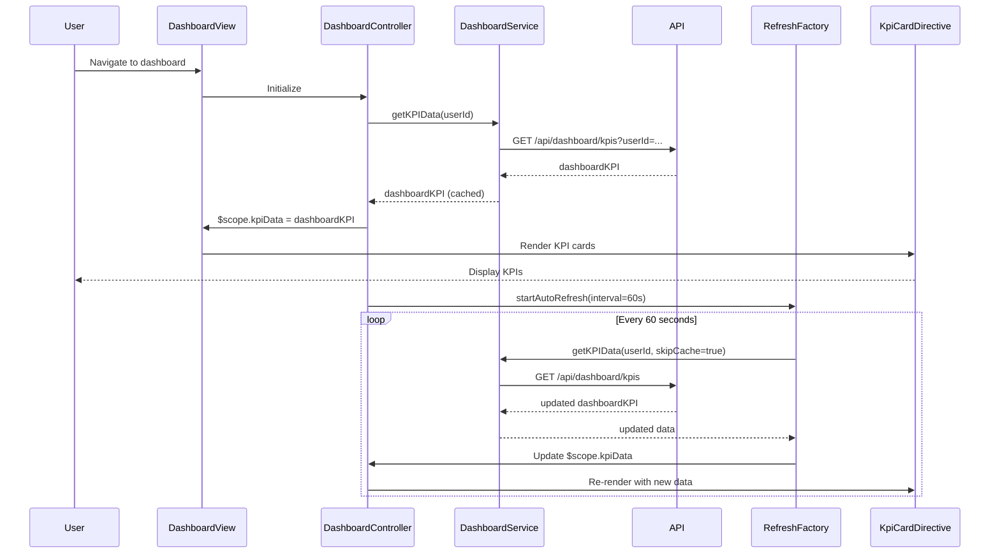

# Low-Level Design: QE-10538 - Dashboard and Key Performance Indicators

## a. Architecture Mapping

- **Dashboard UI Module** → AngularJS Module (`app.dashboard`)
- **Dashboard Controller** → AngularJS Controller (`DashboardController`)
- **Dashboard Service** → AngularJS Service (`DashboardService`)
- **KPI Card Directive** → AngularJS Directive (`kpiCard`)
- **Refresh Service** → AngularJS Factory (`RefreshFactory`)

**Recommended Folder Structure:**
```
/app
  /dashboard
    dashboard.module.js
    dashboard.controller.js
    dashboard.service.js
    refresh.factory.js
    /directives
      kpi-card.directive.js
    /views
      dashboard.html
```

## b. Component Specifications

| Name | Artifact Type | Responsibility | Key Dependencies |
|------|--------------|----------------|------------------|
| DashboardModule | Module | Registers dashboard components, routes, and configures responsive breakpoints | angular, ui.router, angular-responsive |
| DashboardController | Controller | Manages dashboard state, KPI data binding, and refresh logic | DashboardService, RefreshFactory, $scope, $interval |
| DashboardService | Service | Fetches aggregated KPI data (monthly spend, credit limits, outstanding) from REST API | $http, $q, API_CONFIG |
| KpiCardDirective | Directive | Renders individual KPI card with value, label, and trend indicator | DashboardController |
| RefreshFactory | Factory | Implements real-time data refresh with configurable interval and manual refresh trigger | $interval, DashboardService |

## c. Data Model

**DashboardKPI Object:**
```javascript
{
  monthlySpend: Number,
  totalCreditLimit: Number,
  availableCredit: Number,
  outstandingAmount: Number,
  lastUpdated: Date
}
```

**KPICard Object (for directive):**
```javascript
{
  label: String,
  value: Number,
  unit: String, // e.g., "$", "%"
  trend: String, // "up", "down", "neutral"
  trendValue: Number
}
```

## d. Data Flow

User navigates to dashboard → DashboardController initializes and invokes DashboardService to fetch KPI data via REST API (`GET /api/dashboard/kpis?userId=...`) → DashboardService aggregates data from Credit Card Data Service and Transaction Processing Service → API returns DashboardKPI object → DashboardService caches response and returns to controller → Controller populates $scope.kpiData → KpiCardDirective renders four KPI cards (monthly spend, total credit limit, available credit, outstanding amount) in responsive Bootstrap grid → RefreshFactory polls API every 60 seconds for real-time updates → On data change, controller updates $scope and view re-renders → User can manually trigger refresh via UI button.

## e. Primary Sequence Diagram



## f. Implementation Notes

- Use AngularJS $interval service in RefreshFactory for periodic API polling with auto-cleanup on scope destruction.
- Implement responsive layout using Bootstrap grid system (col-xs, col-sm, col-md, col-lg) to ensure dashboard adapts to desktop, tablet, and mobile.
- Use AngularJS $cacheFactory in DashboardService to cache KPI data and reduce API load; cache TTL set to 60 seconds.
- Leverage ES6 template literals for dynamic KPI card rendering and formatting currency values.
- Implement loading spinner using ng-show directive bound to $scope.loading flag during API calls.

## g. Error Handling

HTTP interceptor handles API errors; display error banner with retry option; RefreshFactory stops auto-refresh on repeated failures.

## h. Security Notes

Requires token-based auth via existing SSO; sensitive financial data transmitted over HTTPS with proper CORS configuration.