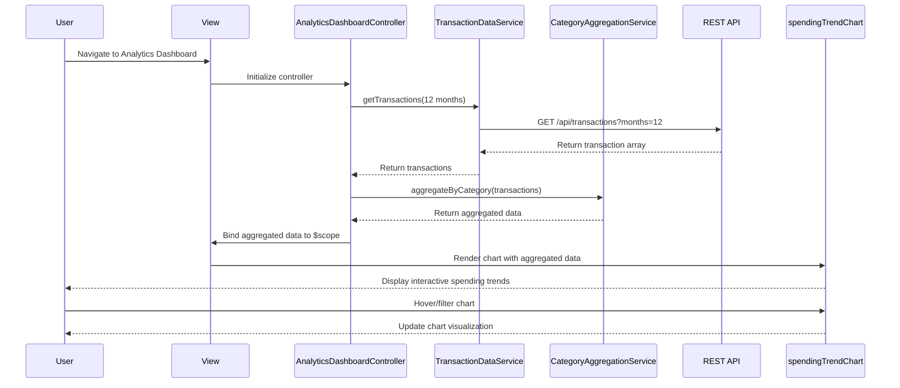

# Low-Level Design: QE-10539 - Spending Analytics and Trend Visualization

## a. Architecture Mapping

**AngularJS Artifacts:**
- **Module:** `app.analytics` - Root module for analytics feature
- **Controller:** `AnalyticsDashboardController` - Manages analytics view state and user interactions
- **Service:** `TransactionDataService` - Fetches transaction history via REST API
- **Service:** `CategoryAggregationService` - Aggregates spending data by category and time period
- **Directive:** `spendingTrendChart` - Renders interactive line/bar charts for monthly trends
- **Directive:** `categoryBreakdownChart` - Renders pie/donut charts for category-wise spending
- **Factory:** `ChartConfigFactory` - Provides reusable chart configuration objects

**Recommended Folder Structure:**
```
app/
├── analytics/
│   ├── analytics.module.js
│   ├── controllers/
│   │   └── analytics-dashboard.controller.js
│   ├── services/
│   │   ├── transaction-data.service.js
│   │   └── category-aggregation.service.js
│   ├── directives/
│   │   ├── spending-trend-chart.directive.js
│   │   └── category-breakdown-chart.directive.js
│   ├── factories/
│   │   └── chart-config.factory.js
│   └── views/
│       └── analytics-dashboard.html
```

---

## b. Component Specifications

| Name | Artifact Type | Responsibility | Key Dependencies |
|------|---------------|----------------|------------------|
| `app.analytics` | Module | Encapsulates all analytics-related components and routing | `ngRoute`, `chart.js` (or similar charting library) |
| `AnalyticsDashboardController` | Controller | Orchestrates data fetching, aggregation, and view updates for analytics dashboard | `TransactionDataService`, `CategoryAggregationService`, `$scope` |
| `TransactionDataService` | Service | Fetches transaction history from REST API endpoint `/api/transactions` | `$http`, `$q` |
| `CategoryAggregationService` | Service | Aggregates transactions into 9 categories and calculates monthly trends | None (pure JS logic) |
| `spendingTrendChart` | Directive | Renders interactive line/bar chart showing monthly spend trends over 12 months | `ChartConfigFactory`, charting library (Chart.js/D3.js) |
| `categoryBreakdownChart` | Directive | Renders pie/donut chart displaying spending breakdown by category | `ChartConfigFactory`, charting library |
| `ChartConfigFactory` | Factory | Provides reusable chart configuration (colors, labels, responsive settings) | None |

---

## c. Data Model

**Transaction Model:**
```javascript
{
  transactionId: String,
  cardId: String,
  amount: Number,
  category: String, // One of: Food & Dining, Fuel, Shopping, Travel, Entertainment, Utilities, Healthcare, Education, Miscellaneous
  date: Date (ISO 8601),
  description: String
}
```

**Aggregated Spending Model:**
```javascript
{
  monthlyTrends: [
    { month: String (YYYY-MM), totalSpend: Number }
  ],
  categoryBreakdown: [
    { category: String, totalSpend: Number, percentage: Number }
  ],
  cardWiseSpend: [
    { cardId: String, totalSpend: Number }
  ]
}
```

---

## d. Data Flow

User navigates to analytics dashboard → `AnalyticsDashboardController` initializes and calls `TransactionDataService.getTransactions()` → Service makes GET request to `/api/transactions?months=12` → API returns transaction array → `CategoryAggregationService` processes transactions to compute monthly trends and category breakdowns → Aggregated data bound to `$scope` → `spendingTrendChart` and `categoryBreakdownChart` directives watch scope and render interactive charts → User interactions (hover, filter) trigger chart updates via directive event handlers.

---

## e. Primary Sequence Diagram



---

## f. Implementation Notes

- Use AngularJS dependency injection to inject `TransactionDataService` and `CategoryAggregationService` into controller.
- Leverage ES6 classes for services and controllers; use arrow functions for callbacks to preserve `this` context.
- Implement REST API calls using `$http` service with promise-based error handling (`$q`).
- Use isolated scope in chart directives (`scope: { data: '=' }`) to ensure reusability and encapsulation.
- Integrate Chart.js or D3.js via AngularJS directive wrapper for responsive, interactive visualizations.

---

## g. Error Handling

HTTP interceptor captures API errors; controller displays user-friendly error messages via Bootstrap alerts; failed requests retry once with exponential backoff.

---

## h. Security Notes

Requires token-based authentication via existing SSO; API calls include Authorization header with JWT token.