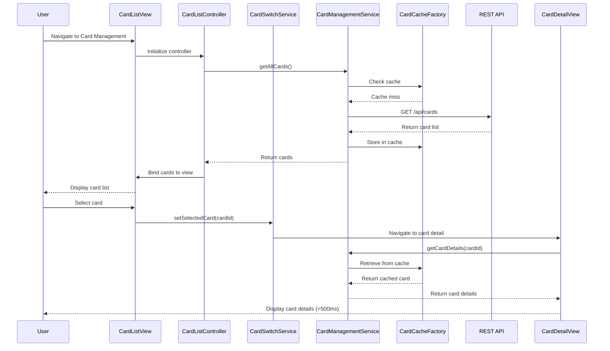

# Low-Level Design: QE-10540 - Multiple Credit Card Management

## a. Architecture Mapping

**AngularJS Artifacts:**
- **Module:** `app.cardManagement` - Root module for card management feature
- **Controller:** `CardListController` - Manages card list display and selection
- **Controller:** `CardDetailController` - Manages individual card detail view
- **Service:** `CardManagementService` - Fetches and manages credit card data via REST API
- **Service:** `CardSwitchService` - Handles card selection state and switching logic
- **Directive:** `cardListItem` - Renders individual card summary in list view
- **Factory:** `CardCacheFactory` - Provides client-side caching for card data to optimize switching performance

**Recommended Folder Structure:**
```
app/
├── card-management/
│   ├── card-management.module.js
│   ├── controllers/
│   │   ├── card-list.controller.js
│   │   └── card-detail.controller.js
│   ├── services/
│   │   ├── card-management.service.js
│   │   └── card-switch.service.js
│   ├── directives/
│   │   └── card-list-item.directive.js
│   ├── factories/
│   │   └── card-cache.factory.js
│   └── views/
│       ├── card-list.html
│       └── card-detail.html
```

---

## b. Component Specifications

| Name | Artifact Type | Responsibility | Key Dependencies |
|------|---------------|----------------|------------------|
| `app.cardManagement` | Module | Encapsulates all card management components and routing | `ngRoute`, `app.core` |
| `CardListController` | Controller | Fetches and displays list of all user credit cards; handles card selection | `CardManagementService`, `CardSwitchService`, `$scope` |
| `CardDetailController` | Controller | Displays detailed information for selected card including card-wise spend analysis | `CardManagementService`, `CardSwitchService`, `$scope`, `$routeParams` |
| `CardManagementService` | Service | Fetches card list and individual card details from REST API endpoints `/api/cards` and `/api/cards/{id}` | `$http`, `$q`, `CardCacheFactory` |
| `CardSwitchService` | Service | Manages currently selected card state; provides card switching logic with sub-500ms response | None (stateful service) |
| `cardListItem` | Directive | Renders card summary (card number, issuer, available credit) in list view | None |
| `CardCacheFactory` | Factory | Implements LRU cache for card data to minimize API calls during switching | None |

---

## c. Data Model

**Credit Card Model:**
```javascript
{
  cardId: String,
  cardNumber: String, // Masked (e.g., **** **** **** 1234)
  cardholderName: String,
  issuer: String,
  cardType: String, // Visa, MasterCard, Amex, etc.
  creditLimit: Number,
  availableCredit: Number,
  outstandingAmount: Number,
  expiryDate: String (MM/YY),
  status: String // Active, Blocked, Expired
}
```

**Card List Model:**
```javascript
{
  cards: [
    { cardId, cardNumber, issuer, availableCredit, status }
  ],
  totalCards: Number
}
```

---

## d. Data Flow

User navigates to card management view → `CardListController` initializes and calls `CardManagementService.getAllCards()` → Service checks `CardCacheFactory` for cached data; if miss, makes GET request to `/api/cards` → API returns card list → Service caches response and returns to controller → Controller binds cards to `$scope` → View renders card list using `cardListItem` directive → User selects card → `CardSwitchService.setSelectedCard(cardId)` updates state → `CardDetailController` retrieves selected card from cache or API → Detailed card view and card-wise spend analysis rendered with sub-500ms latency.

---

## e. Primary Sequence Diagram



---

## f. Implementation Notes

- Use AngularJS DI to inject `CardManagementService` and `CardSwitchService` into controllers.
- Implement `CardCacheFactory` using ES6 Map for O(1) lookup; set TTL of 5 minutes for cached card data.
- Use `$http` interceptors to attach authentication tokens to all API requests.
- Leverage `ng-repeat` with `track by cardId` in view for optimized list rendering.
- Implement card switching via `$location.path()` or `$state.go()` (if using UI-Router) for sub-500ms navigation.

---

## g. Error Handling

HTTP interceptor captures API errors; controller displays error notifications using Bootstrap modals or toasts; retry logic for transient failures.

---

## h. Security Notes

Requires token-based auth via existing SSO; card numbers masked on client; secure HTTPS communication for all API calls.