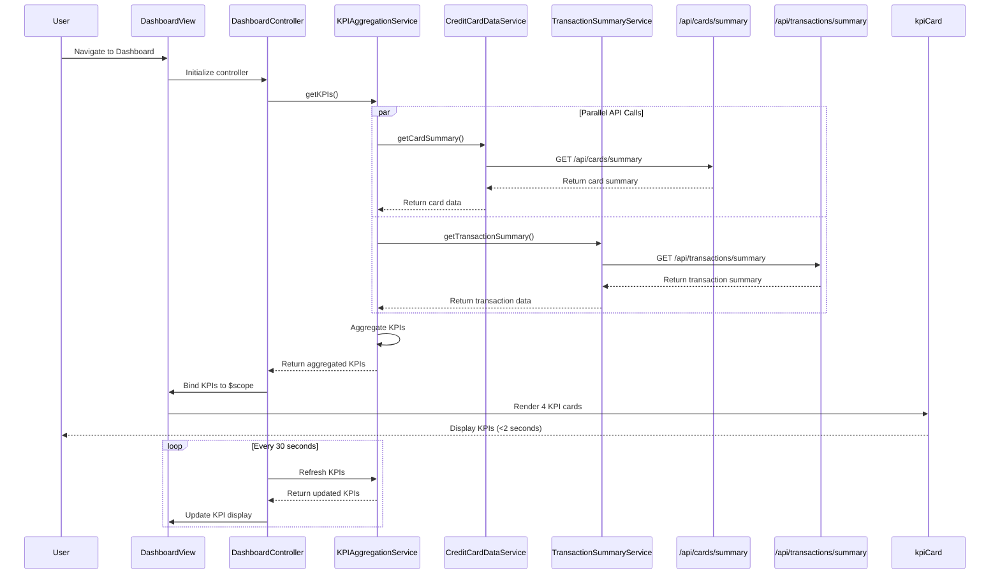

# Low-Level Design: QE-10541 - Credit Card Dashboard and KPI Management

## a. Architecture Mapping

**AngularJS Artifacts:**
- **Module:** `app.dashboard` - Root module for dashboard feature
- **Controller:** `DashboardController` - Manages dashboard state and KPI data binding
- **Service:** `KPIAggregationService` - Fetches and aggregates KPI data from multiple sources
- **Service:** `CreditCardDataService` - Retrieves card details and balances via REST API
- **Service:** `TransactionSummaryService` - Retrieves monthly spend and outstanding amounts via REST API
- **Directive:** `kpiCard` - Renders individual KPI metric card (e.g., Monthly Spend, Credit Limit)
- **Factory:** `DashboardRefreshFactory` - Manages real-time data refresh logic

**Recommended Folder Structure:**
```
app/
├── dashboard/
│   ├── dashboard.module.js
│   ├── controllers/
│   │   └── dashboard.controller.js
│   ├── services/
│   │   ├── kpi-aggregation.service.js
│   │   ├── credit-card-data.service.js
│   │   └── transaction-summary.service.js
│   ├── directives/
│   │   └── kpi-card.directive.js
│   ├── factories/
│   │   └── dashboard-refresh.factory.js
│   └── views/
│       └── dashboard.html
```

---

## b. Component Specifications

| Name | Artifact Type | Responsibility | Key Dependencies |
|------|---------------|----------------|------------------|
| `app.dashboard` | Module | Encapsulates all dashboard components and routing | `ngRoute`, `app.core` |
| `DashboardController` | Controller | Orchestrates KPI data fetching, aggregation, and binding to view | `KPIAggregationService`, `DashboardRefreshFactory`, `$scope`, `$interval` |
| `KPIAggregationService` | Service | Aggregates KPI data (monthly spend, credit limit, available credit, outstanding) from multiple services | `CreditCardDataService`, `TransactionSummaryService`, `$q` |
| `CreditCardDataService` | Service | Fetches credit card details and balances from REST API endpoint `/api/cards/summary` | `$http`, `$q` |
| `TransactionSummaryService` | Service | Fetches monthly spend and outstanding amounts from REST API endpoint `/api/transactions/summary` | `$http`, `$q` |
| `kpiCard` | Directive | Renders individual KPI metric with icon, label, value, and trend indicator | None |
| `DashboardRefreshFactory` | Factory | Provides interval-based refresh mechanism for real-time KPI updates | `$interval` |

---

## c. Data Model

**KPI Model:**
```javascript
{
  monthlySpend: Number,
  totalCreditLimit: Number,
  availableCredit: Number,
  outstandingAmount: Number,
  utilizationPercentage: Number, // Calculated: (outstandingAmount / totalCreditLimit) * 100
  lastUpdated: Date (ISO 8601)
}
```

**Card Summary Model:**
```javascript
{
  totalCards: Number,
  totalCreditLimit: Number,
  totalAvailableCredit: Number,
  cards: [
    { cardId: String, creditLimit: Number, availableCredit: Number }
  ]
}
```

**Transaction Summary Model:**
```javascript
{
  currentMonthSpend: Number,
  totalOutstanding: Number
}
```

---

## d. Data Flow

User navigates to dashboard → `DashboardController` initializes and calls `KPIAggregationService.getKPIs()` → Service makes parallel API calls via `CreditCardDataService.getCardSummary()` and `TransactionSummaryService.getTransactionSummary()` using `$q.all()` → APIs return card summary and transaction summary → Service aggregates data into unified KPI model (calculates utilization percentage) → Aggregated KPIs bound to `$scope` → View renders four `kpiCard` directives for each metric → `DashboardRefreshFactory` triggers periodic refresh every 30 seconds → Updated KPIs re-rendered in real-time with 2-second load time guarantee.

---

## e. Primary Sequence Diagram



---

## f. Implementation Notes

- Use AngularJS DI to inject `KPIAggregationService` and `DashboardRefreshFactory` into controller.
- Implement parallel API calls using `$q.all([promise1, promise2])` to minimize latency and meet 2-second load time NFR.
- Use `$interval` service in `DashboardRefreshFactory` for periodic refresh every 30 seconds; cancel interval on controller `$destroy` event.
- Leverage Bootstrap grid system (col-md-3) for responsive 4-column KPI card layout on desktop; stack vertically on mobile.
- Implement `kpiCard` directive with isolated scope (`scope: { label: '@', value: '=', icon: '@' }`) for reusability.

---

## g. Error Handling

HTTP interceptor captures API errors; controller displays fallback message in dashboard view; failed requests retry once with 2-second delay.

---

## h. Security Notes

Requires token-based auth via existing SSO; API calls include Authorization header with JWT token; sensitive KPI data transmitted over HTTPS.