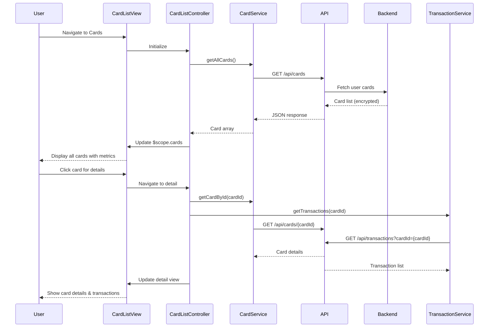

# Low-Level Design: Multiple Credit Card Management
**Epic ID:** QE-10542

## a. Architecture Mapping

- **Card Management UI** → AngularJS Module (`cardManagement`) + Controller (`CardListController`, `CardDetailController`)
- **Card Management Service** → AngularJS Service/Factory (`CardService`) for API communication
- **User Profile Service Integration** → AngularJS Service (`UserProfileService`) for card registration
- **Transaction Processing Integration** → AngularJS Service (`TransactionService`) for transaction data
- **Card Comparison Logic** → AngularJS Filter/Service (`CardComparisonService`)

**Folder Structure:**
```
/app
  /modules
    /card-management
      /controllers
      /services
      /views
      /directives
      card-management.module.js
```

## b. Component Specifications

| Name | Artifact Type | Responsibility | Key Dependencies |
|------|---------------|----------------|------------------|
| CardManagementModule | Module | Root module for card management features | ngRoute, ngResource |
| CardListController | Controller | Display all user cards with summary metrics | CardService, $scope |
| CardDetailController | Controller | Show individual card details and transactions | CardService, TransactionService, $routeParams |
| CardRegistrationController | Controller | Handle new card registration form | CardService, UserProfileService, $scope |
| CardService | Factory | REST API calls for card CRUD operations | $http, $q, API_CONFIG |
| TransactionService | Factory | Fetch card-specific transaction history | $http, $q |
| UserProfileService | Factory | Manage user-card associations | $http, $q |
| CardComparisonService | Service | Calculate and compare card metrics | - |
| cardSummary | Directive | Reusable card summary widget | CardService |
| cardEncryption | Service | Client-side encryption helper for sensitive data | CryptoJS |

## c. Data Model

**Card Object:**
```javascript
{
  cardId: String,
  userId: String,
  cardNumber: String (encrypted),
  cardIssuer: String,
  cardType: String, // 'VISA', 'MASTERCARD', etc.
  creditLimit: Number,
  availableCredit: Number,
  outstandingBalance: Number,
  lastUpdated: Date,
  isActive: Boolean
}
```

**Transaction Object:**
```javascript
{
  transactionId: String,
  cardId: String,
  amount: Number,
  category: String,
  merchant: String,
  transactionDate: Date,
  description: String
}
```

## d. Data Flow

User navigates to card management view → CardListController initializes and calls CardService.getAllCards() → CardService sends GET request to API Gateway (/api/cards) → Backend retrieves cards from Credit Card Data Repository with encryption → Response returns card list with balances and limits → Controller updates $scope.cards → View renders card list using ng-repeat → User clicks card for details → CardDetailController loads, calls CardService.getCardById() and TransactionService.getTransactions(cardId) → Services fetch data via REST APIs → Controller aggregates data and updates view with card details, transaction history, and comparison metrics → User can register new card via CardRegistrationController which posts encrypted data to UserProfileService endpoint.

## e. Primary Sequence Diagram



## f. Implementation Notes

- Use AngularJS Dependency Injection for all services and controllers; register via module.factory() and module.controller()
- Implement $http interceptor for adding auth tokens and handling 401/403 responses globally
- Use $q promises for async operations; chain .then() for sequential API calls in card detail view
- Apply ng-cloak directive to prevent flash of unstyled content during initial load
- Encrypt sensitive card data (card number) client-side using CryptoJS before POST/PUT; decrypt on retrieval for masked display (show last 4 digits only)

## g. Error Handling

HTTP interceptor-based error handling with $http response interceptor; display user-friendly notifications via toastr or custom notification service on API failures.

## h. Security Notes

Requires token-based auth via existing SSO; card numbers encrypted at rest (AES-256) and in transit (TLS); session timeout enforced at 15 minutes via authentication service.