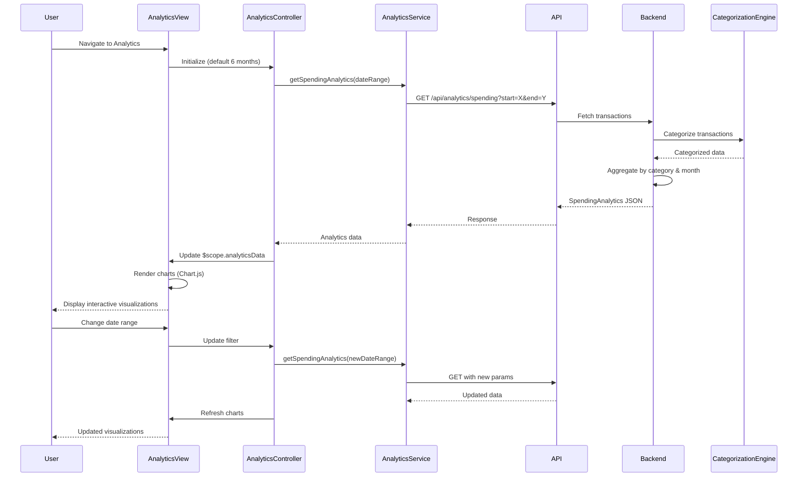

# Low-Level Design: Spending Analytics and Insights
**Epic ID:** QE-10543

## a. Architecture Mapping

- **Analytics UI** → AngularJS Module (`analytics`) + Controller (`AnalyticsController`)
- **Analytics Service** → AngularJS Factory (`AnalyticsService`) for data aggregation and API calls
- **Transaction Data Service Integration** → AngularJS Service (`TransactionDataService`)
- **Categorization Engine Integration** → Backend service consumed via REST API
- **Visualization Library** → Chart.js or D3.js integrated via AngularJS directive (`chartDirective`)

**Folder Structure:**
```
/app
  /modules
    /analytics
      /controllers
      /services
      /directives
      /views
      analytics.module.js
```

## b. Component Specifications

| Name | Artifact Type | Responsibility | Key Dependencies |
|------|---------------|----------------|------------------|
| AnalyticsModule | Module | Root module for analytics features | ngRoute, chart.js |
| AnalyticsController | Controller | Manage analytics view state and user interactions | AnalyticsService, $scope, $filter |
| AnalyticsService | Factory | Fetch and aggregate spending data from API | $http, $q, API_CONFIG |
| TransactionDataService | Factory | Retrieve raw transaction data | $http, $q |
| CategoryFilterService | Service | Filter transactions by category and date range | - |
| spendingChart | Directive | Render category-wise spending chart | Chart.js |
| trendChart | Directive | Render monthly trend line chart | Chart.js |
| dateRangePicker | Directive | Custom date range selector | - |

## c. Data Model

**SpendingAnalytics Object:**
```javascript
{
  userId: String,
  timePeriod: { startDate: Date, endDate: Date },
  categorySpending: [
    { category: String, amount: Number, percentage: Number, transactionCount: Number }
  ],
  monthlyTrends: [
    { month: String, totalSpend: Number, categoryBreakdown: Object }
  ],
  totalSpend: Number
}
```

**Transaction Object:**
```javascript
{
  transactionId: String,
  amount: Number,
  category: String, // 'Food & Dining', 'Fuel', 'Shopping', etc.
  date: Date,
  merchant: String
}
```

## d. Data Flow

User navigates to analytics view → AnalyticsController initializes with default date range (last 6 months) → Controller calls AnalyticsService.getSpendingAnalytics(dateRange) → AnalyticsService sends GET request to API Gateway (/api/analytics/spending) with date parameters → Backend retrieves transactions from Transaction Data Service, applies Categorization Engine to classify transactions, aggregates by category and month → API returns SpendingAnalytics object → AnalyticsService processes response and returns to controller → Controller updates $scope.analyticsData → View renders using spendingChart and trendChart directives which consume data and render interactive Chart.js visualizations → User changes date range via dateRangePicker → Controller re-fetches data and updates charts dynamically.

## e. Primary Sequence Diagram



## f. Implementation Notes

- Use AngularJS module pattern with DI; register Chart.js as angular-chart.js for easier integration
- Implement custom directive for chart rendering: isolate scope with two-way binding for data, watch data changes to trigger chart.update()
- Use $filter service for date formatting and currency display in chart tooltips
- Cache analytics data in AnalyticsService using simple object cache with TTL (5 minutes) to reduce API calls on view re-entry
- Apply debounce (300ms) on date range picker to avoid excessive API calls during user interaction

## g. Error Handling

$http interceptor captures API errors; display error messages via notification service; gracefully degrade by showing cached data or empty state with retry button.

## h. Security Notes

Standard input validation and secure API calls assumed; date range inputs sanitized to prevent injection; API enforces user-scoped data access via auth token.