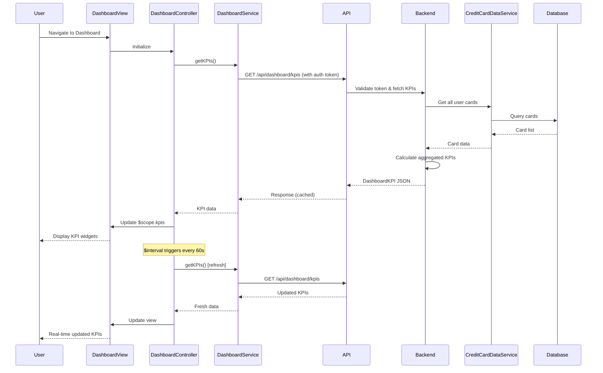

# Low-Level Design: Dashboard and Key Performance Indicators
**Epic ID:** QE-10544

## a. Architecture Mapping

- **Dashboard UI Layer** → AngularJS Module (`dashboard`) + Controller (`DashboardController`)
- **Dashboard Service** → AngularJS Factory (`DashboardService`) for KPI data aggregation
- **Credit Card Data Service Integration** → AngularJS Service (`CreditCardDataService`)
- **User Authentication Service** → Integrated via $http interceptor for token management
- **Real-time Refresh** → AngularJS $interval service for polling or WebSocket directive

**Folder Structure:**
```
/app
  /modules
    /dashboard
      /controllers
      /services
      /directives
      /views
      dashboard.module.js
```

## b. Component Specifications

| Name | Artifact Type | Responsibility | Key Dependencies |
|------|---------------|----------------|------------------|
| DashboardModule | Module | Root module for dashboard features | ngRoute, ngResource |
| DashboardController | Controller | Manage dashboard state and KPI display | DashboardService, $scope, $interval |
| DashboardService | Factory | Fetch aggregated KPI data from API | $http, $q, API_CONFIG |
| CreditCardDataService | Factory | Retrieve card details and balances | $http, $q |
| kpiWidget | Directive | Reusable KPI display widget with icon and value | - |
| autoRefresh | Service | Manage polling interval for real-time updates | $interval, $rootScope |
| AuthInterceptor | Factory | Add JWT token to all outbound requests | $window, $q |

## c. Data Model

**DashboardKPI Object:**
```javascript
{
  userId: String,
  monthlySpend: Number,
  totalCreditLimit: Number,
  availableCredit: Number,
  outstandingAmount: Number,
  creditUtilization: Number, // percentage
  cardCount: Number,
  lastUpdated: Date
}
```

**CreditCard Object (summary):**
```javascript
{
  cardId: String,
  creditLimit: Number,
  availableCredit: Number,
  outstandingBalance: Number
}
```

## d. Data Flow

User authenticates via Authentication Service and navigates to dashboard → DashboardController initializes and calls DashboardService.getKPIs() → DashboardService sends GET request to API Gateway (/api/dashboard/kpis) → API Gateway validates auth token via interceptor → Backend Dashboard Service aggregates data from Credit Card Data Service (queries all user cards from Database) → Backend calculates KPIs: sum of credit limits, available credit, outstanding amounts, current month spend → API returns DashboardKPI object → DashboardService caches response and returns to controller → Controller updates $scope.kpis → View renders KPI widgets using kpiWidget directive in responsive grid layout → autoRefresh service triggers $interval every 60 seconds to re-fetch KPIs → Controller updates view with latest data maintaining 2-second load time via caching and optimized queries.

## e. Primary Sequence Diagram



## f. Implementation Notes

- Use AngularJS DI pattern; register AuthInterceptor via $httpProvider.interceptors.push() in module config
- Implement kpiWidget as reusable directive with isolate scope: attributes for title, value, icon, and trend indicator
- Use $interval service for 60-second polling; cancel interval on $scope.$on('$destroy') to prevent memory leaks
- Apply Bootstrap grid system (col-md-3, col-sm-6, col-xs-12) for responsive KPI layout across devices
- Cache KPI data in DashboardService using timestamp-based invalidation (cache valid for 30 seconds) to optimize repeated calls

## g. Error Handling

AuthInterceptor handles 401/403 by redirecting to login; other errors caught by $http error callback and displayed via notification service with retry option.

## h. Security Notes

Requires token-based auth via existing SSO; JWT token included in Authorization header via interceptor; session timeout enforced at 15 minutes; all API calls over HTTPS (TLS).