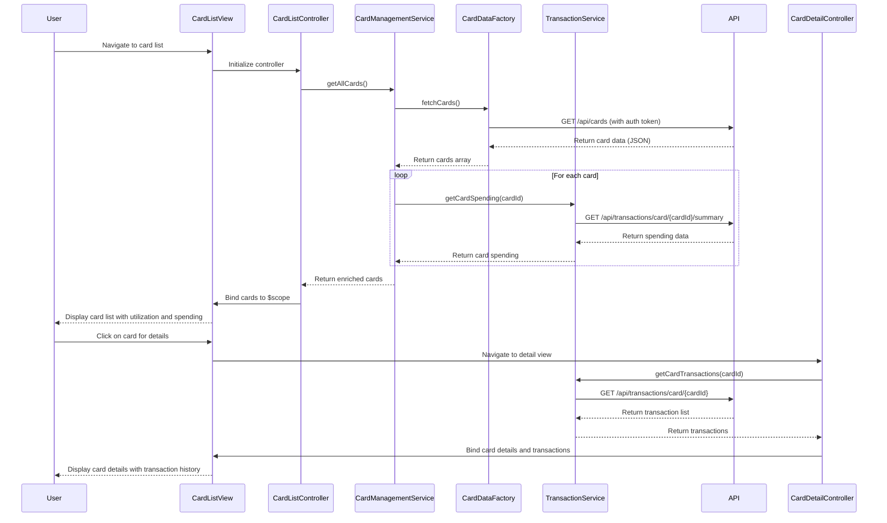

# Low-Level Design: QE-10545 - Multiple Credit Card Management and Monitoring

## a. Architecture Mapping

**AngularJS Artifact Mapping:**
- User Interface → AngularJS Module: `creditCardManagementModule` with Controller: `CardListController` and View: `card-list.html`
- Card Management Service → AngularJS Service: `CardManagementService` (business logic for card operations)
- User Authentication Service → AngularJS Service: `AuthService` (token-based authentication)
- Credit Card Data Repository → REST API integration via AngularJS Factory: `CardDataFactory`
- Transaction Service → REST API integration via AngularJS Service: `TransactionService`
- Encryption Module → Server-side encryption; client receives decrypted data via secure API calls

**Recommended Folder Structure:**
```
/app
  /modules
    /card-management
      /controllers
        card-list.controller.js
        card-detail.controller.js
      /services
        card-management.service.js
        transaction.service.js
      /factories
        card-data.factory.js
      /directives
        card-tile.directive.js
      /views
        card-list.html
        card-detail.html
  /shared
    /services
      auth.service.js
    /interceptors
      auth.interceptor.js
```

## b. Component Specifications

| Component Name | Artifact Type | Responsibility | Key Dependencies |
|----------------|---------------|----------------|------------------|
| creditCardManagementModule | Module | Root module for card management feature | angular, ngRoute |
| CardListController | Controller | Manages card list display, filtering, and selection | CardManagementService, $scope |
| CardDetailController | Controller | Displays individual card details and card-wise spend analysis | CardManagementService, TransactionService, $routeParams |
| CardManagementService | Service | Orchestrates card retrieval, filtering, and aggregation logic | CardDataFactory, TransactionService, $q |
| CardDataFactory | Factory | Handles REST API calls to credit card data repository | $http, AuthService |
| TransactionService | Service | Fetches card-wise spending data from transaction API | $http, $q |
| AuthService | Service | Manages user authentication and token storage | $http, $window.localStorage |
| cardTileDirective | Directive | Reusable card display component with utilization visualization | None |
| authInterceptor | Interceptor | Attaches auth token to outgoing API requests | $q, AuthService |

## c. Data Model

**CreditCard Model:**
```javascript
{
  cardId: String,
  cardNumber: String,          // Masked (e.g., "**** **** **** 1234")
  cardType: String,            // "Visa", "MasterCard", "Amex"
  cardHolderName: String,
  creditLimit: Number,
  currentBalance: Number,
  availableCredit: Number,
  utilization: Number,         // Calculated: (currentBalance / creditLimit) * 100
  expiryDate: String,          // "MM/YY"
  status: String               // "Active", "Blocked", "Expired"
}
```

**CardSpending Model:**
```javascript
{
  cardId: String,
  monthlySpend: Number,
  transactions: Array<Transaction>
}
```

**Transaction Model:**
```javascript
{
  transactionId: String,
  date: Date,
  amount: Number,
  merchant: String,
  category: String
}
```

## d. Data Flow

User logs in and navigates to the card management view → CardListController initializes and calls CardManagementService.getAllCards() → CardManagementService invokes CardDataFactory.fetchCards() which makes a GET request to `/api/cards` with auth token → Server decrypts and returns card data (JSON array) → CardManagementService enriches each card with spending data by calling TransactionService.getCardSpending(cardId) → TransactionService calls `/api/transactions/card/{cardId}/summary` → Aggregated card data (with utilization and spending) is bound to $scope.cards → View renders card list using ng-repeat and cardTile directive → User filters/selects a card → CardDetailController fetches detailed spending via TransactionService and updates the detail view.

## e. Primary Sequence Diagram



## f. Implementation Notes

- Use AngularJS Dependency Injection for all services, factories, and controllers; register components via module.controller(), module.service(), module.factory()
- Implement ES6 classes for services and controllers where applicable; use arrow functions for callbacks to preserve `this` context
- Use $http service with promise chaining ($q) for all REST API calls; implement error handling in .catch() blocks
- Apply ng-repeat with track by cardId for card list rendering to optimize DOM updates and performance
- Use $http interceptor (authInterceptor) to automatically attach JWT token to all outgoing API requests for secure authentication

## g. Error Handling

Client-side error handling via $http interceptor with try/catch blocks in service methods; display user-friendly error messages using a shared NotificationService and Bootstrap alerts.

## h. Security Notes

Requires token-based authentication via existing SSO; all card data is encrypted at rest on server-side and transmitted over HTTPS with JWT tokens attached via authInterceptor.