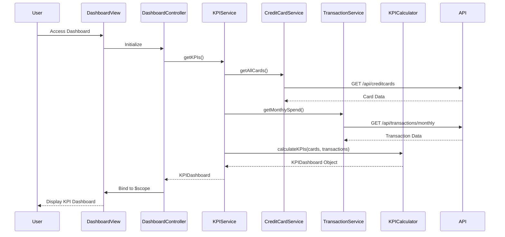

# Low-Level Design: Dashboard and KPI Management
**Epic ID:** QE-10546

## a. Architecture Mapping

- **Dashboard Module** → AngularJS Module (`app.dashboard`)
- **Dashboard Controller** → AngularJS Controller (`DashboardController`)
- **KPI Service** → AngularJS Service (`KPIService`)
- **Credit Card Service** → AngularJS Service (`CreditCardService`)
- **Transaction Service** → AngularJS Service (`TransactionService`)
- **KPI Calculation Factory** → AngularJS Factory (`KPICalculator`)
- **Dashboard Directive** → AngularJS Directive (`dashboardWidget`)

**Folder Structure:**
```
/app
  /modules
    /dashboard
      dashboard.module.js
      dashboard.controller.js
      dashboard.html
      /services
        kpi.service.js
        creditcard.service.js
        transaction.service.js
      /factories
        kpi-calculator.factory.js
      /directives
        dashboard-widget.directive.js
  /shared
    /styles
      dashboard.css
```

## b. Component Specifications

| Name | Artifact Type | Responsibility | Key Dependencies |
|------|---------------|----------------|------------------|
| DashboardModule | Module | Register dashboard components and configure routing | ngRoute, ngResource |
| DashboardController | Controller | Orchestrate dashboard view, bind KPI data to scope | KPIService, $scope, $interval |
| KPIService | Service | Fetch and aggregate KPI data from backend APIs | CreditCardService, TransactionService, KPICalculator, $http |
| CreditCardService | Service | Retrieve card balances, limits, outstanding amounts via REST | $http, $q |
| TransactionService | Service | Fetch monthly spend and transaction aggregations via REST | $http, $q |
| KPICalculator | Factory | Calculate available credit, utilization percentage, totals | None |
| DashboardWidget | Directive | Render individual KPI widgets with responsive layout | None |

## c. Data Model

**KPIDashboard (JS Object):**
```javascript
{
  monthlySpend: Number,
  totalCreditLimit: Number,
  availableCredit: Number,
  outstandingAmount: Number,
  creditUtilization: Number,  // percentage
  lastUpdated: Date
}
```

**CreditCard (JS Object):**
```javascript
{
  cardId: String,
  cardNumber: String,
  balance: Number,
  creditLimit: Number,
  outstandingAmount: Number
}
```

**Transaction (JS Object):**
```javascript
{
  transactionId: String,
  cardId: String,
  amount: Number,
  date: Date,
  category: String
}
```

## d. Data Flow

User accesses dashboard view → DashboardController initializes and calls KPIService.getKPIs() → KPIService invokes CreditCardService.getAllCards() and TransactionService.getMonthlySpend() concurrently using $q.all() → REST APIs return card data and transaction data → KPICalculator.calculateKPIs() aggregates total credit limit, available credit, utilization percentage → KPIService returns consolidated KPIDashboard object → DashboardController binds data to $scope → Dashboard view renders KPI widgets via DashboardWidget directive with Bootstrap responsive grid → $interval triggers periodic refresh every 30 seconds to update KPIs in real-time.

## e. Primary Sequence Diagram



## f. Implementation Notes

- Use AngularJS Dependency Injection for all services and controllers with explicit array notation for minification safety
- Implement $http interceptor for authentication token injection and global error handling
- Use $q.all() for parallel API calls to CreditCard and Transaction services to minimize latency
- Apply Bootstrap grid system (col-xs, col-sm, col-md, col-lg) for responsive KPI widget layout
- Use $interval service for 30-second periodic refresh with cleanup on $scope.$on('$destroy')

## g. Error Handling

HTTP interceptor captures API errors, displays user-friendly notifications via Bootstrap alerts, and logs errors to console; controller-level try/catch for calculation errors.

## h. Security Notes

Requires token-based auth via existing SSO; tokens injected in $http interceptor for all API calls.