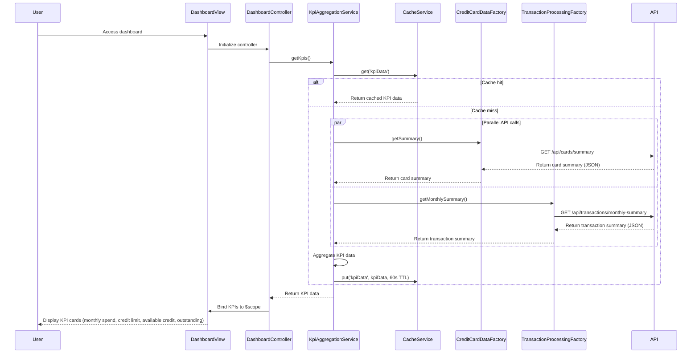

# Low-Level Design: QE-10547 - Dashboard and KPI Management

## a. Architecture Mapping

**AngularJS Artifact Mapping:**
- User Interface Dashboard → AngularJS Module: `dashboardModule` with Controller: `DashboardController` and View: `dashboard.html`
- KPI Aggregation Service → AngularJS Service: `KpiAggregationService` (orchestrates KPI calculation and data fetching)
- Credit Card Data Service → REST API integration via AngularJS Factory: `CreditCardDataFactory`
- Transaction Processing Service → REST API integration via AngularJS Factory: `TransactionProcessingFactory`
- Data Cache Layer → AngularJS Service: `CacheService` (wraps $cacheFactory for client-side caching)

**Recommended Folder Structure:**
```
/app
  /modules
    /dashboard
      /controllers
        dashboard.controller.js
      /services
        kpi-aggregation.service.js
        cache.service.js
      /factories
        credit-card-data.factory.js
        transaction-processing.factory.js
      /directives
        kpi-card.directive.js
      /views
        dashboard.html
  /shared
    /services
      auth.service.js
```

## b. Component Specifications

| Component Name | Artifact Type | Responsibility | Key Dependencies |
|----------------|---------------|----------------|------------------|
| dashboardModule | Module | Root module for dashboard feature | angular, ngRoute |
| DashboardController | Controller | Manages dashboard view and KPI display | KpiAggregationService, $scope, $interval |
| KpiAggregationService | Service | Aggregates KPIs (monthly spend, credit limit, available credit, outstanding) from multiple sources | CreditCardDataFactory, TransactionProcessingFactory, CacheService, $q |
| CreditCardDataFactory | Factory | Fetches card balances and limits from REST API | $http, AuthService |
| TransactionProcessingFactory | Factory | Fetches monthly spend and outstanding amounts from REST API | $http, AuthService |
| CacheService | Service | Manages client-side caching for KPI data with TTL | $cacheFactory |
| kpiCardDirective | Directive | Reusable KPI display card component with icon and value | None |
| AuthService | Service | Manages authentication and token injection | $http, $window.localStorage |

## c. Data Model

**KpiData Model:**
```javascript
{
  monthlySpend: Number,
  totalCreditLimit: Number,
  availableCredit: Number,
  outstandingAmount: Number,
  lastUpdated: Date
}
```

**CreditCardSummary Model:**
```javascript
{
  totalCreditLimit: Number,
  totalCurrentBalance: Number,
  totalAvailableCredit: Number,
  cardCount: Number
}
```

**TransactionSummary Model:**
```javascript
{
  monthlySpend: Number,
  outstandingAmount: Number,
  currentMonth: String         // "YYYY-MM"
}
```

## d. Data Flow

User accesses the dashboard view → DashboardController initializes and calls KpiAggregationService.getKpis() → KpiAggregationService checks CacheService for cached KPI data → If cache miss, KpiAggregationService makes parallel calls: CreditCardDataFactory.getSummary() (GET `/api/cards/summary`) and TransactionProcessingFactory.getMonthlySummary() (GET `/api/transactions/monthly-summary`) → Both factories return promises with data → KpiAggregationService aggregates results into KpiData object (calculates totalCreditLimit, availableCredit, monthlySpend, outstandingAmount) → KpiData is stored in CacheService with 60-second TTL → KpiData is returned to DashboardController and bound to $scope.kpis → View renders KPI cards using kpiCard directive with Bootstrap responsive grid → $interval triggers auto-refresh every 60 seconds to update KPIs.

## e. Primary Sequence Diagram



## f. Implementation Notes

- Use AngularJS $q.all() to make parallel API calls to CreditCardDataFactory and TransactionProcessingFactory for faster KPI aggregation within 2-second load time
- Implement client-side caching using $cacheFactory with 60-second TTL to minimize redundant API calls and support real-time refresh requirement
- Use Bootstrap grid system (col-xs-12, col-sm-6, col-md-3) in dashboard.html for responsive KPI card layout across desktop and mobile devices
- Implement $interval service in DashboardController to auto-refresh KPIs every 60 seconds; cancel interval on $scope.$on('$destroy') to prevent memory leaks
- Use ES6 arrow functions in promise chains to maintain `this` context; apply AngularJS DI for all services and factories

## g. Error Handling

Interceptor-based error handling for API failures; display fallback KPI values (0 or "N/A") with user notification via Bootstrap alert on API timeout or error.

## h. Security Notes

Requires token-based auth via existing SSO; JWT token attached to all API requests via $http interceptor; standard input validation and secure API calls assumed.