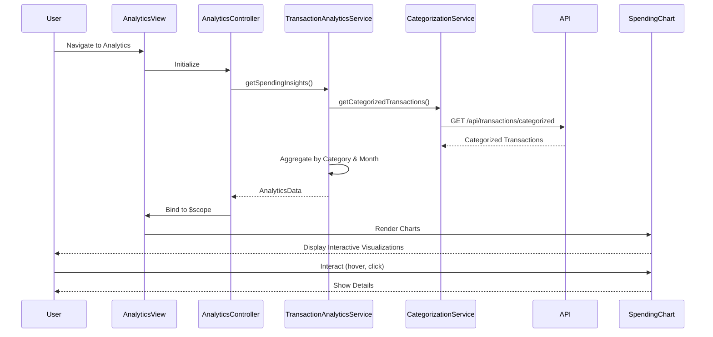

# Low-Level Design: Transaction Analytics and Spending Insights
**Epic ID:** QE-10548

## a. Architecture Mapping

- **Analytics Module** → AngularJS Module (`app.analytics`)
- **Analytics Controller** → AngularJS Controller (`AnalyticsController`)
- **Transaction Analytics Service** → AngularJS Service (`TransactionAnalyticsService`)
- **Categorization Service** → AngularJS Service (`CategorizationService`)
- **Visualization Directive** → AngularJS Directive (`spendingChart`)
- **Chart Factory** → AngularJS Factory (`ChartConfigFactory`)

**Folder Structure:**
```
/app
  /modules
    /analytics
      analytics.module.js
      analytics.controller.js
      analytics.html
      /services
        transaction-analytics.service.js
        categorization.service.js
      /directives
        spending-chart.directive.js
      /factories
        chart-config.factory.js
  /shared
    /styles
      analytics.css
```

## b. Component Specifications

| Name | Artifact Type | Responsibility | Key Dependencies |
|------|---------------|----------------|------------------|
| AnalyticsModule | Module | Register analytics components and configure routing | ngRoute, chart.js (or similar) |
| AnalyticsController | Controller | Manage analytics view, bind spending data and trends to scope | TransactionAnalyticsService, $scope, $filter |
| TransactionAnalyticsService | Service | Fetch transaction data, aggregate by category and time period | CategorizationService, $http, $q |
| CategorizationService | Service | Retrieve categorized transactions from backend or apply client-side categorization | $http |
| SpendingChart | Directive | Render interactive pie/bar charts for category breakdown and trends | ChartConfigFactory, Chart.js |
| ChartConfigFactory | Factory | Generate chart configuration objects for different visualization types | None |

## c. Data Model

**CategorySpending (JS Object):**
```javascript
{
  category: String,  // One of: Food & Dining, Fuel, Shopping, Travel, Entertainment, Utilities, Healthcare, Education, Miscellaneous
  amount: Number,
  percentage: Number,
  transactionCount: Number
}
```

**MonthlyTrend (JS Object):**
```javascript
{
  month: String,  // YYYY-MM format
  totalSpend: Number,
  categoryBreakdown: Array<CategorySpending>
}
```

**AnalyticsData (JS Object):**
```javascript
{
  currentMonthSpending: Array<CategorySpending>,
  monthlyTrends: Array<MonthlyTrend>,
  topCategory: String,
  lastUpdated: Date
}
```

## d. Data Flow

User navigates to analytics view → AnalyticsController calls TransactionAnalyticsService.getSpendingInsights() → Service invokes CategorizationService.getCategorizedTransactions() → REST API returns transactions with category assignments → TransactionAnalyticsService aggregates data by category (nine predefined categories) and calculates percentages → Service generates monthly trend data by grouping transactions by month → AnalyticsData object returned to AnalyticsController → Controller binds data to $scope → SpendingChart directive receives category data and renders interactive pie chart for category breakdown and line/bar chart for monthly trends using Chart.js → User interacts with charts to drill down into specific categories or time periods.

## e. Primary Sequence Diagram



## f. Implementation Notes

- Use Chart.js library integrated via angular-chart.js directive for interactive visualizations
- Apply AngularJS $filter for date formatting and currency display in charts
- Implement lazy loading for historical transaction data using pagination or infinite scroll if dataset is large
- Use ES6 Array methods (map, reduce, filter) for efficient client-side aggregation of transaction data
- Cache categorized transaction data in service using simple object cache with TTL to reduce API calls

## g. Error Handling

HTTP interceptor-based error handling with user notifications; try/catch in aggregation logic with fallback to empty state display.

## h. Security Notes

Standard input validation and secure API calls assumed; token-based authentication via interceptor.