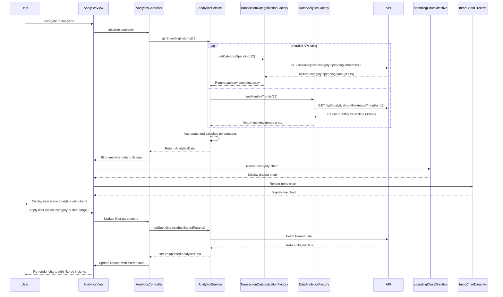

# Low-Level Design: QE-10549 - Analytics and Spending Insights

## a. Architecture Mapping

**AngularJS Artifact Mapping:**
- User Interface → AngularJS Module: `analyticsModule` with Controller: `AnalyticsController` and View: `analytics.html`
- Analytics Service → AngularJS Service: `AnalyticsService` (orchestrates data retrieval and aggregation)
- Transaction Categorization Service → REST API integration via AngularJS Factory: `TransactionCategorizationFactory`
- Data Analytics Engine → REST API integration via AngularJS Factory: `DataAnalyticsFactory`
- Transaction History Database → Accessed via REST API endpoints consumed by factories
- Visualization Library → AngularJS Directive: `spendingChartDirective` (wraps Chart.js or D3.js for rendering)

**Recommended Folder Structure:**
```
/app
  /modules
    /analytics
      /controllers
        analytics.controller.js
      /services
        analytics.service.js
      /factories
        transaction-categorization.factory.js
        data-analytics.factory.js
      /directives
        spending-chart.directive.js
        trend-chart.directive.js
      /views
        analytics.html
  /shared
    /services
      auth.service.js
```

## b. Component Specifications

| Component Name | Artifact Type | Responsibility | Key Dependencies |
|----------------|---------------|----------------|------------------|
| analyticsModule | Module | Root module for analytics and spending insights feature | angular, ngRoute, chart.js |
| AnalyticsController | Controller | Manages analytics view, user interactions, and filter selections | AnalyticsService, $scope, $filter |
| AnalyticsService | Service | Orchestrates spending data retrieval, category aggregation, and trend calculation | TransactionCategorizationFactory, DataAnalyticsFactory, $q |
| TransactionCategorizationFactory | Factory | Fetches categorized transaction data from REST API | $http, AuthService |
| DataAnalyticsFactory | Factory | Fetches monthly trend data and aggregated analytics from REST API | $http, AuthService |
| spendingChartDirective | Directive | Renders category-wise spending pie/bar chart using Chart.js | Chart.js library |
| trendChartDirective | Directive | Renders monthly spend trend line chart using Chart.js | Chart.js library |
| AuthService | Service | Manages authentication and token injection | $http, $window.localStorage |

## c. Data Model

**CategorySpending Model:**
```javascript
{
  category: String,            // "Food & Dining", "Fuel", "Shopping", "Travel", "Entertainment", "Utilities", "Healthcare", "Education", "Miscellaneous"
  totalSpend: Number,
  transactionCount: Number,
  percentage: Number           // Percentage of total spend
}
```

**MonthlyTrend Model:**
```javascript
{
  month: String,               // "YYYY-MM"
  totalSpend: Number,
  categoryBreakdown: Array<CategorySpending>
}
```

**AnalyticsData Model:**
```javascript
{
  categorySpending: Array<CategorySpending>,
  monthlyTrends: Array<MonthlyTrend>,
  totalSpend: Number,
  periodStart: Date,
  periodEnd: Date
}
```

## d. Data Flow

User navigates to analytics view → AnalyticsController initializes and calls AnalyticsService.getSpendingInsights(periodInMonths) → AnalyticsService makes parallel API calls: TransactionCategorizationFactory.getCategorySpending() (GET `/api/analytics/category-spending?months=12`) and DataAnalyticsFactory.getMonthlyTrends() (GET `/api/analytics/monthly-trends?months=12`) → APIs return categorized spending data and monthly trend data → AnalyticsService aggregates results into AnalyticsData object and calculates percentages → AnalyticsData is returned to AnalyticsController and bound to $scope.analyticsData → View renders category-wise spending using spendingChartDirective (pie/bar chart) and monthly trends using trendChartDirective (line chart) → User interacts with filters (date range, category selection) → AnalyticsController updates filter parameters and re-fetches data via AnalyticsService → Charts are re-rendered with updated data.

## e. Primary Sequence Diagram



## f. Implementation Notes

- Use Chart.js library wrapped in AngularJS directives (spendingChartDirective, trendChartDirective) for rendering interactive charts with drill-down capability
- Implement $q.all() for parallel API calls to TransactionCategorizationFactory and DataAnalyticsFactory to meet 3-second rendering NFR
- Use AngularJS $filter service for client-side filtering by category and date range; apply ng-change on filter controls to trigger data refresh
- Implement directive link function to initialize Chart.js instances and watch $scope for data changes to re-render charts dynamically
- Use ES6 classes for services and arrow functions in promise chains; apply AngularJS DI for all components

## g. Error Handling

Interceptor-based error handling with try/catch in service methods; display user-friendly error messages using Bootstrap alerts when API calls fail or data aggregation errors occur.

## h. Security Notes

Requires token-based auth via existing SSO; standard input validation and secure API calls assumed; all transaction data transmitted over HTTPS with JWT token attached via $http interceptor.