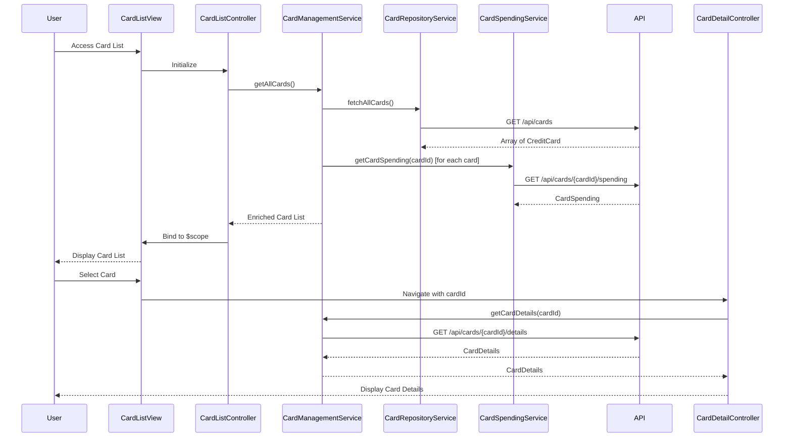

# Low-Level Design: Credit Card Management and Monitoring
**Epic ID:** QE-10550

## a. Architecture Mapping

- **Card Management Module** → AngularJS Module (`app.cardManagement`)
- **Card List Controller** → AngularJS Controller (`CardListController`)
- **Card Detail Controller** → AngularJS Controller (`CardDetailController`)
- **Card Management Service** → AngularJS Service (`CardManagementService`)
- **Card Repository Service** → AngularJS Service (`CardRepositoryService`)
- **Card Spending Service** → AngularJS Service (`CardSpendingService`)
- **Card Filter** → AngularJS Filter (`cardFilter`)
- **Card Item Directive** → AngularJS Directive (`cardItem`)

**Folder Structure:**
```
/app
  /modules
    /card-management
      card-management.module.js
      card-list.controller.js
      card-detail.controller.js
      card-list.html
      card-detail.html
      /services
        card-management.service.js
        card-repository.service.js
        card-spending.service.js
      /directives
        card-item.directive.js
      /filters
        card-filter.filter.js
  /shared
    /styles
      card-management.css
```

## b. Component Specifications

| Name | Artifact Type | Responsibility | Key Dependencies |
|------|---------------|----------------|------------------|
| CardManagementModule | Module | Register card management components and configure routing | ngRoute, ngResource |
| CardListController | Controller | Display all cards, handle filtering and selection | CardManagementService, $scope, $location |
| CardDetailController | Controller | Display individual card details, utilization, and spending trends | CardManagementService, $scope, $routeParams |
| CardManagementService | Service | Orchestrate card data retrieval and spending analysis | CardRepositoryService, CardSpendingService, $q |
| CardRepositoryService | Service | Fetch card metadata, balances, limits from REST API | $http, $q |
| CardSpendingService | Service | Retrieve card-specific spending data and trends from REST API | $http, $q |
| CardFilter | Filter | Filter cards by criteria (card type, utilization range, etc.) | None |
| CardItem | Directive | Render individual card summary with utilization indicator | None |

## c. Data Model

**CreditCard (JS Object):**
```javascript
{
  cardId: String,
  cardNumber: String,
  cardType: String,  // Visa, MasterCard, etc.
  cardHolderName: String,
  creditLimit: Number,
  availableCredit: Number,
  outstandingBalance: Number,
  utilizationPercentage: Number,
  expiryDate: String,
  status: String  // Active, Blocked, Expired
}
```

**CardSpending (JS Object):**
```javascript
{
  cardId: String,
  currentMonthSpend: Number,
  lastMonthSpend: Number,
  averageMonthlySpend: Number,
  spendingTrend: String,  // Increasing, Decreasing, Stable
  topCategories: Array<String>
}
```

**CardDetails (JS Object):**
```javascript
{
  card: CreditCard,
  spending: CardSpending,
  recentTransactions: Array<Transaction>
}
```

## d. Data Flow

User accesses card list view → CardListController calls CardManagementService.getAllCards() → Service invokes CardRepositoryService.fetchAllCards() → REST API returns array of CreditCard objects → CardManagementService enriches each card with spending data by calling CardSpendingService.getCardSpending(cardId) for each card → Enriched card list returned to CardListController → Controller binds cards to $scope → View renders cards using CardItem directive with Bootstrap grid → User applies CardFilter to filter by utilization or card type → User selects a card → CardDetailController loads via routing with cardId parameter → Controller calls CardManagementService.getCardDetails(cardId) → Service fetches detailed card info and spending trends → CardDetails object bound to $scope and rendered in detail view.

## e. Primary Sequence Diagram



## f. Implementation Notes

- Use AngularJS $resource for RESTful card API interactions with custom actions for spending endpoints
- Implement client-side caching in CardManagementService using $cacheFactory to store card list and reduce API calls
- Apply AngularJS ng-repeat with track by cardId for efficient list rendering with multiple cards
- Use Bootstrap progress bars to visualize credit utilization percentage in CardItem directive
- Implement card filtering using custom AngularJS filter with ng-model binding for real-time filter updates

## g. Error Handling

HTTP interceptor handles API failures with user-friendly error messages; empty state displayed if no cards found.

## h. Security Notes

Requires token-based auth via existing SSO; card data encrypted in transit (HTTPS); sensitive card numbers masked in UI.