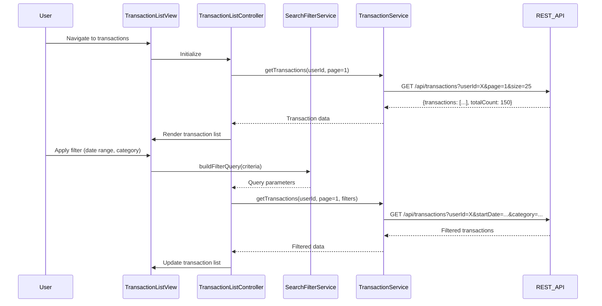

# Low-Level Design: Transaction Management and Viewing
**Epic ID:** QE-10557

## a. Architecture Mapping

- **transactionModule** (AngularJS Module) - Root module for transaction management functionality
- **TransactionListController** (Controller) - Manages transaction list view, pagination, and user interactions
- **TransactionDetailController** (Controller) - Handles individual transaction detail display
- **TransactionService** (Service) - Communicates with REST API for transaction data retrieval
- **SearchFilterService** (Service) - Manages search and filter logic, query construction
- **transactionCard** (Directive) - Reusable component for displaying individual transaction items
- **PaginationFactory** (Factory) - Handles pagination state and navigation logic

**Folder Structure:**
```
/app
  /modules
    /transactions
      /controllers
        - transactionListController.js
        - transactionDetailController.js
      /services
        - transactionService.js
        - searchFilterService.js
      /directives
        - transactionCard.js
      /factories
        - paginationFactory.js
      /views
        - transaction-list.html
        - transaction-detail.html
      - transactionModule.js
```

## b. Component Specifications

| Component Name | Artifact Type | Responsibility | Key Dependencies |
|----------------|---------------|----------------|------------------|
| transactionModule | Module | Registers all transaction-related components and configures routing | ngRoute, ngResource |
| TransactionListController | Controller | Manages transaction list display, applies filters, handles pagination | TransactionService, SearchFilterService, PaginationFactory, $scope |
| TransactionDetailController | Controller | Displays detailed view of selected transaction | TransactionService, $routeParams, $scope |
| TransactionService | Service | Fetches transaction data from REST API, handles data synchronization | $http, $q, API_CONFIG |
| SearchFilterService | Service | Constructs filter queries, manages filter state | $filter |
| transactionCard | Directive | Renders individual transaction card with merchant, amount, date, category | None |
| PaginationFactory | Factory | Maintains current page, page size, total count, provides navigation methods | None |

## c. Data Model

**Transaction Object:**
```javascript
{
  transactionId: String,
  cardId: String,
  cardName: String,
  merchantName: String,
  category: String,
  amount: Number,
  currency: String,
  transactionDate: Date,
  postingDate: Date,
  status: String, // 'posted', 'pending', 'declined'
  description: String
}
```

**FilterCriteria Object:**
```javascript
{
  cardIds: Array<String>,
  startDate: Date,
  endDate: Date,
  minAmount: Number,
  maxAmount: Number,
  categories: Array<String>,
  merchantName: String
}
```

**PaginationState Object:**
```javascript
{
  currentPage: Number,
  pageSize: Number,
  totalCount: Number,
  totalPages: Number
}
```

## d. Data Flow

User navigates to transaction list view → TransactionListController initializes and loads user's card portfolio → User applies search/filter criteria via UI → SearchFilterService constructs query parameters from FilterCriteria model → TransactionService calls REST API endpoint `/api/transactions` with filter and pagination params → API returns paginated transaction array and metadata → Controller updates $scope with transaction list and PaginationFactory state → transactionCard directive renders each transaction → User clicks transaction card → TransactionDetailController fetches full details via TransactionService from `/api/transactions/{id}` → Detail view displays complete transaction information.

## e. Primary Sequence Diagram



## f. Implementation Notes

- Use AngularJS $http service with interceptors for authentication token injection and error handling
- Implement dependency injection pattern for all services and controllers using explicit array notation for minification safety
- Leverage $resource factory for RESTful API communication with custom actions for search/filter endpoints
- Apply Bootstrap grid system and responsive utilities for mobile/desktop layout adaptation
- Use AngularJS $filter service for client-side date formatting and currency display

## g. Error Handling

HTTP interceptor captures API errors; user-friendly messages displayed via Bootstrap alert directive; network failures trigger retry prompt.

## h. Security Notes

Requires token-based auth via existing SSO; all API calls include Authorization header with JWT token.